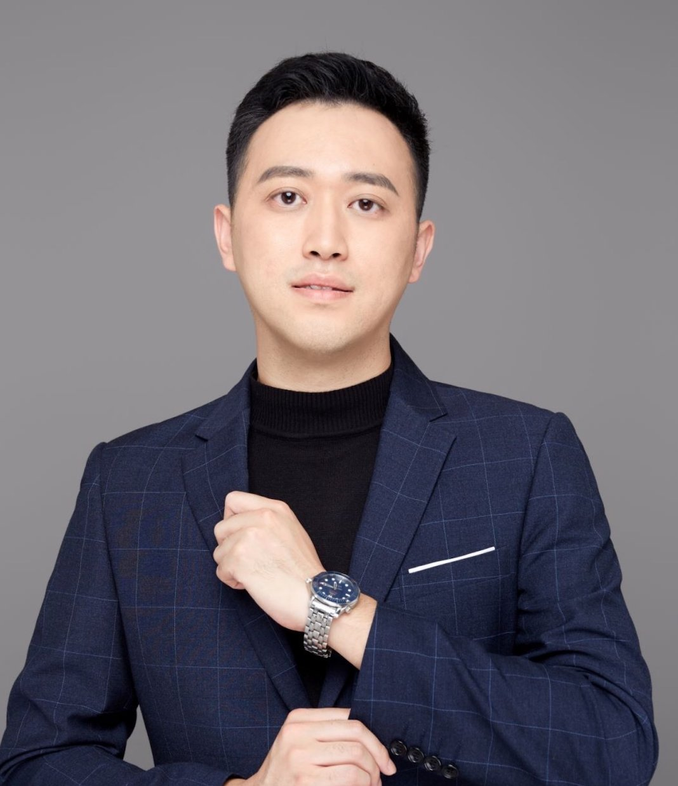
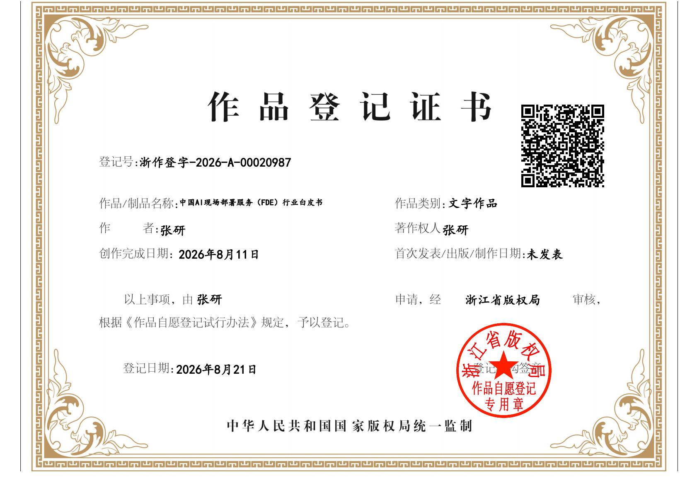

# 关于作者

**张研ᴷᴱᴺ｜焕燃科技 & 研之有理 CEO**

前美图旗下美事美选高级副总裁

- 抖音生活服务认证讲师
- 抖音生活服务学习中心认证讲师
- 生活服务职业能力认证专家组讲师
- 杭州市人工智能学会高级讲师
- 浙江省人工智能协会会员

张研拥有**15 年互联网大厂工作经验**，职业经历横跨人力资源、市场营销、新媒体运营与人工智能等多个领域，曾任美图旗下美事美选高级副总裁，对大型互联网组织的业务运转与组织管理有深入理解。此后创立焕燃科技与研之有理，长期深耕企业级 AI 落地一线，聚焦大模型与智能体从"演示"走向"生产"的最后一公里交付，在央国企、外资与民营企业的 AI 转型项目中积累了丰富的现场部署与方法论沉淀。其团队致力于把可复用的交付资产与行业模板沉淀为企业的公共能力，推动 FDE 角色在中国市场的标准化与规模化实践。

*作品版权登记证明*

*扫码添加微信交流*

---

*（本报告为基于公开信息的综合分析初稿，市场规模部分为合理推算，不代表任何机构的官方统计。读者应结合一手数据进行独立判断。报告中的案例研究基于公开报道与行业实践综合整理，部分为示意性重构，供方法论参考。）*
