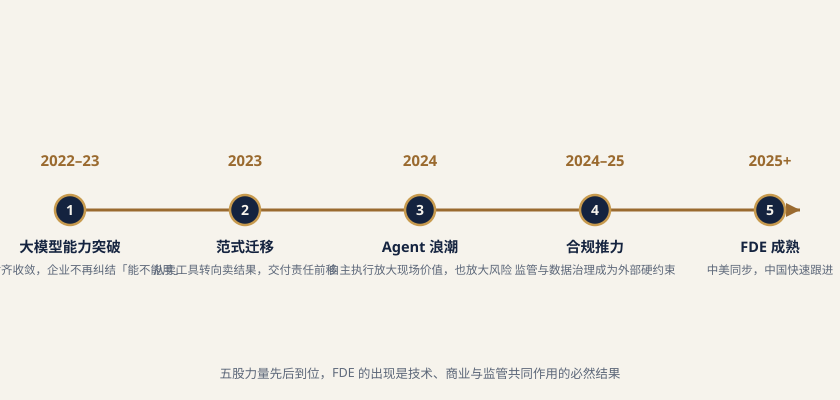

# 第一章 行业背景与驱动因素

> **定义｜FDE（Forward Deployed Engineer，现场部署工程师）**
>
> 驻扎在客户现场、把通用 AI 能力接入真实业务系统并推动生产上线的复合角色。其价值不在“做出 Demo”，而在“跑通生产”。

## 1.1 大模型普及后的"落地断层"：Demo 与生产之间的鸿沟

**核心观点：大模型能力的商品化速度远快于企业生产系统的吸收速度，二者之间形成了一条清晰的"落地断层"。**

2023 年以来，基础模型能力通过 API、开源权重与云平台三条通道迅速下沉，"做出一个像样的 Demo"的门槛已从数月缩短到数天甚至数小时。一名产品经理配合一名工程师，用几百行代码和一份整理过的样例数据，就能演示出问答、文档摘要、报告生成、代码辅助等一系列看似成熟的能力。然而，从多家咨询机构与行业观察的口径汇总看，超过 60% 的企业 AI 试点长期停留在实验阶段，未能进入稳定运行的生产环境。能力供给的丰裕与生产结果的稀缺，构成当前企业 AI 最突出的结构性矛盾。

断层之所以恰好出现在 Demo 与生产之间，是因为两者面对的约束条件根本不同。Demo 的运行环境是被精心裁剪过的：数据是清洗后的样本，场景是单一且边界明确的，调用链路不涉及权限校验，出错了可以由演示者当场解释过去，也不需要考虑三个月后谁来维护。生产环境则相反——数据来自多个业务系统且长期存在字段缺失、口径冲突、历史脏值；一次业务动作往往横跨 ERP、CRM、工单、财务、主数据等多个系统；每一次读写都要经过角色与数据权限校验；异常必须有兜底路径而非中断；最终还要说服一线员工改变已经沿用多年的操作习惯。Demo 验证的是"模型能不能做到"，生产回答的是"这套系统能否在无专家在场的情况下持续产出可被审计的结果"。两者之间隔着的不是模型能力，而是工程与组织。

| 对比维度 | Demo 阶段（容易） | 生产阶段（困难） | 关键落差 |
| --- | --- | --- | --- |
| 系统耦合 | 独立沙箱，几乎无外部依赖 | 与 ERP/CRM/OA/工单/主数据深度耦合 | 需要接口改造、幂等设计与回滚机制 |
| 权限体系 | 演示账号，权限全开 | 组织架构、角色、行级/字段级数据权限 | 需要权限模型映射与最小权限落地 |
| 合规审计 | 无留痕要求 | 全链路日志、可解释、可追溯、可复核 | 需要审计设计前置到架构层 |
| 组织采用 | 演示者本人操作 | 一线员工日常使用，涉及绩效与习惯 | 需要流程重构与变更管理 |
| 持续运维 | 一次性运行 | 7×24 稳定性、模型漂移、版本迭代、故障响应 | 需要长期驻场或远程运维承接 |

**建议数据来源类型：**行业研究报告（企业 AI 试点转化率）、企业侧 CIO 调研、技术社区的项目复盘与失败案例分析。

## 1.2 从"卖软件"到"交付结果"的范式迁移

**核心观点：企业侧的 ROI 计算逻辑正在重构，采购标的从"标准化模块与人天"转向"可度量的经营结果"，交付责任随之从厂商后方前移到客户现场。**

传统企业软件的商业契约建立在一个隐含假设之上：产品能力是标准的，价值实现由客户自己负责。厂商交付许可证、模块与实施人天，验收标准是功能清单是否勾完；至于系统上线后是否真的降低了成本、提升了转化，通常不在合同的责任边界内。这套逻辑在流程数字化时代基本成立，因为软件的价值主要来自"把线下流程搬到线上"，标准化程度高、场景差异小。

AI 时代打破了这个假设。同一个模型能力，在两家营收规模相近的企业里可能产生数量级差异的价值，差别不在模型，而在数据可用性、流程适配度与组织执行力。这意味着价值不再内嵌于产品，而生成于"客户具体场景里跑通"的那个过程。相应地，采购决策权也在上移：过去由 IT 部门按预算与功能清单选型，现在越来越多由业务一号位主导，其提问方式是"这套东西一年能帮我省下多少人力成本、多带来多少订单"。当买方的验收口径变成经营结果，卖方就必须把工程能力推到离结果最近的地方——客户现场。

| 维度 | 传统软件交付 | AI 时代结果交付 |
| --- | --- | --- |
| 计价方式 | 许可证 + 模块 + 实施人天 | 订阅 + 效果分成 / 结果里程碑 |
| 验收标准 | 功能清单、UAT 通过 | 业务指标改善（成本、周期、转化） |
| 价值形成位置 | 产品内（出厂即定型） | 客户场景内（现场跑通才产生） |
| 责任边界 | 上线即交付完成 | 持续到业务指标兑现 |
| 主导角色 | 售前顾问 + 实施顾问 | 现场部署工程师（FDE） |
| 失败成本承担 | 主要由客户承担 | 厂商需共担，影响续费与口碑 |

这一迁移直接催生了对一线工程交付角色的刚需。当合同条款把厂商收入与客户业务结果绑定，厂商就不可能再依赖"远程支持 + 定期巡检"的轻模式，而必须派出既懂模型能力边界、又能读懂客户业务与系统的复合型工程师，长期驻扎在价值发生的现场。

**建议数据来源类型：**上市厂商财报与业绩说明会（收入结构、NDR 指标）、SaaS 与企业服务行业报告、一级市场投资人访谈与投后复盘。

## 1.3 智能体（Agent）浪潮放大现场价值

**核心观点：Agent 把 AI 从"生成文本"推进到"执行动作"，部署复杂度随之上升一个数量级，FDE 在场景定义、系统集成与组织采纳三个环节的作用被显著放大。**

2024 至 2025 年，Agent 完成了从概念叙事到工程实践的转变。函数调用、工具编排、上下文协议、多步规划与记忆机制逐步标准化，Agent 开始能够调用外部工具、读写业务系统、按规则连续执行多步任务。与只输出建议的聊天机器人相比，Agent 离生产系统更近——它不再是"给人看的答案"，而是"直接落到系统里的动作"。

但越靠近生产，对现场工程的依赖就越强。一个真正可用的 Agent 需要回答一连串只有在客户现场才能明确的问题：这个任务的成功标准是什么，边界条件有哪些；哪些动作可以自动执行，哪些必须人工复核；调用哪个系统的哪个接口，失败后如何回滚；执行记录如何留痕以满足审计；权限如何随发起人的角色动态收敛。这些问题的答案不写在任何产品文档里，只存在于客户的业务规则、历史惯例与部门博弈之中。把模糊的业务"意图"翻译成稳定、可审计、可回滚的"动作序列"，正是 FDE 的核心工作内容。

| 能力形态 | 与生产系统的距离 | 主要风险 | 现场工程依赖度 |
| --- | --- | --- | --- |
| 知识检索增强（RAG） | 中，读取企业知识库 | 检索不准、知识过期、权限越界 | 中 |
| 流程副驾（Copilot） | 中高，嵌入业务界面 | 建议被误用、流程被绕过 | 中高 |
| 智能体（Agent） | 近，直接读写业务系统 | 误操作、连锁故障、审计缺口 | 高 |
| 多 Agent 协同 | 极近，跨系统自主编排 | 责任归属不清、故障定位困难 | 极高 |

Agent 浪潮的本质效果，是把 AI 项目的失败成本从"答案不好用"提升到"业务动作出错"。这一变化使企业对现场工程能力的支付意愿显著提升，也使 FDE 从"实施顾问的升级版"变成独立的、不可替代的工程角色。

**建议数据来源类型：**头部厂商技术发布与产品文档、行业技术会议议题分布、工程团队公开博客与开源项目实践记录。

## 1.4 中美同步、路径分化

**核心观点：FDE 角色起源于美国前沿 AI 公司，中国市场在 2024 年前后快速跟进，两国在角色出现的时间上高度同步，但受客户付费能力、IT 成熟度与组织文化差异影响，商业化路径明显分化。**

FDE 的原型来自美国数据与 AI 公司的驻场工程实践：工程师直接进入客户业务环境，与客户团队共同定义问题、搭建管线、迭代交付，厂商以结果而非工时计价。这套模式在前沿 AI 公司大规模商业化阶段被继承和放大。中国市场几乎在同一技术周期内出现了相同的角色需求——大模型能力可获得性趋同，落地难题也趋同，因此"派工程师到现场"成为中美厂商共同的自然选择。

分化出现在商业化层面。美国市场的客户 IT 底座相对统一、SaaS 渗透率高、对高单价专业服务的付费意愿强，FDE 更多承担"高价值咨询式工程"角色，人均产出与定价空间较大。中国市场的客户系统异构程度更高、定制诉求更强、对服务的独立付费意愿偏弱，FDE 往往被打包进整体项目成本，承担更重的集成与运维负担，同时还需处理更复杂的多方关系协调。这种差异不是能力差距，而是市场结构差异的自然结果，其具体表现、定价机制与组织配置将在第四章展开对比，此处不作展开。

**建议数据来源类型：**跨国厂商公开案例与客户故事、招聘平台岗位描述与公开合同信息、中英文行业对比报道与分析文章。

## 1.5 企业数字化成熟度与组织准备度

**核心观点：行业数字化底座的差异，直接决定 FDE 的落地难度与工作重心；数据地基是否具备，比模型选型更能预测项目成败。**

FDE 进入客户现场后，第一件事往往不是部署模型，而是评估"这家企业的数据和流程能不能承接 AI"。已建成数据中台、核心流程完成线上化、主数据治理相对规范的企业，FDE 可以在数周内完成接入并进入价值验证；而仍以 Excel 台账、邮件审批、人工流转为主的企业，FDE 必须先花费大量精力补齐数据采集、口径统一与流程标准化，AI 能力反而成为后置环节。这也是同一套产品在不同客户处交付周期相差数倍的根本原因。

| 行业板块 | 数字化成熟度 | 典型底座状况 | FDE 落地难度 | 现场工作重心 |
| --- | --- | --- | --- | --- |
| 电信运营商 | 高 | 大规模数据平台、流程高度线上化 | 低—中 | 多系统编排、规模化推广 |
| 互联网与科技 | 高 | 云原生、API 化程度高 | 低 | 场景深挖、效果调优 |
| 制造业（中大型） | 中 | ERP/MES 已建但数据孤岛明显 | 中—高 | 数据打通、现场工况适配 |
| 能源与化工 | 中 | 工业系统封闭、安全隔离要求高 | 中—高 | 网络隔离下的部署、安全合规 |
| 医疗与医药 | 中 | 系统分散、数据敏感度极高 | 高 | 脱敏方案、伦理与合规审查 |
| 长尾中小企业 | 低 | Excel + 人工流转为主 | 高 | 先补数据地基，再谈 AI |

组织准备度是另一条隐性约束。即便数据底座良好，若缺乏明确的业务负责人、没有配套的绩效调整、一线员工缺少使用动机，系统也会在上线后被迅速绕过。FDE 因此需同时具备工程能力与组织推动能力。

**建议数据来源类型：**行业数字化转型评估报告、企业 IT 成熟度调研、各行业信息化主管部门的公开统计。

## 1.6 监管与数据合规的外部推力

**核心观点：金融、医药、能源等强监管行业对可解释、可审计、数据安全的硬性要求，把"现场工程角色"从可选项变为必选项；合规不是 FDE 的阻力，而是其存在合法性的重要来源。**

在强监管行业，AI 系统的上线门槛不由技术团队单方决定。数据是否可以出域、模型推理过程能否复现、自动决策是否需要人工复核、日志保留多久、出现争议时如何举证——这些问题的答案必须在架构设计阶段就被确定，而不能等到上线后补救。远程交付的团队很难获得足够的现场信息来完成这类设计：数据分级标准存在于内部制度文件中，审计口径由风控与内审部门掌握，网络隔离方案取决于机房实际拓扑。只有长期在场的工程师，才能同时对接业务、IT、风控、法务与内审，把合规约束提前转化为技术方案。

| 行业 | 主要合规约束 | 对 AI 部署的具体要求 | FDE 的现场职责 |
| --- | --- | --- | --- |
| 证券与基金 | 投资建议合规、留痕与回溯 | 输出内容审查、全量日志留存 | 建立内容过滤与留痕机制 |
| 医药与医疗 | 患者隐私、数据脱敏、伦理审查 | 数据不出院、脱敏后训练与推理 | 本地化部署、脱敏管线搭建 |
| 能源与工业 | 生产安全、网络隔离 | 内外网隔离部署、动作双重确认 | 隔离环境交付、安全评审配合 |
| 政务与公共事业 | 数据主权、国产化要求 | 信创适配、数据本地化 | 国产软硬件栈适配与验证 |

从产业角度看，监管强度与 FDE 的必要性正相关。监管越严，远程标准化交付的可行性越低，客户对现场工程服务的支付意愿越高。这解释了为什么 FDE 模式最先在金融、医药等行业形成稳定商业闭环。

**建议数据来源类型：**监管机构公开文件与管理办法、行业协会合规指引、企业公开的合规实践与内控披露。

## 1.7 技术发展时间线：FDE 出现的时序必然性

*图 1-1　FDE 出现的时序必然性：五股力量共同推动角色成型*

**核心观点：FDE 不是某家公司的组织创新，而是技术商业化节奏在特定阶段"逼"出来的角色——每一年的主要矛盾变化，都在为这个岗位增加必要性。**

| 时间 | 技术阶段 | 市场主要矛盾 | 稀缺能力 | 对应角色演变 |
| --- | --- | --- | --- | --- |
| 2024 | Agent 工程化兴起 | 能不能接进系统 | 工具编排、系统集成 | AI 应用工程师、解决方案架构师 |
| 2025 | 落地之年 | 能不能稳定产出结果 | 现场工程 + 组织推动 | 现场部署工程师（FDE） |
| 2026 及以后 | 规模化与治理 | 能不能规模复制并可控 | 方法论沉淀、平台化 | FDE 团队 + 交付平台化 |

这条脉络的内在逻辑是清晰的：2023 年模型能力本身是瓶颈，市场追逐的是会调模型的人；2024 年模型能力过剩而集成能力不足，瓶颈转移到系统对接，市场需要能把 AI 接进业务系统的工程师；到 2025 年，能接进系统的项目多了，但真正稳定运行并产生经营结果的仍是少数，瓶颈进一步转移到"生产化"本身——需要有人长期驻场，处理脏数据、异常路径、权限边界与组织阻力。稀缺性决定了岗位价值，而稀缺性所在的位置每年都在向后移动，FDE 正好站在当前这一环。

**建议数据来源类型：**技术公司年度发布会与工程博客、行业技术会议议题的年度变化、主流媒体年度 AI 趋势综述、招聘平台上相关岗位首次出现与增长的时序数据。

## 1.8 采用普及与价值兑现的鸿沟

**核心观点：AI 已经大规模进入企业，但绝大多数项目尚未进入利润表。"会不会用"已经不是问题，"能不能产出经营结果"才是。**

多家权威机构在 2024 至 2026 年的研究中，从不同角度指向同一个结论：采用率与价值兑现率之间存在巨大落差。

| 机构与年份 | 关键发现 | 指向的问题 | 来源类型 |
| --- | --- | --- | --- |
| BCG 2025 | 仅 5% 的企业达到 AI 规模化价值，约 60% 几乎未获得实质价值 | 价值分布极度头部集中 | 权威机构研究报告 |
| Gartner 2026 | 预测超过 80% 的企业将使用 GenAI API/模型或部署 GenAI 应用 | 技术采用已成基础设施级普及 | 权威机构预测 |
| Gartner 2025 | 63% 的组织没有或不确定是否具备 AI 所需的数据管理实践（AI-ready data） | 数据地基缺失是核心制约 | 权威机构调研 |
| Microsoft 2024 Work Trend Index | 75% 的知识工作者使用 AI，其中 78% 自带工具上班（"影子 AI"） | 员工侧先行，企业侧治理滞后 | 厂商趋势报告 |

把这些数据放在一起看，画面相当清晰：采用面已经铺开到接近饱和，价值面却仍在塌方。88% 的使用率与 39% 的 EBIT 影响之间的差距，5% 的规模化价值与 60% 的无实质价值之间的对比，说明企业普遍完成了"把 AI 用起来"这一步，却卡在了"让 AI 产生钱"这一步。而 Gartner 关于 AI-ready data 的调研进一步指出了落差的位置——不是模型不够强，而是数据管理实践缺位；Microsoft 的"影子 AI"数据则揭示了另一面：员工的使用需求远超企业的供给与治理能力，价值以分散、不可度量、不可审计的方式流失在个人工具里。

这条鸿沟的成因不在模型层，而在模型与业务之间的那段距离：数据不可用、流程未重构、系统未打通、组织未采纳、结果未度量。这五个缺口没有任何一个可以靠更换模型解决，也没有任何一个可以在远程会议里解决。它们共同定义了 FDE 的工作边界——把通用能力接进具体业务，把技术产出翻译成经营结果，把一次性的项目成功变成可持续的生产运行。这正是本白皮书讨论 FDE 这一角色的现实起点。

**建议数据来源类型：**Gartner、McKinsey、BCG、Microsoft 等机构的公开研究与年度报告，以及企业侧 AI 投资回报的公开披露。

## 1.9 Agent 走向生产系统的趋势与治理风险

**核心观点**：当 AI 从"回答问题"进化为"执行动作"，其风险敞口被结构性放大。Agent 越是能自主操作业务系统，越需要清晰的岗位说明书、权限边界、验收指标与事故预案——这正是 FDE 现场价值的放大器。

Agentic AI（具备自主行动能力的智能体）正在从概念验证走向生产部署。Gartner 预测，到 2028 年，至少 15% 的日常工作决策将由 agentic AI 自主完成，33% 的企业软件应用将内嵌 agentic AI 能力。趋势明确，但热度之下风险同样高企。

| 信号 | 数据 | 解读 | 来源类型 |
| --- | --- | --- | --- |
| 企业软件含 Agent 能力 | 33%（2028 预测） | 能力内嵌成标配 | 研究咨询（Gartner 2028） |
| 被取消的 Agent 项目 | >40%（2027 预测） | 高预期伴随高流产率 | 研究咨询（Gartner 2027） |
| 认为 Agent 重要但未广泛落地 | 75% 重视 vs 13% 广泛使用 | 期望与现实的落差 | 咨询机构（BCG 2025） |

BCG 2025 的调查呈现一个典型剪刀差：75% 的受访者认为 AI agents 对未来至关重要，但只有 13% 表示其已广泛进入工作流程。Gartner 甚至预测，到 2027 年超过 40% 的 agentic AI 项目会被取消——这并非否定 Agent 的方向，而是提示：把"能执行动作的 AI"放进真实生产系统，比把"能对话的 AI"放进演示环境，难度高出一个数量级。

核心论点由此清晰：Agent 越能执行动作，越不能只把它当作一个模型能力，而必须当作一名"需要被管理的数字员工"。岗位说明书（它负责什么）、权限边界（它能碰什么）、验收指标（怎样算做对）、事故预案（做错了怎么办），缺一不可。这也解释了为何 FDE 在 Agent 时代从"锦上添花"变为"不可或缺"。

---

## 1.10 企业 AI 生产化成熟度与"最后一公里"瓶颈

**核心观点**：从 Demo 到生产交付之间，横亘的不是模型能力，而是企业自身的数据、流程、系统与组织 readiness。FDE 的核心战场，正是这被业界反复提及的"最后一公里"。

**1. 生产化成熟度五级模型**

我们尝试将企业 AI 生产化成熟度分为五个层级，便于 CIO 对自身定位做校准：

| 级别 | 名称 | 典型特征 |
| --- | --- | --- |
| L2 | 场景复用 | 多个成功试点，开始沉淀可复用组件 |
| L3 | 系统集成 | AI 接入核心业务系统，进入真实流程 |
| L4 | 规模运营 | 有治理框架、指标体系与标准化交付能力 |
| L5 | 价值闭环 | AI 贡献可被经营结果度量并持续迭代 |

多数企业停留在 L1–L2，真正跨越到 L3 以上的比例有限。

**2. 最后一公里八类问题**

跨越到生产的障碍可归为八类，几乎每一项都需要现场工程介入：

| 维度 | 典型问题 |
| --- | --- |
| 数据 | 数据分散、质量差、口径不统一 |
| 流程 | 现有流程不支持 AI 介入，缺乏验收标准 |
| 系统 | 遗留系统封闭，接口复杂 |
| 权限 | 数据访问与操作权限边界模糊 |
| 采用 | 业务侧不愿用、不会用、不信任 |
| ROI | 价值无法度量，预算难持续 |
| 运维 | 模型漂移、版本混乱、缺责任主体 |

**3. 企业知识的三层结构与系统接入难点**

企业知识可分为三层：公开知识（行业通用）、私有结构化知识（数据库/文档）、隐性知识（经验、诀窍、组织默契）。FDE 的难点往往集中在后两层——它们难以被模型直接获取。

系统接入侧，典型难点包括：CRM 字段不统一导致语义对齐困难；ERP 接口复杂、权限严格，写回风险高；OA 对操作留痕要求高，需满足审计；工单系统分类规则繁多且易变；知识库内容过期、来源难追溯。这些"脏活累活"恰恰是 FDE 区别于纯算法工程师的价值所在。

**4. 生产化判断四问**

判断一个 AI 项目是否真正完成生产化，可用四个问题快速体检：① 是否进入真实业务流程（而非演示）？② 是否有权限边界（而非全量直连）？③ 是否可回滚（出错能否撤销）？④ 能否复盘（效果与事故可追踪）？四项皆"是"，才算跨过最后一公里。

---

## 1.11 风险治理与 ROI 口径的再定义

**核心观点**：Agent 获得执行权之后，安全与治理从"合规加分项"变为"投产前提"。与此同时，ROI 的度量必须跳出"省了多少时间"的窄口径，转向多维经营贡献。

**1. 风险治理：从访问控制到事故预案**

IBM 2025 数据泄露报告显示，全球平均单次数据泄露成本达 444 万美元；在报告 AI 相关安全事件的组织中，97% 缺少适当的 AI 访问控制。需要强调的是，这是全球均值，不能直接套用于中国单一企业，但其揭示的结构性风险——"AI 具备访问与执行能力却缺乏管控"——具有普遍参考意义。

当 Agent 能读写业务系统，控制动作应形成闭环：

| 控制层面 | 关键措施 |
| --- | --- |
| 动作执行 | 人工确认、写回白名单、可回滚 |
| 过程留痕 | 操作日志、审批节点、明确责任人 |
| 持续监控 | 定期评估集、异常监控、版本冻结 |

这四层控制，本质上把 FDE 的"现场工程"从交付模型，升级为交付一套"可审计、可控、可恢复"的生产系统。

**2. ROI 口径的再定义**

Gartner 2024 数据显示，约 41%–42% 的 GenAI 原型最终进入生产；2025 年进一步指出，高成熟度组织中 45% 的 AI 项目已运行三年以上——说明价值兑现需要时间复利，而非一次性冲刺。

更重要的是度量口径。ROI 不能只算"节省了多少工时"，否则极易低估或误判 AI 的真实贡献。建议从六个维度并行评估：

| 维度 | 关注点 |
| --- | --- |
| 降本 | 是否减少人力、物料或外包成本 |
| 提速 | 流程周期是否压缩 |
| 提质 | 准确率、合规率、客户满意度是否提升 |
| 降风险 | 是否减少事故、泄露与合规处罚 |
| 资产沉淀 | 是否形成可复用的方法、数据与组件 |

CIO 在立项与复盘时，应以这六个维度构建统一的价值看板，避免用单一"效率指标"掩盖 AI 在增收、提质与降险上的真实贡献，也避免用模糊的"战略意义"回避可度量的经营问责。

把视野拉回到三年的技术演进，可以更清晰地看到 FDE 并非偶然职位，而是技术—商业节奏切换的必然产物。

| 时间 | 技术/产业里程碑 | 对交付的要求 | FDE 角色信号 |
| --- | --- | --- | --- |
| 2024 | Agent 概念工程化（工具调用、多步推理、编排框架成熟） | 系统级集成与业务规则编码 | 现场集成与编排需求显性化 |
| 2025 | “落地之年”：从试点转向生产，ROI 与合规双约束收紧 | 结果交付、可审计、可运营 | FDE 作为独立岗位制度化 |

2023 年，能力溢出使“人人可做 Demo”，掩盖了落地问题；2024 年，Agent 把系统复杂度推高，使集成与编排成为瓶颈；到 2025 年，当行业集体从“尝鲜”转向“算账”，生产稳定性、可解释性与可量化 ROI 同时成为硬门槛，原本散落在实施、售前、算法之间的“现场缝合”工作，终于被收敛、命名并制度化为一个专门角色——FDE。

（建议数据来源类型：技术公司年度发布与工程博客；行业会议议题演变；主流媒体年度 AI 趋势综述；招聘平台岗位出现的时序数据。）

核心观点：FDE 不是被“发明”出来的，而是被 2023–2025 三年技术商业化节奏“逼”出来的——当 Demo 泛滥而生产稀缺，市场必须用一种新角色来为落地负责。

## 1.12 本章核心判断

FDE 的出现不是又一波岗位炒作，而是 AI 从“能力商品”走向“生产系统”这一历史拐点的组织性回应。落地断层是技术商品化与场景约束之间的适配成本；范式迁移把交付责任推到了客户现场；Agent 浪潮抬高了现场编排的复杂度；中美同源而路径分化；行业数字化与组织底座决定了落地的难易不均；强监管则把现场角色从“可选”变为“必选”。多条线索汇于一点：当企业真正要为 AI 的“结果”而非“演示”付费时，必须有人站在技术能力与业务现场之间承担缝合与兜底之责——这就是 FDE 存在的根本理由，也是中国企业级 AI 进入生产阶段的标志性组织创新。
