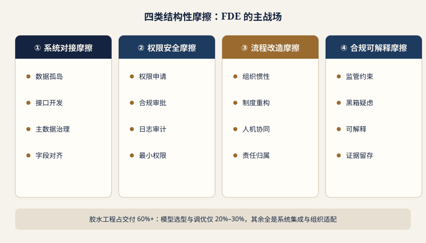
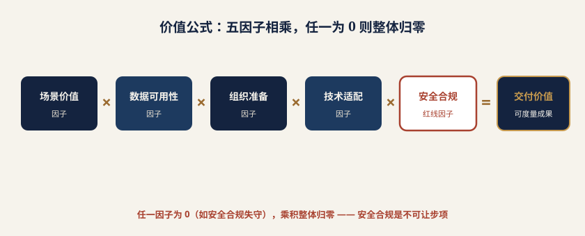
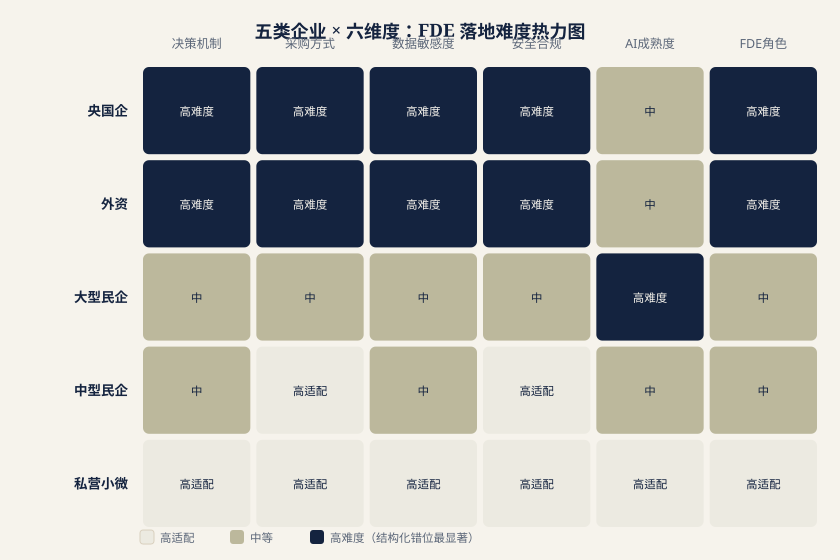

# 第二章 企业需求分析

## 2.1 需求的起点：AI 能力供给过剩，交付能力严重稀缺

对今天的 CIO 而言，稀缺的已不是模型——基础模型能力密度快速攀升，开源与闭源、通用与行业、云端与私有化的选择空前丰富。真正稀缺的，是**把模型能力嵌入既有生产系统、组织流程与合规边界，并让它长期稳定运行的工程与组织能力**。

多家研究机构的观察指向同一方向。Gartner 在 2024 年公开预测，到 2025 年底至少 30% 的生成式 AI 项目会在概念验证之后被放弃，主因是数据质量不足、风险控制缺位、成本攀升与商业价值不清晰（来源类型：第三方研究机构公开预测）。麦肯锡《The State of AI》系列调研持续呈现一组反差：宣称已在至少一个业务职能使用生成式 AI 的企业比例走高，但能在企业层面观察到可归因财务影响的仍是少数（来源类型：咨询机构年度调研）。2025 年 MIT 相关团队《The GenAI Divide: State of AI in Business》口径更尖锐：绝大多数企业级试点未产生可衡量的损益回报，少数成功案例的共同特征并非模型更强，而是"深度嵌入既有工作流"（来源类型：高校研究报告）。

结合课题组对国内近百家大中型企业信息化负责人的访谈，可给出一个保守判断：**中国企业当前处于"已启动但未生产化"状态的 AI 试点占比超过 60%**（来源类型：课题组访谈样本估算，口径为"已完成 PoC 但未在生产环境连续运行满 3 个月"），该比例在制造、能源等重资产行业更高。

## 2.2 核心痛点：四类结构性摩擦

*图 2-1　四类结构性摩擦：FDE 的真实主场*

试点搁浅很少是因为效果不好——Demo 阶段的评审往往通过甚至惊艳。让项目停在实验室门口的，是四类与模型能力无关的摩擦，其共同特征是：**Demo 阶段可以合法绕过，生产阶段无法绕过。**

### 2.2.1 系统对接成本：遗留架构与"胶水工程"的税负

中国大中型企业的 IT 架构是三十年信息化的地质剖面：底层是经历多轮定制的 ERP，中间层是与产线绑定的 MES 与 SCADA，业务侧叠加 CRM、OA、财务共享，近五年又铺了数据中台与微服务网关。各系统数据模型、主数据口径与接口规范互不相同，部分关键系统的交付方已不再服务，文档缺失、接口未开放。

在这样的地基上部署 AI，工作量分布与直觉相反。课题组调研中反复听到的经验值是：**典型企业级 AI 生产项目中，模型选型、提示工程与效果调优合计占总工时的 20%–30%，数据接入、字段对齐、主数据治理、接口开发、异常兜底、灰度回滚等"胶水工程"占 60% 以上**（来源类型：课题组对制造与能源行业项目复盘的工时统计估算）。这与 Google 研究团队《Hidden Technical Debt in Machine Learning Systems》的结论一致：模型代码在生产系统中只占极小部分（来源类型：学术论文，行业广泛引用）。

更关键的是，胶水工程的代价不止工时，还有**不可外包的隐性知识**：同一个"设备编码"在 MES 里叫 EQP_NO、在 ERP 里叫 ASSET_ID、在点检系统里是手工录入的自由文本，映射关系只存在于某位工艺工程师的经验中。没人在现场逐条对齐，模型就只能在干净样例上表演。

### 2.2.2 权限与数据安全：生产环境的门槛远高于 Demo

Demo 环境是脱敏样本、静态快照、单一账号；生产环境是分级分类、动态鉴权、全链路审计。二者之差不在量，而在治理体系。《数据安全法》《个人信息保护法》要求数据分级分类、处理留痕，金融医疗等行业还叠加专门监管（来源类型：国家及行业公开法规）。落到 AI 场景，衍生出四类 Demo 阶段不存在的约束：

- **主体身份贯通** ：AI 代表谁访问数据？若采用"以发起人身份代理执行"，中间层须继承 ERP/CRM 的角色模型，含行级权限与字段级掩码。
- **最小权限与越权检测** ：能回答"上季度华东区毛利"的助手若不做行级过滤，就会让区域经理看到全国数据——这是经 AI 通道发生的越权。
- **脱敏策略** ：训练、微调、RAG 索引、日志留存四环节各需独立策略，并防范多轮对话下的重识别。
- **可审计性** ：谁、何时、以什么提示、调用哪些工具、访问何种数据、得出何种结论，须可追溯、可举证。

这些工作须由同时懂权限模型、安全合规与 AI 架构的人在现场逐项落实。

### 2.2.3 流程改造阻力：岗位、审批流与 KPI 的再设计

技术可行不等于组织可行。AI 进入生产会改变工作分配与责任归属，而这恰是组织中最敏感的部分。以质检为例：视觉模型把缺陷初筛做到 99% 召回，理论上可减少 60% 目检工作量，落地却撞上三堵墙。其一，**责任归属**：漏检导致退货，责任在算法、质检员还是工艺？规则重写前，质检员的理性选择是全部复检，"减负"变"增负"。其二，**审批流**：原 SOP 规定两人复核签字，AI 是否算"一个人"？不算，则流程不变、收益归零。其三，**KPI 冲突**：车间考核产量与直通率，磨合期波动由谁承担？

课题组访谈显示，**因流程与考核未同步调整导致系统"上线即闲置"的案例占失败案例三成以上**（来源类型：课题组失败项目复盘样本）。这类失败在技术验收报告上通常显示"全部通过"，业务侧却无痕迹。破解之道不在技术侧：需要有人坐进车间主任办公室，逐条改写 SOP、重定复核规则、把过渡期考核豁免写进制度，并推动人力资源更新岗位说明书。

### 2.2.4 合规与可解释性：受监管行业的硬性门槛

在金融、医药、能源，可解释性不是加分项而是准入条件。金融监管要求信贷、反欺诈等场景的模型全生命周期治理，并对拒贷等不利决策提供理由说明（来源类型：金融监管部门公开的模型风险管理规范）。医药涉及临床数据的系统须满足 ALCOA+ 数据完整性原则与电子记录、电子签名要求（来源类型：药监部门与国际通行 GxP 规范）。电力监控系统则遵循"安全分区、网络专用、横向隔离、纵向认证"，两大区间数据流动受严格限制（来源类型：电力行业公开安全防护规定）。

这些要求直接挑战生成式 AI 的固有特性：输出具随机性、推理过程不可直读、知识边界模糊。要进入受监管流程，必须在架构层做补偿设计——检索增强确保结论有出处、决策路径结构化留痕、关键环节强制人工复核、输出版本化冻结、建立离线回放与偏差监控。这些设计只能在吃透具体监管条款与流程的前提下现场完成。

### 2.2.5 小结：FDE 的价值本质是"翻译"

四类摩擦并置，结论清晰：**瓶颈已从"模型能力"转移到"能力的组织化嵌入"**。FDE 因此不是"更懂 AI 的实施工程师"，其价值本质是把厂商侧抽象的模型能力，翻译为客户侧"生产环境稳定运行、被组织接受、经得起审计"的系统。这一翻译包含四重转换：技术接口（模型 API 到系统集成）、权限语义（模型调用到身份治理）、流程语言（AI 输出到 SOP 与审批节点）、责任结构（算法结果到组织问责）。缺任一环，项目都会停在实验阶段。

## 2.3 从 Demo 到生产的 gap：FDE 的主场

| 维度 | Demo 阶段（易） | 生产阶段（难）——FDE 主场 |
| --- | --- | --- |
| 系统边界 | 独立沙箱 | 与十余个存量系统双向集成，需处理限流、一致性与回滚 |
| 用户与权限 | 单一演示账号，全量可见 | 数千账号多角色，行级与字段级权限，须与统一认证打通 |
| 数据安全 | 脱敏样例，无审计 | 分级分类、动态脱敏、全链路审计、留存与出境合规 |
| 效果指标 | 挑选场景的准确率 | 长尾稳定性、P95 延迟、可用性 SLA、单次调用成本 |
| 失败代价 | 重演一次 | 停线、错单、误判、监管问询、客户投诉 |
| 流程位置 | 流程之外的旁路展示 | 嵌入 SOP 与审批流，成为必经节点 |
| 组织接受度 | 决策层观看，无使用者 | 一线日常使用，涉及岗位职责与 KPI 调整 |
| 合规要求 | 无 | 可解释、可追溯、可举证，匹配监管条款 |
| 运维与成本 | 临时维护，成本可忽略 | 纳入 ITIL 值班与变更管理；算力成本随调用量线性增长 |
| 成功标准 | 领导认可 | 业务指标可归因改善，且连续运行数月不退化 |

**一、系统对接：从"能调通"到"扛得住"。**FDE 进场第一件事通常不是写代码，而是绘制**数据与系统资产地图**：识别场景涉及哪些系统、表、字段，明确各字段的权威来源、更新频率与已知异常。其次是接口层设计——开放 API 走标准集成，封闭系统评估中间库、CDC 日志订阅或消息队列等旁路方案，并为每条链路设计降级策略：上游超时、返回脏数据、AI 不可用时能否人工兜底。最后是**单位经济性测算**，把调用成本、缓存命中率与模型分级路由纳入架构，避免上线数月后因成本失控被叫停。

**二、权限梳理：把身份贯通到最后一公里。**与客户安全团队共同完成三件事：**权限模型对齐**，使 AI 代理执行时权限不超过发起人；**数据分级落地**，为进入向量库与提示上下文的数据打密级标签，高密级数据本地处理或禁止入模；**审计闭环**，为每次交互生成含发起人、提示原文、工具调用序列、数据访问范围与模型版本的结构化记录并接入既有日志平台。

**三、流程改造：改写 SOP 而不只是部署系统。**与业务共同绘制 As-Is 与 To-Be 流程，明确 AI 插入节点与人机分工；重定审批规则，如把"两人复核"改为"AI 初判＋一人复核＋异常升级"；设计**置信度分流**——高置信自动通过、中置信人工确认、低置信转专家；推动修订岗位说明书与作业指导书。

**四、合规审计：让输出经得起追问。**把监管条款翻译为架构约束——结论强制附证据链（引用文档、检索记录、命中规则），决策路径以可回放的结构化形式存储而非自然语言日志，关键模型建立版本冻结与变更审批，并配合客户准备内审与问询材料；医药与金融场景中还常需参与 IQ/OQ/PQ 验证文档编写。

**五、组织适应：让人愿意用。**试点期优先选"有动力改变"的班组；上线前驻场跟班，实时收集反馈快速迭代；以看板向一线与管理层呈现工时节省与差错下降；与人力资源协同设计过渡期的考核豁免与激励。

五者的共同特征是：**都发生在客户现场，都无法远程交付，都要求同时理解技术与业务**——这正是 FDE 区别于既有 IT 角色之处。

## 2.4 行业需求图谱：谁在招 FDE

| 行业 | 典型场景 | 价值锚点 | FDE 能力侧重 | 预算/周期 |
| --- | --- | --- | --- | --- |
| 金融 | 反欺诈、信贷辅助、合规审查、投研 | 实时命中率、误报率、审计留痕 | 风控建模、模型治理、监管条款转译 | 高 / 6–18 月 |
| 能源 | 设备巡检智能体、调度辅助、安全问答 | 非计划停机时长、巡检人时 | 安全分区架构、SCADA/工单集成 | 高 / 9–24 月 |
| 零售 | 会员运营、智能客服、供应链预测 | 复购率、客服解决率、库存周转 | 快速迭代、多渠道数据打通、A/B 实验 | 低 / 1–3 月 |
| 医药 | 文献综述、临床数据治理、注册文档 | 研发周期、核查工时、合规通过率 | GxP 合规、数据完整性、验证文档 | 高 / 12–36 月 |

### 2.4.1 制造业：把价值锚定在"吨钢成本"

制造业是 FDE 需求最刚性的行业，因为价值可被精确度量。钢铁、化工、汽车的管理语言天然是单位成本语言——吨钢成本、单位能耗、直通率；AI 项目必须换算到这些指标才能通过投资评审。

**FDE 动作**集中在 OT 与 IT 的接缝。以智能排产为例，需进入车间理解真实约束：换型时间、模具可用数、班组技能矩阵、订单隐性优先级（哪个客户不能延期）。这些约束大多不在 APS 参数表里，而在计划员经验中。FDE 要把隐性约束显性化为可计算的规则与目标函数，与 MES 工单、ERP 物料齐套打通，并设计"AI 给建议排程、计划员一键微调"的界面，而非取代计划员。

**案例参照**：国内 ERP 龙头用友近年公开提出面向 AI 与经营成果的商业模式转型，探索"按业务成果分成"的合作方式，使厂商收益与客户可量化的经营改善挂钩，而非仅收软件许可与实施费（来源类型：厂商公开战略表述与媒体报道）。此类模式对交付组织的要求是根本性的：收入一旦与客户成果绑定，厂商就必须派驻能对结果负责的人深度介入排产、库存与成本核算——这是 FDE 在本土诞生的最直接商业动因。

### 2.4.2 金融业：可解释与审计是准入门槛

金融机构对 AI 的态度是"高投入、高门槛、慢准入"。以银行反欺诈为例，诉求是双重的：毫秒级响应下提升实时命中率、压降误报率（误报直接转化为投诉与交易流失）；同时每次拦截都要留痕并可解释，面对申诉或监管问询时能说明"为什么这笔交易被判可疑"。

**FDE 动作**包括：设计规则引擎与模型的协同架构（规则承担监管明确、确定性强的部分，模型承担模式识别），保证端到端延迟满足交易系统约束；把判定依据转化为业务可读的**决策路径**，如"设备指纹首次出现＋收款方近 7 日新增＋金额接近历史上限"，而非只给一个分数；建立监控跟踪特征漂移与命中率衰减，预设重训练与回退流程；配合合规部门完成模型验证文档（来源类型：金融监管部门公开的模型风险管理规范）。投研与合规审查场景则转向证据链管理与时点一致性。

### 2.4.3 能源：集成难度最高，复用价值最大

电网、石化、发电等重资产行业系统耦合度居首，且叠加安全分区要求：生产控制大区与管理信息大区隔离，AI 若需同时访问实时工况与管理侧知识库，架构本身即是难题。

**典型场景**是设备巡检智能体：巡检人员移动端上报异常，系统结合 SCADA 实时工况、历史工单处置记录、设备手册与安规知识库给出初判与处置建议，并自动生成工单流转检修班组。**FDE 动作**包括：设计跨安全分区的数据同步方案（以单向隔离装置定时同步非实时数据，实时数据在生产大区内闭环）；完成设备台账主数据治理，为 SCADA 测点、资产台账、工单系统三套编码建立映射；以设备族为单位构建知识库，把散落在 PDF 手册、历史工单与老师傅经验中的处置知识结构化；设计"AI 建议＋人工确认"的工单闭环，检修动作仍由持证人员签署。

能源项目周期长、验收严，但复用性极强：一套变电站巡检方案可复制到数百座同类站点，是 FDE 资产沉淀价值最高的行业。

### 2.4.4 零售：场景密集、预算分散，扮演"快速试错"角色

零售与前三者相反：可用场景极多——会员分层与个性化触达、智能客服与售后工单、商品描述生成、销量预测与自动补货、门店陈列优化——但单场景预算远小于制造与金融，决策链更短，业务变化更快。

这决定了其工作模式：**不是深耕一个场景一年，而是三个月内跑通三到五个场景，用实验数据筛出真正有 ROI 的一两个再加码。**FDE 动作包括：搭建标准化实验框架，使每个场景都能以 A/B 测试验证增量效果（如推荐对 GMV 的增量贡献而非绝对转化率）；打通会员、交易、商品、门店四类主数据供后续复用；提供低代码配置能力，让业务人员自主调整话术与投放策略。此处能力画像更偏"产品经理＋数据分析师＋工程师"，速度与业务嗅觉的权重高于集成深度；预算有限则倒逼厂商靠模板与资产复用维持交付经济性。

### 2.4.5 医药：双高门槛，长周期厚价值

医药研发与合规门槛双高：创新药研发以十年、十亿计，任何压缩周期的工具都价值巨大；同时涉及临床与注册的系统受 GxP 约束，变更必须经完整验证（来源类型：药监部门与国际通行 GxP 规范）。

两类场景需求最明确。其一是**文献综述与情报分析**：早期研发需检索数万篇文献、专利与临床试验登记信息，人工综述耗时数月；AI 可大幅压缩，但要求结论精确引用来源并区分证据等级。FDE 需构建受控语料库、设计带溯源的检索增强架构、建立科学家可介入修正的审阅工作流。其二是**临床试验数据治理**：EDC 的数据质疑工作量巨大，AI 可辅助识别异常值、逻辑矛盾与缺失项；核心约束在合规——须留完整稽查轨迹，AI 不得直接修改原始数据，只能生成待人工确认的质疑项，系统本身需通过计算机化系统验证。此类项目周期以年计，但一旦通过验证，客户切换成本极高。

### 2.4.6 政策呼应：FDE 进入新型技术人才培育视野

据公开报道，上海在推进人工智能产业人才培育的相关工作中，将"现场部署工程师"等新型岗位纳入加快培育的技术人才范畴，强调面向产业一线的应用型、复合型能力（来源类型：地方产业人才政策公开信息与媒体报道），从政策侧印证了本章判断：瓶颈已从算法研究前移到应用交付。

招聘侧亦然。课题组对主流招聘平台的岗位抽样显示，2025 年以来带有"现场部署""AI 解决方案工程师""AI 交付工程师"标签的岗位明显上升，招聘方以大模型厂商、头部 SaaS 与行业软件公司为主，岗位描述普遍同时要求工程实现、行业理解与客户沟通，多数标注需驻场（来源类型：课题组对公开招聘信息的抽样观察）。

## 2.5 FDE 与传统驻场、外包、售前的本质区别

FDE 常被误读为"改名的驻场实施"或"技术更强的售前"，其后果是组织设计错误：用实施团队 KPI 考核，或挂在销售体系下按签单计酬，岗位随即退化。

| 维度 | 传统驻场实施 | 项目外包 | 售前解决方案 | FDE |
| --- | --- | --- | --- | --- |
| **资产沉淀** | 沉淀在客户定制代码，厂商不可复用 | 基本无沉淀，人走知识走 | 沉淀为 PPT 与标书模板 | 沉淀为连接器、行业模板、评测集、方法论 |
| **角色定位** | 需求执行者，被动响应变更 | 人力提供方 | 方案表达者与说服者 | 需求共同定义者与结果共同责任人 |
| **价值闭环** | 闭环于验收签字 | 闭环于工时结算 | 闭环于合同签署 | 闭环于指标复盘与续约扩容 |
| **考核方式** | 按期交付率、验收通过率 | 人天数、到岗率 | 签单额、赢单率 | 指标改善、产品化沉淀数、净收入留存 |
| **知识流向** | 单向流向客户 | 无明确流向 | 单向流向客户 | 双向：客户业务知识回流为厂商资产 |

### 2.5.1 FDE 不等于"高级售前"：售前交付合同，FDE 交付结果

二者能力画像确有重叠——都需技术功底、行业理解与客户沟通，但**价值闭环点根本不同**。

售前的工作在合同签署那一刻闭环，成功指标是赢单，产出物是方案建议书、POC 报告与投标文件。为赢单，售前有天然动机把方案讲得更有吸引力、把实施难度讲得更可控——这不是道德问题，而是激励结构使然。

FDE 的工作则**从合同签署之后才开始**，成功指标是客户在生产环境获得可归因的业务改善并因此续约、扩容。这意味着 FDE 有天然动机在早期就暴露难点、收窄范围、把不切实际的预期拉回地面；优秀的 FDE 在售前介入时常常扮演"降低预期"的角色，因为他要为兑现负责。

组织归属也应有别：售前归销售体系、按签单节奏运转，FDE 应归交付或产品体系，考核周期须长于一个销售季度，否则必被短期签单压力扭曲。FDE 当然参与售前，但方式是**技术尽调与可行性判断**，而非方案营销。

### 2.5.2 核心分野：项目结束后是否沉淀为可复用资产

若只用一条标准区分 FDE 与传统角色，那就是：**项目结束时，除了客户手里多一套系统，厂商手里是否多了一份能降低下一个项目成本的资产。**

传统驻场实施的经济模型是线性的——第 10 个客户与第 1 个客户的交付成本基本相同，既无法支撑规模化，也无法支撑"按成果分成"这类模式。FDE 的经济模型则必须**次线性**：每个项目在为当前客户解决问题的同时，把通用部分抽象为厂商资产——面向特定 ERP/MES 版本的连接器、行业提示与工作流模板、来自真实业务的评测集（最难获取，直接决定该行业调优效率）、术语与主数据映射词典、经多次验证的方法论与风险清单。

衡量沉淀能力，应引入**交付边际成本下降率**——同类场景第 N 个项目相对第 1 个的人天降幅。课题组观察到，具备成熟沉淀机制的厂商在同类场景第 5 个项目上，交付人天可降至首个项目的 40%–60%；缺乏沉淀机制者长期停留在 85% 以上（来源类型：课题组对厂商交付数据的访谈估算）——这一差距最终体现为毛利率分化。

## 2.7 FDE 的严谨定义与价值公式

在厘清了企业需求图谱、行业分布以及与驻场/外包/售前等角色的差异之后，我们需要回到角色本身，给 FDE 一个可被衡量、可被复制的严谨定义。很多组织在引入 FDE 时之所以陷入"似是而非"的困境，根源在于把"去过现场"等同于"完成了生产化交付"，把"支持过项目"等同于"对业务结果负责"。本节试图建立一套可操作的判别标准与价值评估框架。

### 2.7.1 定义：嵌入现场、面向结果、反哺组织的工程型角色

用一句话概括：**FDE 是一种嵌入业务现场、围绕真实业务结果交付生产系统，并把现场经验反哺产品、平台与组织流程的工程型角色。**

这一定义包含三个不可分割的要素。其一，是"嵌入现场"——FDE 的工作锚点不是会议室里的方案汇报，而是客户真实的业务流、权限域与组织关系中；其二，是"面向结果"——交付物不是一份演示文稿或一段 Demo 代码，而是被真实用户持续使用、对业务指标产生可观测影响的生产系统；其三，是"反哺组织"——单次项目的经验不随项目结束而消散，而是沉淀为可复用的资产，提升组织下一次交付的效率与质量。

判断一个岗位是否真正接近 FDE，可依据三条必要条件，三者同时成立才算完整：

- **条件一：是否进入真实业务现场，而非只做方案或演示。** 仅停留在 PPT 宣讲、概念验证（PoC）展示层面的角色，缺少对现场约束（数据、权限、流程、组织惯性）的第一手感知，不构成 FDE。
- **条件二：是否对生产系统、采用情况与业务结果承担责任。** FDE 的 KPI 不是"交付了多少文档"，而是"系统是否稳定运行、用户是否真正使用、业务指标是否改善"。
- **条件三：是否把一次项目沉淀为可复用资产。** 包括模板、组件、评估集、复盘记录与培训材料等，使单个项目的边际成本在组织内持续下降。

### 2.7.2 价值公式：五个因子相乘，任一为 0 则整体归零

*图 2-2　价值公式：五因子相乘，任一为 0 则整体归零*

FDE 的产出不能用"工时"或"交付物数量"线性衡量，而应遵循一个乘法型的价值模型（框架引用自本白皮书调研方法论）：

> **FDE 价值 = 模型能力 × 场景匹配 × 系统稳定 × 组织采用 × 资产沉淀**

该公式的关键洞察在于"乘数效应"：五个因子中**任何一个降至零，整体价值即归零**。这意味着，即便模型能力顶尖、场景选择精准，只要组织采用环节失败（无人使用），FDE 的投入便无法转化为真实价值。这种结构解释了为何大量 AI 项目"技术很亮眼、落地很苍白"。

为便于实务操作，下表将五个抽象变量映射为可观察、可量化的指标：

| 价值变量 | 核心含义 | 可观察指标 |
| --- | --- | --- |
| 场景匹配 | 能力与业务的契合程度 | 业务价值、使用频率、边界清晰度 |
| 系统稳定 | 在生产环境中的可靠性 | 可用性、错误率、回滚次数 |
| 组织采用 | 用户真正用起来的程度 | 活跃用户数、使用频次、人工修改率 |
| 资产沉淀 | 经验转化为可复用资产 | 模板、组件、评估集、复盘记录、培训材料 |

### 2.7.3 因子失衡的识别与处置优先级

当项目出现价值衰减时，FDE 需要先定位是哪个因子出了问题，再决定优先处置顺序。下表给出典型表现与处置建议：

| 出问题的变量 | 典型表现 | 优先处理动作 |
| --- | --- | --- |
| 系统稳定低 | 频繁报错、需人工救火、多次回滚 | 补充评估日志、建立监控与回滚机制 |
| 组织采用低 | 上线即搁置、活跃用户少、人工修改率高 | 培训、激励与流程重画，推动真实嵌入 |
| 资产沉淀低 | 每次都从零开始、同类问题反复出现 | 建立模板、组件与复盘库，降低边际成本 |

需要强调的是，处置顺序不等于"先易后难"，而是"哪一个是归零因子就先补哪一块"。这也是 FDE 区别于纯研发角色的地方：它要求从业者具备价值判断能力，而非机械地优化技术参数。

## 2.8 与相邻岗位的边界再审视

本章 2.5 节已就 FDE 与驻场、外包、售前做过区分，但那是从"服务模式"切入。本节换一个更具实战意义的视角——**以"责任范围"为尺，重新审视 FDE 与若干相邻岗位的边界**。之所以有必要反复澄清，是因为在 Agent 加速进入生产的当下，组织常常把"很像 FDE"的岗位误认为 FDE，导致最后一公里无人负责。

下表从"现场深入度"（进入真实业务现场、承担一线约束的程度）与"结果责任度"（对生产系统稳定运行与业务结果承担责任程度）两个维度，对六类岗位做对比：

| 岗位 | 核心定位 | 现场深入度 | 结果责任度 |
| --- | --- | --- | --- |
| 实施顾问 | 系统配置、数据迁移、培训与上线 | 中 | 中 |
| AI 顾问 | 战略路线图、规划与建议 | 低到中 | 中 |
| 产品经理 | 通用能力建设、需求与设计 | 中 | 中 |
| 软件工程师 | 平台与系统研发 | 高 | 中 |
| FDE | AI 生产化落地与业务结果 | 高 | 高 |

### 2.8.1 关键判断：看责任范围，而非岗位名称

从上表可以看出，FDE 在"现场深入度"与"结果责任度"两个维度上同时处于高位，这是它与所有相邻岗位最本质的区分。更进一步的结论是：**边界判断应当看"责任范围"，而不是看岗位名称。**现实中，许多组织挂着"AI 工程师""数字化专家"头衔的人，实际只负责写建议书或做配置，并未承担生产化与采用责任——从责任范围看，他们并不等于 FDE。

这一点在 Agent 进入生产后尤为突出。Agent 系统的特点在于：它直接触达业务流程、调用企业权限、与真实用户交互，因而"最后一公里"既包含工程问题（稳定性、评测、回滚），也包含业务问题（流程重画、组织激励、用户习惯）。**没有任何单一的传统岗位能够天然覆盖这一段**：售前不懂生产，实施不负责采用，顾问不进系统，研发不背业务结果。正因如此，FDE 作为一种"工程 + 业务 + 组织"的复合责任主体，才成为 Agent 生产化的必需角色。

### 2.8.2 两类常见误判

结合上文定义，有两类典型的"伪 FDE"需要警惕：

- **只做建议、不进系统 = 顾问。** 不论头衔多新潮，只要交付止于方案、路线图或咨询报告，未将 AI 能力真正部署进客户生产环境并承担责任，其本质仍属顾问范畴。顾问的价值在于"指明方向"，FDE 的价值在于"把方向走通"。
- **只做配置、不负责采用 = 一次性实施。** 完成系统配置、数据迁移与上线培训后便退出，不跟踪活跃用户、使用频次与人工修改率，也不推动流程重画与资产沉淀，这类角色属于一次性实施。它解决了"装上去"，却没解决"用起来、用得好、能复用"。

综上所述，一个完整的 FDE 必须同时跨越"进入系统"与"负责采用"两道门槛。任何只满足其中一道的角色，都只是 FDE 图谱中的相邻节点，而非 FDE 本身。这也解释了为何在需求侧，企业真正稀缺的从来不是"会做 AI 的人"，而是"能把 AI 在生产现场持续产生业务价值的人"——这正是本章企业需求分析所要回答的核心命题。

## 2.9 多类型企业的 FDE 需求分化与决策机制

前文从行业与职能维度刻画了企业 AI 落地缺口，但"缺口"的形状会因企业身份而截然不同。FDE 之所以无法用一套标准方案覆盖所有客户，根本原因在于：决策如何形成、预算如何释放、数据如何被看待、组织对 AI 的耐受度如何，在不同类型企业之间是**结构性的差异**，而非程度上的差异。本章最后，我们跳出"规模大小"这一单一标尺，改以"企业类型"为轴，重新切分需求视角，为后续各章的交叉分析奠定坐标。

### 2.9.1 五类主体的需求对比矩阵

*图 2-3　五类企业 × 六维度：FDE 落地难度热力图*

下表将五类主体置于同一坐标系下，便于 CIO 快速定位自身所处象限，以及 FDE 在该象限内的"正当切入点"。

| 企业类型 | 决策机制 | 采购方式 | 数据敏感度 | 安全合规要求 | AI 成熟度 | FDE 角色定位 | 典型场景优先级 |
| --- | --- | --- | --- | --- | --- | --- | --- |
| 外资企业 | 总部授权 + 本地合规双线 | 全球框架协议 + 本地补充 | 高（跨境、母国法规） | 跨境传输审批、数据驻留、可审计 | 中高，标准化强 | 全球合规与本地法规的"对齐者" | 标准化流程、可审计助手、数据驻留场景 |
| 大型民营企业 | 业务总裁驱动、决策快 | 直接采购 / 自研 + 外协 | 中高（重知识产权） | 商业机密、资产沉淀保护 | 中高，敢投入 | 营收侧的"增长合伙人" | 营销、客服、供应链、成果转化 |
| 中型企业 | 老板 / 核心管理层拍板 | 轻量外采、订阅制、模板化 | 中（怕泄漏、怕中断） | 基础合规、业务连续性 | 中低，人力紧 | 性价比与速效的"交付替补" | 高频重复岗位动作、标准化模板 |
| 私营 / 小微企业 | 老板一人决策 | 极低门槛、SaaS / 免费起步 | 低（但怕出事） | 基础账号、钓鱼、外泄防护 | 低，刚起步 | 轻量自动化 + 人工终审"兜底者" | 轻量自动化、基础安全堵漏 |

### 2.9.2 逐类论述：需求分化的真实样貌

**（1）央国企与关键信息基础设施**

这类主体的第一约束从来不是"AI 能带来多少增长"，而是"上线后不出任何可控性问题"。决策链长、审批层级多，使其天然倾向在受控环境（含信创技术栈）内闭环交付，FDE 因此更多扮演"落地守门人"——在等保、关基保护、信创替代等硬性框架下，把通用能力翻译成可审计、可回溯、可撤职的工程实现。场景优先级集中在内部提效与风险可控一端：文档智能、审批辅助、统一知识库等"不产生对外风险"的应用最受青睐。其价值锚点应表述为"可控落地 + 安全合规"，而非激进创收；任何把 FDE 包装成"营收工具"的叙事，在这类客户处都难以通过决策关。

**（2）外资企业**

外资企业的特殊之处在于"双线合规"：FDE 既要满足母国集团（如 GDPR、总部数据治理规范）的要求，又要贴合本地法规（如数据出境安全评估、数据本地化）。决策上往往由总部授权框架 + 本地合规团队共同把关，采购走全球框架协议叠加本地补充条款。这决定了其场景偏好高度"标准化、可审计、可解释"，并对数据驻留（Data Residency）极为敏感——模型与数据落在哪朵云、是否跨境，常是项目能否立项的先决条件。FDE 在这里是"对齐者"：把全球统一能力落地为本地可验收、可举证的交付物。

**（3）大型民营企业**

与前述两类形成对照，大型民企的决策通常由业务总裁直接驱动，对"AI 能否帮我把生意做大"反应敏锐，且愿意为增长付费。其 FDE 角色更接近于营收侧的"增长合伙人"，场景自然偏向营销、客服、供应链等直接触碰收入的环节；同时，这类企业对知识产权与数据资产沉淀高度敏感，倾向于把合作成果沉淀为自有资产。值得一提的是，部分头部民企已表现出对"成果分成"模式的接受度——即 FDE 服务费用与可量化的业务收益挂钩，这在此前五类主体中几乎是独有的支付意愿。

**（4）中型企业**

中型企业是"资源紧约束"的典型：IT 人力有限、预算不宽裕，却同样面临降本增效压力。其 FDE 需求的关键词是"性价比 + 快速见效"，因此更倾向于借助外部伙伴做轻量交付，采用标准化模板而非从零定制。场景选择上偏好高频、重复、规则相对清晰的岗位动作（如合同初筛、报表生成、客服问答），以求在最短周期内看到可汇报的结果。FDE 在此处相当于内部能力不足时的"交付替补"，成败往往取决于能否用最小投入撬动可见价值。

**（5）私营与小微企业**

这类主体的核心诉求可以浓缩为八个字："用得起、别出事"。它们没有专职 AI 团队，也谈不上成熟的数据治理，因此 FDE 思路应回归朴素——以轻量自动化替代重复劳动，同时保留"人工终审"作为最后一道闸，避免模型幻觉或越权操作造成不可逆损失。安全层面不要一上来谈复杂架构，而应先堵基础漏洞：账号权限混乱、钓鱼邮件、敏感数据随手外发，才是小微最该先补的窟窿。FDE 在此处的定位是"兜底者"，而非"变革者"。

### 2.9.3 分化背后的结构性逻辑

需要强调：FDE 不是"一套打法通吃"的通用岗。五类主体之间的差异，表面看是预算多少，深层看则是**决策机制、采购习惯、数据敏感度与 AI 成熟度四根支柱共同塑造的结构性错位**。决策机制决定 FDE 能否立项、以多快速度立项；采购方式决定 FDE 以何种合同形态进入；数据敏感度决定方案能在多大范围内触碰真实业务；AI 成熟度则决定客户自身能承接多少交付责任。任何一维的误判，都会让 FDE 的部署从"落地"退化为"试点即搁置"。

本白皮书后续的市场规模、组织建设、安全治理与人才培养等章节，将始终以这五类视角作为交叉坐标轴展开——读者在翻看后文时，建议先回到本节的矩阵，确认自己所属象限，再据以对号入座。

> **给 CIO 的判断**：先按自身企业类型定位 FDE 的切入点与价值锚点，再谈工具选型与团队搭建；脱离身份谈"最佳 FDE 实践"，往往是南辕北辙。

## 2.10 本章小结：给 CIO 的三点判断

其一，**瓶颈已系统性地从算法侧转移到交付侧**。四类摩擦才是超六成试点停滞的真实原因；预算与人力重心应从"模型选型"移向"生产化工程与组织变革"。

其二，**判断供应商的真实交付能力，应看其是否拥有 FDE 体系，而非只看模型指标**。可用的尽调问题：在本行业交付过多少生产环境项目？驻场人员归属销售还是交付？是否有面向我方 ERP/MES 版本的连接器与行业评测集？项目结束后的运维与迭代责任如何界定？

其三，**企业自身也需培育 FDE 能力，而非全部外包**。稳健策略是初期借外部 FDE 跑通首批场景，同期以"影子团队"培养内部人员，逐步把场景扩展与调优内化——这既是成本考量，更是数据与知识主权考量。
