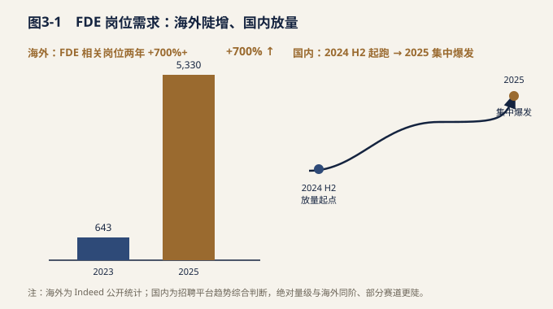
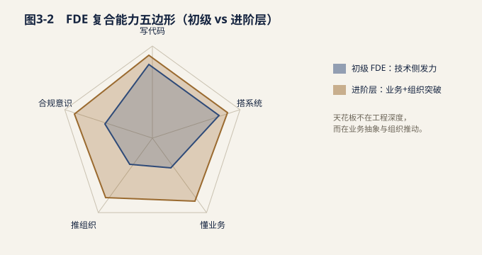
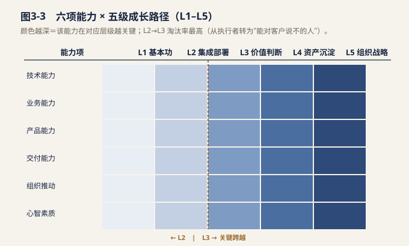
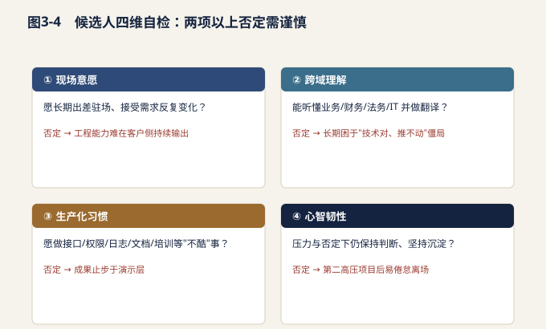

# 第三章 人才市场现状

FDE（现场部署工程师，Forward Deployed Engineer）在中国仍是一个年轻且尚未被标准化定义的岗位。与海外由 Palantir、OpenAI、Anthropic 等厂商率先规模化建制不同，国内的 FDE 更多是在大模型应用落地、企业 AI 转型与"AI 原生"创业浪潮中，被真实需求倒逼出来的角色。它没有对应的学科、缺乏统一的职业资格，却偏偏站在了 AI 从"实验室能力"走向"生产线价值"的最窄关口上。本章从需求侧、供给侧、能力模型、薪酬水平、缺口与培养五个维度，以招聘平台数据、行业媒体观察、猎头访谈与政策信息为据，刻画这一岗位在当下中国人才市场中的真实图景。

## 3.1 需求侧：岗位高速扩张

**海外信号：两年增长 700%+。**据美国招聘平台 Indeed 公开数据（来源类型：招聘平台公开统计），与 FDE 高度相关的岗位数量从约 643 个增长至 5,330 个，两年间增幅超过 700%。这一数字尽管绝对体量不大，但增速在 Indeed 覆盖的数千类岗位中位居前列，被广泛视为"AI 落地交付"岗位独立化的明确信号。需要补充说明：FDE 在海外的统计口径往往与 "AI Solutions Engineer""Deployment Engineer""Field Engineer""Applied AI Engineer" 等交叉重叠，真实的岗位需求被严重低估；若把所有"把 AI 部署到客户现场"的角色合并统计，曲线斜率只会更陡。

**国内放量：2024–2025 明显加速。**在 BOSS直聘、猎聘、拉勾等主流招聘平台上（来源类型：招聘平台），以"FDE""现场部署工程师""AI 交付工程师""AI 落地工程师"为关键词的岗位，自 2024 年下半年起进入明显放量期，至 2025 年呈现集中爆发。从平台公开职位趋势可见，多家提供 AI 中台、Agent 开发平台与行业大模型解决方案的厂商，以及一批"AI 原生"创业公司，开始将 FDE 作为标准岗位单列招聘；部分头部互联网企业，以及金融科技、智能制造、医药等领域的数字化部门，也在内部增设同类角色（来源类型：行业媒体与猎头访谈）。综合多方访谈与平台职位趋势，国内增速与海外处于同一量级，即在一年左右出现数倍增长，部分赛道甚至更陡。

**需求的结构特征。**从行业分布看，放量最集中的是金融、互联网与软件、智能制造三大板块——它们既有数据基础与付费能力，又面临真实的流程重构压力；医疗、政务、零售等场景则在 2025 年加速跟进，呈现"先头部、后长尾"的扩散曲线。从岗位归属看，需求方分为两类：一是 AI 厂商与集成商，将 FDE 作为"客户成功 + 技术交付"的复合前线；二是甲方企业自身，在数字化部门内设置"内部 FDE"以承接外部供应商成果并推动内部落地。两类需求叠加，使岗位画像在"厂商侧"与"企业侧"之间出现分化：厂商侧更强调标准化交付与规模化复制，企业侧更强调内部流程理解与组织推动，但核心职责一致——在客户现场把 AI 能力接进真实业务。

**需求的质量信号。**值得关注的是，岗位描述中"驻场""POC 到生产""权限接入""可观测性""合规"等关键词出现频率显著上升（来源类型：招聘平台职位文本），说明企业招聘的已不是"会演示的人"，而是"能把系统稳定跑在生产环境的人"。这一用词变化，是需求从概念期迈入交付期的直接证据，也为供给侧的能力建设指明了方向。

**为什么是现在？对增速的三点解读：**

1.**技术成熟度越过临界点。**大模型能力在 2023–2024 年快速收敛，企业不再纠结"能不能用"，而是转向"怎么稳定、安全、可度量地用"。一旦进入生产交付阶段，纯销售与纯研发都无法独立闭环——既懂技术边界、又能在客户现场把系统跑通的人成为刚需。 2.**交付复杂度从模型层下沉到业务层。**早期 AI 项目以 Demo 和 POC 为主，工程化要求低；当企业要求 AI 接入真实权限体系、数据管道、审批流与合规审计时，需要有人长期驻场解决"最后一公里"。这一职责天然属于 FDE 的定义内核，无法被售前或研发单独吸收。 3.**厂商商业模式从"卖工具"转向"卖结果"。**订阅制与按效果付费的兴起，倒逼厂商把交付责任前移到客户侧。谁能把 AI 变成客户可运营、可续费的生产力，谁就掌握扩张主动权，FDE 因此成为厂商与客户之间不可替代的关键接口。

当前国内 FDE**并非科班产出**——几乎没有高校或职业院校开设对应专业，市场上基本不存在"毕业即 FDE"的供给。现有一线从业者主要来自四类背景的转行流动（来源类型：猎头访谈与行业媒体）。

| 来源背景 | 核心优势 | 主要短板 | 转行典型路径 |
| --- | --- | --- | --- |
| (b) 售前 / 解决方案架构师 | 懂客户、懂销售节奏，沟通与方案能力强 | 工程深度不足，复杂系统需协作 | 售前 → 技术交付深化 → FDE |
| (c) 管理咨询顾问 | 结构化思维、变革管理与高层对话强 | 实际编码与系统搭建能力弱 | 咨询 → 技术补强 → FDE |
| (d) 行业专家 / 业务老手 | domain know-how 深，痛点判断准 | 需补齐 AI 与工程能力 | 业务专家 → AI/工程培训 → FDE |

**能力错配的双向流动。**供给端最显著的特征是"能力错配下的双向流动"：技术出身者向下补业务与组织能力，业务、咨询出身者向上补 AI 与工程能力。没有任何单一来源背景能天然胜任 FDE，这决定了该岗位本质上是"组装型"人才——其竞争力不来自某一专长，而来自跨边界的整合力。在实践中常见两种典型流动：一类是全栈工程师在多个客户项目中"撞"出业务感，逐渐能独立定义价值指标；另一类是资深售前或咨询顾问通过系统化的 AI 与编程训练，把方案能力落地为可运行系统。两条路径殊途同归，但所需时间均在 1–2 年以上。需要强调的是，四种来源背景各有"转行陷阱"：(a)类易陷入"用工程复杂度掩盖业务幼稚"；(b)类易"方案漂亮、落地无力"；(c)类常"谈战略、写不出一行能跑的代码"；(d)类则"懂业务却无法与模型对话"。识别并规避这些陷阱，是 FDE 个体成长与企业用人的共同课题。

**交付一线是最好的考场。**由于岗位标准缺失、培训体系不成熟，真实的项目交付现场成为最有效的筛选与训练场。多数企业更倾向从内部或合作方"用过、验证过"的人中提拔 FDE，而非直接从市场高价挖角。这意味着供给的成熟高度依赖"项目历练"而非学历或证书：一个人在三个真实交付项目中的成长，往往胜过一年课堂训练。这也解释了为何资深 FDE 极度稀缺——它无法被快速"生产"，只能被项目"熬"出来。

**供给的隐性约束。**除了能力错配，供给还受两类隐性约束：其一，愿意长期驻场、承受客户侧高压强度的技术人才本就有限；其二，行业 know-how 与 AI 工程能力的"双高"组合在小众垂直领域尤其罕见。这两点共同推高了资深垂直 FDE 的稀缺度。

## 3.3 能力要求：复合能力模型

FDE 的能力结构呈现明显的"五边形"特征，五项能力缺一不可且相互耦合（来源类型：白皮书综合归纳 / 行业媒体 / 厂商岗位 JD）。

| 能力维度 | 关键技能 | 分层要求 |
| --- | --- | --- |
| 搭系统 | Agent 编排、RAG 架构、权限与日志、可观测性 | 基础层：会用平台搭原型；进阶层：能设计生产级架构与运维体系 |
| 懂业务 | 抽象业务痛点、定义可度量价值、ROI 测算 | 基础层：理解流程；进阶层：能把 AI 价值翻译成业务指标 |
| 推组织 | 跨部门沟通、变革管理、培训赋能、向上管理 | 基础层：单点推进；进阶层：驱动组织级采纳 |
| 合规意识 | 数据安全、审计留痕、行业监管（金融 / 医疗等） | 基础层：守住红线；进阶层：设计合规交付框架 |

**能力雷达说明。**初级 FDE 在"写代码 + 搭系统"上发力，进阶层必须在"懂业务 + 推组织"上突破，资深 FDE 则以"合规意识 + 价值定义"建立壁垒。一个普遍误区是"FDE = 更强的工程师"，但实践中真正的天花板来自业务抽象与组织推动能力——这正是多数技术出身者最需要补课的地方。反过来，业务与咨询出身者若无法亲手搭起一个能跑的系统，也难以赢得研发团队与客户技术侧的信任。

**场景化能力组合举例。**在金融风控场景中，FDE 既要能调通模型 API 与内部数据管道（写代码 + 搭系统），又要能向合规部门解释决策可解释性（合规意识），还要说服业务线把 AI 建议纳入审批流（推组织）；缺任何一环，项目都会卡在某个"非技术"环节。在智能制造的质检场景中，FDE 则需要把视觉模型接进产线数据、培训一线工人使用、并让 IT 部门接受其运维边界，能力组合虽不同，耦合要求一致。这也说明为何 FDE 难以被任何单一职能替代——它的价值恰在于把五个维度拧成一股可交付的绳。

**能力成熟度分层（参考框架）。**综合厂商与行业实践，可把 FDE 粗略分为三级：初级（能独立交付标准化原型，依赖指导）、中级（能端到端负责一个客户项目，独立定义价值指标）、高级（能设计跨客户的交付方法论、驾驭强监管行业、驱动组织级采纳）。目前市场供给以初级到中级为主，高级（尤其是垂直行业）极度稀缺，这一金字塔结构直接对应了后文的缺口判断。

**预期高涨，现实温和。**多家行业媒体在 2025 年的报道中直言："第一批做 FDE 的人，离高薪差远了""FDE 没有一步登天"（来源类型：行业媒体）。与"硅谷 FDE 动辄 30–50 万美元总包"的叙事相比，国内 FDE 薪酬并未出现同等量级的跃升，预期与现实之间存在明显落差。市场一度被海外高薪叙事与"AI 即高薪"的联想推高预期，落地时却发现国内定价逻辑完全不同。

**落差的结构化归因：**

- **岗位界定模糊。** 名称混乱（FDE / AI 交付 / AI 落地 / 解决方案架构），职责边界不清，企业难以按"稀缺专家"给出独立薪酬序列。
- **价值未量化。** 多数项目仍处早期，客户付费意愿与续约尚未验证，FDE 的贡献难以折算为清晰财务指标，定价缺乏锚点。
- **项目早期小额。** 试点预算有限，人力成本被压缩，薪酬直接受项目体量约束，难以对标成熟交付岗。
- **结构性原因：** ① FDE 在多数组织内被计入"实施成本中心"而非"价值利润中心"，资源分配天然受限；② 可量化成果少，缺乏行业对标基准；③ 岗位标准缺失，HR 与薪酬体系无据可依，只能套用既有序列（如高级工程师或解决方案顾问），进一步压平溢价。

**国内薪酬区间（描述性，非精确统计）。**综合招聘平台公开薪资与猎头访谈（来源类型：招聘平台 / 猎头访谈），当前国内 FDE 薪酬大致落在"中高级工程师到资深顾问之间"——即明显低于硅谷美元报价，但显著高于传统软件外包与实施岗位。一线厂商与头部金融科技给出的资深岗可达行业中上游，具备稀缺行业 know-how 的专家可获额外溢价，但整体上尚未形成"稀缺即天价"的市场共识。换言之，FDE 在国内已是"体面且高于平均"的岗位，但远未到"一步登天"。

**中美薪酬对比（区间描述）：**

| 维度 | 中国（国内） | 美国硅谷 |
| --- | --- | --- |
| 相对基准 | 远高于外包 / 实施，低于硅谷 | 显著高于本土平均水平 |
| 溢价来源 | 稀缺性 + 行业 know-how | 稀缺性 + 美元定价 + 利润中心定位 |
| 主要制约 | 岗位标准缺失、价值未量化 | 人力市场成熟、对标清晰 |
| 重估条件 | 可量化交付成果出现 | 已具备成熟定价体系 |

**薪酬重估的触发点。**国内 FDE 薪酬中枢的上移，不取决于概念热度，而取决于"可量化交付成果"的普遍出现。一旦企业能清晰证明某位 FDE 带来的续费、提效或降本，薪酬将快速向"价值利润中心"逻辑回归。这一拐点预计随 2025–2026 年一批标杆项目的财务验证而逐步临近。

**预期管理的现实意义。**对 CIO 与数字化负责人而言，认清"FDE 薪酬未一步登天"有双重价值：一方面，不必因海外高薪叙事而对国内人才成本过度焦虑，应着眼"能力—价值"的本地定价；另一方面，也不应把 FDE 当作廉价实施资源——低估其稀缺性将导致留不住核心交付者，项目随之断层。理性的做法是：以"价值利润中心"的视角设计激励，让 FDE 的回报与其交付的可量化成果挂钩，从而同时解决"定价无锚"与"留住人才"两个问题。

## 3.5 人才缺口与培养路径

**核心判断：中短期内缺口持续扩大，"有价无市"将成常态。**一方面需求随 AI 落地深入而持续放量，另一方面供给高度依赖"项目历练"、成长周期长且标准化程度低，供需剪刀差短期难以收敛。尤其在金融、医疗、制造等强监管、强行业属性的垂直领域，**资深垂直行业 FDE 将长期处于"有价无市"状态**——企业愿意出价，却找不到既懂行业又懂 AI 工程的交付者（来源类型：猎头访谈 / 行业媒体）。这种缺口不是总量的缺口，而是"高质量、垂直化"的结构性缺口。

**培养路径分四条主线：**

1.**企业自建：双轨轮岗。**头部厂商与数字化领先企业采用"研发—交付—行业"双轨轮岗，让工程师在客户现场锤炼业务感，让业务人才补强技术，以项目实战沉淀能力标准（来源类型：厂商实践 / 行业媒体）。这种方式见效慢但忠诚度高，适合规模化的厂商侧供给。 2.**地方培育：政策与实训。**以上海等地为代表，部分城市已将 AI 应用交付类人才纳入人才政策支持与实训基地规划，通过政企协同缩短供给培育周期（来源类型：政策 / 地方公开信息）。地方政策的介入，有助于把 FDE 从"企业私产"变成"区域公共能力"。 3.**生态共建：项目即教材。**厂商 + 合作伙伴 + 客户三方共建交付方法论，把真实项目沉淀为培训教材与认证体系，以生态方式规模化输出 FDE（来源类型：白皮书 / 厂商生态实践）。这与"交付一线是考场"的逻辑一致——最好的教材就是真实项目。 4.**院校衔接：高职共建方向。**部分职业院校与厂商探索共建"AI 交付"方向课程，前置培养基础工程与行业认知，缓解初级供给（来源类型：院校合作 / 政策导向）。尽管院校难以产出资深 FDE，但能显著降低初级人才的入场门槛。

**区域差异简述。**供给与需求高度集中于长三角、京津冀、粤港澳等数字化领先区域；中西部与产业带城市需求增长快但本地供给薄弱，更多依赖远程交付与厂商派驻，区域间"人才虹吸"效应明显（来源类型：招聘平台区域分布 / 行业媒体）。这种不均衡在短期内会加剧——越缺人的地方越难留住人，最终可能催生"区域 FDE 服务中心"式的共享交付模式。对地方政府而言，把 FDE 纳入人才政策与实训体系，既是补本地供给短板，也是吸引 AI 产业落地的抓手；对企业而言，则需接受"核心 FDE 集中、边缘交付远程化"的混合部署现实。

**缺口的量化感知。**尽管缺乏统一的官方统计，但多方猎头与厂商反馈指向同一结论：初级 FDE 可通过培训在半年到一年内补充，而兼具行业深度与工程落地能力的中高级 FDE，培育周期普遍在 2–3 年，且高度依赖真实项目练兵（来源类型：猎头访谈 / 厂商实践）。这意味着即便今天全力投入培养，结构性缺口也要到 2027 年前后才可能松动。时间差，正是当前企业争夺资深 FDE 的根本原因。

## 3.6 岗位族观察法与市场成熟度信号

**为什么不能只盯"FDE"这三个字母。**中国市场对 FDE 的采用尚处早期，"名实分离"是常态：同样的工作，在 A 公司叫"AI 交付工程师"，在 B 公司叫"解决方案架构师"，在 C 公司挂在"数字化项目经理"名下；反过来，也有企业把只写提示词、做演示页面的岗位包装成"FDE"以吸引简历。若以名称为唯一口径，既会低估真实需求，又会把伪装岗位计入统计。更稳妥的是采用**岗位族（job family）视角**——不问"它叫不叫 FDE"，而问"它是否承担了从现场诊断到生产上线的完整责任链"。

**四类高频重叠岗位。**与 FDE 存在实质性职责交叠的岗位主要有四类。它们并非"假 FDE"，而是 FDE 能力链条上的不同切片；辨明其重叠与差异，是识别真实需求与人才来源的前提。

| 相邻岗位 | 主要工作内容 | 与 FDE 的重叠部分 | 关键差异 |
| --- | --- | --- | --- |
| 大模型应用工程师 | 模型调用、RAG 构建、Agent 编排、效果调优 | 技术实现层高度重合，是 FDE 的工程内核 | 多在自有产品或内部环境中工作，较少直接面对客户组织，不负责推动业务方真正使用 |
| AI 实施顾问 | 产品配置、参数调整、用户培训、上线陪跑 | 现场推进与用户教育部分基本一致 | 工程深度止于产品既有边界，遇接口、权限、数据管道问题需转研发；向产品反馈的路径也较弱 |
| 数字化转型负责人 | 跨部门统筹、预算与优先级、组织变革推动 | 组织推动与高层对话能力直接对应 | 站位偏管理侧，通常不亲自完成系统对接与代码级落地，依赖供应商执行 |

四者的共性是"各占一段"，FDE 的特殊性在于**把四段串成闭环**：从现场问出真问题，到亲手把系统接进生产环境，再到让业务方持续使用并沉淀为可复用资产。因此判断一个岗位是否属于 FDE 族，本质是看"责任链是否闭合"，而非技能清单是否齐全。

**三个市场成熟度信号。**一个新职业从"概念"走向"建制"，通常依次出现三类可观测信号，可作为判断中国 FDE 市场阶段的粗颗粒标尺。

| 成熟度信号 | 具体表现 | 当前中国市场状态（定性判断） |
| --- | --- | --- |
| 薪酬区间稳定 | 同级别岗位在不同企业间报价收敛，形成可对标带宽 | 初步显现但离散度高，同职级报价差可达一倍 |
| 交付指标稳定 | 以上线率、采用率、ROI、运维稳定性等结果指标衡量岗位价值，而非以人天计量 | 萌芽期，仅见于部分头部厂商与标杆项目 |

三个信号的顺序有其逻辑：只有企业开始用**交付结果**而非**投入工时**衡量该岗位，薪酬才有定价锚点；薪酬形成带宽后，名称才会被市场自发统一。因此交付指标虽最晚被感知，却是真正的先导变量。对 CIO 由此可得一条判断：**当组织能说清"这个人上季度让哪几个流程真正跑起来了"，就已在事实上建立了 FDE 岗位，无论它叫什么。**

**七维度岗位识别框架。**面对一份具体 JD 或一位候选人的履历，可用以下七个维度做快速甄别。七项中若有四项以上落在右列，基本可判定为普通 AI 应用岗，不宜计入 FDE 族。

| 观察维度 | 属于 FDE 族的典型特征 | 更接近普通 AI 应用岗的特征 |
| --- | --- | --- |
| 技术要求 | 要求接口开发、数据管道、权限与日志、可观测性 | 仅写"熟悉大模型""了解提示词工程" |
| 业务要求 | 要求理解特定行业流程、能测算价值 | 无行业限定，或仅要求"沟通能力好" |
| 结果责任 | 对上线、采用率、续约或业务指标承担考核 | 对交付物数量或工时负责 |
| 系统边界 | 需与客户 ERP/CRM/OA/数据仓库等既有系统对接 | 在独立沙箱或演示环境中工作 |
| 部署深度 | 涉及生产环境发布、回滚、灰度与运维值守 | 止于 POC 或原型验收 |
| 资产沉淀 | 要求产出方法论、模板、组件并复用于后续项目 | 无沉淀要求，项目结束即归零 |

该框架的价值不止于筛选。对研究者，它提供了可复现的编码规则，使跨平台、跨年度统计具备可比性；对企业，它可反用作 JD 自检清单——若一份 JD 在七个维度上有一半写不具体，说明企业对该角色的定位尚未想清楚，招进来也多半会被当作普通开发使用。

## 3.7 六项能力模型与五级成长路径

> **本书能力主框架**
>
> 本节为全书的**能力主框架**：2.7 价值公式、3.3 五边形、9.1 职业阶梯均从此展开或与之互参。

本节与第八章的职业通道互为补充：**第八章回答"往上走会得到什么头衔与回报"，本节回答"支撑这些台阶的能力由什么构成、如何按序补齐"**——前者是组织视角的通道设计，后者是能力视角的解剖。

**六项能力构成。**前文五边形模型侧重外显技能；从选拔与培养角度看，还需把"产品化意识"与"心智素质"单列，形成更完整的六项结构。

| 能力项 | 核心内涵 | 现场检验方式 | 常见误判 |
| --- | --- | --- | --- |
| 业务能力 | 听清客户真正的问题，并转译为可度量指标 | 能否把"想提效"追问成"哪个环节、每单省几分钟、月省多少人天" | 把熟悉行业名词等同于业务理解 |
| 产品能力 | 从单点交付中提炼可复用模式与组件 | 第二个同类项目的交付周期是否显著缩短 | 认为这是产品经理的事，与交付无关 |
| 交付能力 | 现场推进范围、依赖、排期与上线，管理预期与冲突 | 项目是否按承诺时点真正进入生产 | 把交付等同于项目管理文档齐全 |
| 组织推动 | 协调决策层、业务部门、IT、法务、财务与一线员工 | 是否有非本部门人员主动配合完成关键动作 | 误以为只是"会沟通" |
| 心智素质 | 承受需求反复、现场混乱、长期出差与被否定 | 三个月高压项目后是否仍保持判断力与沉淀习惯 | 最易被低估，却是淘汰率最高的一项 |

**关键论断：越靠近生产系统，能力越不能偏科。**POC 阶段单项技术突出者往往表现最佳；一旦进入真实生产环境，**技术能力、交付能力、组织推动必须同时在线**——生产化是三重问题的叠加：技术上解决接口、权限与稳定性，交付上在有限窗口内完成切换并控制风险，组织上让真实用户改变既有习惯。缺任一项都会停在演示层：技术不足则跑不稳，交付不足则永远"下个季度上线"，组织推动不足则上线无人使用。第三种失败最隐蔽，因为它在技术验收上完全合格。

**五级成长路径 L1–L5。**与职级晋升不同，五级描述的是**能力获得的先后顺序**：不可跳级，但可在同一职级内跨越多级。

| 层级 | 核心命题 | 标志性产出 | 典型卡点 |
| --- | --- | --- | --- |
| L2 系统集成与部署 | 让系统跑进真实流程 | 与客户既有系统完成对接并在生产环境稳定运行 | 忽视权限、日志与回滚，上线后无法定位问题 |
| L3 现场问题发现与 ROI | 判断什么值得做 | 能否决低价值需求，并给出可测算的价值口径 | 客户提什么做什么，项目越做越散 |
| L4 可复用资产沉淀 | 让下一次交付更快更稳 | 产出模板、组件、检查清单并被他人复用 | 每次都从零开始，个人经验无法外化 |
| L5 组织与战略影响 | 把个人能力变成组织能力 | 建立交付方法论、培养梯队、影响产品路线 | 停留在"自己很能干"，无法规模化 |

四次跨越依次为工程化（L1→L2）、价值判断（L2→L3）、产品化（L3→L4）与组织化（L4→L5）。其中 L2→L3 淘汰率最高，因为它要求从"执行者"转为"能对客户说不的人"，与多数技术人员的职业惯性相反。

**能力短板的现场后果与补齐方式。**识别短板比评估总分更有实操价值——短板决定项目在哪个环节失败。

| 能力短板 | 现场典型后果 | 建议培养方式 |
| --- | --- | --- |
| 业务能力不足 | 做出的功能业务方不用，验收时才发现解错了题 | 要求独立完成业务访谈并输出指标定义，由业务方签字确认 |
| 产品能力不足 | 每个项目重复造轮子，交付成本无法随规模下降 | 设定"第二个同类项目周期缩短 30%"的硬性目标 |
| 交付能力不足 | 范围持续膨胀，上线时间反复延期 | 由资深 FDE 带教做范围与依赖管理，复盘每次延期归因 |
| 组织推动不足 | 系统上线但采用率低，最终沦为"僵尸系统" | 派驻跨部门项目，考核采用率而非交付物 |
| 心智素质不足 | 高压期判断失准、情绪外溢，客户关系恶化 | 渐进式暴露：从短周期、低冲突项目起步，配导师复盘 |

**四维自检：这份工作是否适合你。**FDE 的高淘汰率很大程度上不是能力问题，而是**匹配度问题**——不少技术优秀者在半年内主动退出，原因集中于无法接受现场的不确定性。以下四个维度可供转岗前诚实自检。

| 自检维度 | 核心问题 | 出现否定答案的含义 |
| --- | --- | --- |
| 跨域理解 | 能否听懂业务、财务、法务、IT 四种语言，并在其间做翻译？ | 若否，会长期困在"技术上没错、推进不动"的僵局 |
| 生产化习惯 | 是否愿做接口对接、权限配置、日志埋点、文档、培训与后续维护这些"不酷"的事？ | 若否，成果将止步于演示层 |
| 心智韧性 | 压力与否定下能否保持判断力，并坚持沉淀经验？ | 若否，易在第二个高压项目后倦怠离场 |

若四项中有两项以上为否定，更务实的选择是先从**AI 应用工程、解决方案支持或企业内部自动化**起步：这些路径同样能积累模型工程与业务理解，但对现场强度与组织博弈的要求低得多，待意愿与韧性建立后再转入也不算晚。自检不是劝退，而是避免用错误的岗位消耗一个本可在别处发光的人。

**项目制筛选：用一个真实任务代替一场面试。**FDE 能力高度依赖情境，传统技术面试与行为面试都难以预测其现场表现。更有效的做法是给候选人一个**限定时长的真实或高仿真项目任务**，观察其在四个环节的行为。

| 观察环节 | 具体观察什么 | 优秀信号 | 风险信号 |
| --- | --- | --- | --- |
| 流程拆解 | 能否画出输入、输出、审核节点与异常路径 | 主动询问异常与例外情况如何处理 | 只画理想主干流程，忽略异常分支 |
| 系统意识 | 能否主动考虑数据源、接口、权限、日志与回滚 | 未被提示即询问"数据从哪来、谁有权限、出错怎么退" | 直接进入模型与提示词设计 |
| 结果意识 | 能否定义验收指标与上线后的复盘口径 | 提出可测量的验收标准和观察周期 | 以"做完就算完"作为交付定义 |

**四项训练任务。**无论企业内部培养还是个人自主练习，以下四项任务覆盖从问题发现到资产沉淀的完整链条，且均可在真实工作场景中低成本开展。

| 训练任务 | 训练目标 | 应产出的交付物 |
| --- | --- | --- |
| 改造一个重复性流程 | 训练从流程到系统的转化能力 | 可运行的自动化方案 + 前后耗时对比数据 |
| 完成一次上线复盘 | 训练结果意识与归因能力 | 复盘报告：目标达成度、偏差归因、改进项 |
| 沉淀一套可复用模板 | 训练产品化思维，让经验可迁移 | 需求清单、对接检查表或组件库及使用说明 |

四项任务的排列并非随意：前两项对应 L1–L2 的工程化，第三项对应 L3 的价值判断，第四项对应 L4 的资产沉淀。**能独立完成并拿出实物产出的候选人，其现场表现的可预测性远高于任何简历或证书。**这也回应了本章的一贯判断：在标准尚未建立的阶段，真实项目本身就是最可靠的评价体系。

综合需求、供给、能力、薪酬与培养五端，对当前中国 FDE 人才市场可形成四点核心判断：

1.**需求是真繁荣，而非概念炒作。**岗位放量由技术临界点、交付复杂化与商业模式转变共同驱动，具备结构性支撑，增速与海外同步，且已在多个行业得到交叉验证。 2.**供给是最大瓶颈。**FDE 无科班、无标准、高度依赖项目历练，能力错配下的双向流动虽在补位，但资深供给的成长周期决定了缺口中短期内不可逆，垂直行业尤甚。 3.**薪酬未到"稀缺溢价"阶段。**岗位界定模糊、价值未量化、定位偏成本中心，使国内 FDE 薪酬务实温和；其价格中枢将随"可量化交付成果"的出现而重估，而非随概念升温而暴涨。 4.**胜负手在"垂直行业资深 FDE"。**通用 FDE 会逐步商品化，真正的稀缺与议价权集中在深谙行业监管、流程与价值的资深交付者。谁先建立这类人才的培养与锁定机制，谁就掌握 AI 落地交付的主动权。

FDE 人才市场的成熟度，本质上是中国 AI 从"能力竞赛"走向"交付竞赛"的晴雨表。当前它仍处早期，但方向已经清晰：未来三年的竞争，不在谁的模型更强，而在谁能在客户现场把模型变成生产力——而干这件事的人，正是 FDE。
