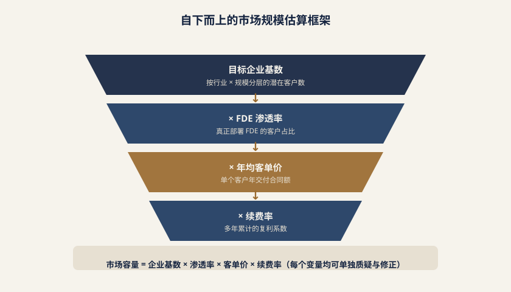
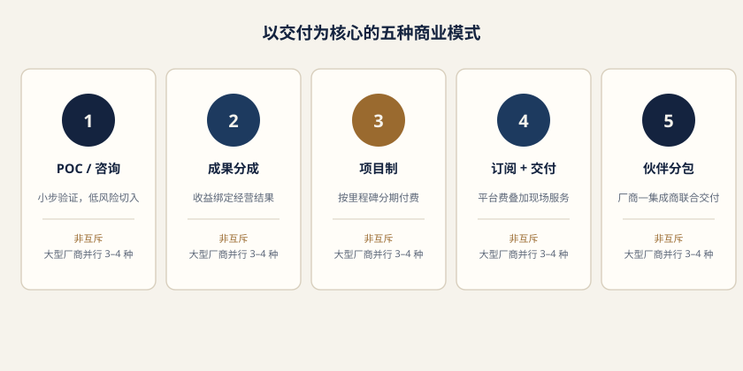
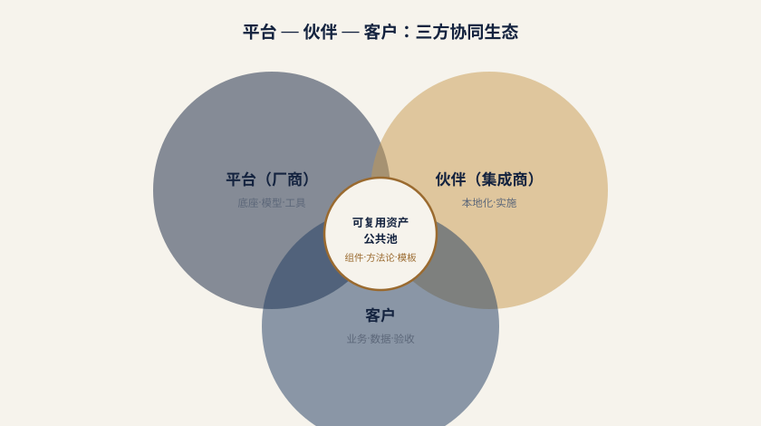

# 第四章 市场规模与商业化路径

前三章讨论了 FDE 这一角色为何出现、其能力模型如何构成,以及人才供给的现状。本章转向更为 CIO 与数字化负责人所关切的问题:这件事究竟有多大的市场?钱从哪里来、以什么方式流转?为什么同样一个 FDE 岗位,在硅谷可以支撑起六到七位数美元的年度合同,在中国却常常压缩到十万到百万人民币量级?以及最关键的——在人力密集、非标程度极高的交付业务里,规模化究竟有没有可能?

需要在开篇明确一个前提:本章所有关于市场规模的数字,都是**估算而非统计**。中国目前不存在任何官方或半官方机构对"FDE"这一职能进行专项统计,国家统计局的职业分类目录中没有对应条目,人社部发布的新职业清单里也尚未出现。这意味着任何声称"中国 FDE 市场规模达 XX 亿元"的说法,都必然建立在一系列可被质疑的假设之上。我们的做法是把假设摆到台面上,让读者自己判断哪一条不成立、以及不成立会导致结论偏移多少。一份不能被证伪的市场规模测算,对 CIO 的决策毫无价值。

## 4.1 市场规模：在没有官方统计的前提下如何估算

### 4.1.1 三类可参考的口径及其局限

在缺乏专项统计的情况下,我们能够依赖的只有三类间接口径,每一类都只能照亮问题的一个侧面。

**第一类是上游需求池口径**,即企业 AI 落地与智能体市场的整体规模。腾讯研究院等机构近年持续发布的企业 AI 应用与智能体落地研究,提供了一个基本判断:中国企业级 AI 已经从"试点验证"进入"规模部署"的转折窗口,大量企业不再纠结"要不要做",而是转向"做哪些场景、如何算账"。这类报告的价值在于给出需求侧的水位线——如果企业 AI 项目的总盘子在快速扩张,那么承接落地的 FDE 需求必然同步扩张。但其局限也很明显:这些报告统计的是**AI 支出总额**,其中包含算力、模型 API 调用、软件许可、数据治理等大量非交付性支出,FDE 相关的人力服务只是其中一个切片,且这个切片的占比在不同项目类型中差异极大。

**第二类是交付侧参照口径**,即中国企业服务行业的既有结构。崔牛会等企业服务社区历年发布的中国 SaaS/企业服务白皮书,长期跟踪国内软件厂商的收入构成、实施服务占比、客单价分布和交付人效。这类数据的参考意义在于:FDE 本质上是"企业服务实施顾问"这一职能在 AI 时代的演化形态,其定价逻辑、毛利结构、人力配比,大概率不会脱离既有企业服务行业的引力场。国内软件厂商的实施服务收入常年占总收入的三到五成,毛利率显著低于产品线,这一结构性特征几乎必然会复制到 FDE 业务上。局限在于,传统实施顾问与 FDE 的能力密度和单人价值创造能力并不等同,直接套用会低估 FDE 的单价上限。

**第三类是跨国厂商的公开财务与案例披露**。以 Palantir 为代表的公司,其 FDE 模式的经济性可以从财报中的客户数、单客户收入、毛利率变化中反推。这类数据的价值在于提供了一个"成熟态"的参照系——当 FDE 模式跑通并完成资产沉淀后,单客户收入与毛利能达到什么水平。局限在于,美国市场的支付能力与决策逻辑与中国存在系统性差异(这一点将在 4.3 节详细展开),直接对标会严重高估中国市场的短期天花板。

### 4.1.2 自下而上的估算框架

*图 4-1　自下而上的市场规模估算框架*

比起自上而下从大盘切分,我们更倾向于用自下而上的方式搭建估算模型,因为每个变量都可以被单独质疑和修正。基本公式是:

> **FDE 市场规模 ≈ 年新增企业 AI 交付项目数 × 单项目 FDE 人力投入(人月) × 单人月报价 × (1 − 资产复用带来的边际递减系数)**

逐项拆解:

**变量一:年新增企业 AI 交付项目数。**这里的"项目"指需要现场或准现场交付、有明确业务目标和验收标准的企业 AI 落地项目,不包括纯 API 调用、纯工具采购和内部自研。综合上游需求池的扩张速度、国内规模以上企业的数量基数,以及当前 AI 项目在这些企业中的渗透率,合理的估计区间是每年数千到数万个项目量级。这个区间之所以跨度大,是因为"项目"的口径本身高度弹性:一个集团型客户的 AI 中台建设可以算作一个项目,也可以拆成十几个子项目分别统计。

**变量二:单项目 FDE 人力投入。**这是差异最大的变量。基于对不同交付深度项目的观察,大致可以分为三档:轻量级的标准化场景复制(如客服问答、文档检索),FDE 投入通常在 2–6 人月;中等复杂度的业务流程嵌入(如供应链排产辅助、质检流程改造),投入在 10–40 人月;深度系统集成型项目(如涉及信创环境适配、多系统打通、权限体系重构),投入可达数百甚至上千人月。这一档次差异直接对应了后文将讨论的"2 万元到 2 亿元"的价差现象。

**变量三:单人月报价。**参照国内企业服务行业的实施顾问报价体系,结合 FDE 更高的能力密度要求,当前市场的报价带大致落在每人月 3 万到 8 万元人民币区间,顶级厂商派驻的资深 FDE 或涉及关键行业、关键系统的项目可以突破 10 万元/人月。需要注意,这是**对客报价**而非人力成本,其中包含厂商的管理成本与毛利。

**变量四:资产复用带来的边际递减。**这是最容易被忽略、却对长期规模判断最关键的一项。FDE 交付的一个本质特征是:同一行业、同一场景的第 N 个项目,其人力投入应当显著低于第一个项目——前提是厂商真的把前面的项目沉淀为了可复用组件。如果资产沉淀做得好,单项目人力投入可能逐年下降 20%–40%;如果做不好,每个项目都从零开始,那么这个系数为零。有意思的是,这一变量对市场规模的影响是**负向**的(单项目收入下降),但对厂商盈利能力的影响是**正向**的(毛利率提升)。这构成了 FDE 商业化中一个根本性的张力,后文 4.4 节会详细讨论。

### 4.1.3 量级区间与增速判断

把上述变量组合起来,并考虑到大量项目实际由客户内部团队或非专业服务商完成、并未形成市场化交易,我们给出的判断是:**中国 FDE 相关的市场化交付服务规模,当前处于百亿元人民币量级的早期阶段**。这个数字远小于企业 AI 支出的总盘子,因为绝大部分 AI 支出流向了算力、模型和软件许可,而非人力交付服务。

关于增速,我们的判断是:

| 阶段 | 时间窗口 | 特征 | 规模变化 |
| --- | --- | --- | --- |
| 高速增长期 | 2025–2027 | POC 向生产转化,客户预算从创新费用转入 IT 主预算,信创与行业大单出现 | 年复合增速有望达到较高双位数 |
| 结构分化期 | 2028 以后 | 资产复用成熟,单项目价格下行,头部厂商靠规模与平台化取胜,中小服务商挤压 | 总规模继续增长但增速放缓,毛利结构分化 |

需要特别提醒的是,**2025–2027 的高增长判断建立在两个可被推翻的假设上**:其一,企业对 AI 项目的预算科目从"创新试点"转为"常规 IT 投入",这决定了预算的稳定性和可持续性;其二,已交付项目能够产生可验证的业务价值,从而支撑续约与追加采购。如果第二个假设不成立——即大批 AI 项目在上线后无法证明 ROI——那么 2026 年前后可能出现一轮明显的预算收缩,增速判断需要整体下修。CIO 在阅读任何 FDE 市场预测时,都应当首先追问的是:这份预测假设的 ROI 验证率是多少?

## 4.2 商业模式：以交付为核心的五种形态

*图 4-2　以交付为核心的五种商业模式*

FDE 的商业化,本质上是在回答一个问题:**客户为什么、在什么时点、按什么依据付这笔钱**。中国市场目前已经演化出五种可辨识的商业模式,它们并非互斥,大型厂商往往同时运行其中的三到四种。

### 4.2.1 POC 阶段：极少付费的中国式起点

这是中国市场与美国市场最早显现分歧的地方。**国内客户普遍不愿为概念验证阶段付费**,这几乎已经成为行业默认规则。客户的逻辑是:"你先做出来给我看,能用我再买。"厂商则被迫承担 POC 的全部人力成本,而 POC 阶段恰恰是 FDE 投入最密集的时期——需要理解业务、摸清数据、打通接口,往往消耗数人月的资深人力。

这一规则的直接后果有三:

第一,**厂商的获客成本被显著推高**。一个 POC 消耗 3–5 人月资深 FDE,按市场报价折算是十几万到几十万元的隐性投入,而 POC 到正式合同的转化率在行业内普遍不高。这意味着厂商实际上是在用自有资金为客户的探索期买单。

第二,**厂商倾向于压缩 POC 的深度**。既然不付费,理性选择就是用最小成本做出"看起来能用"的演示,这直接导致了大量 Demo 惊艳、生产拉胯的现象——POC 阶段刻意回避了权限体系、数据质量、异常流程、并发压力这些真正困难的部分。这形成了一个恶性循环:客户因为 POC 不可信而更不愿付费,厂商因为不付费而更不愿做深 POC。

第三,**头部厂商开始尝试收取象征性的 POC 费用**,金额可能只有几万元,目的不在于覆盖成本,而在于筛选客户诚意、确立项目的正式性。这是一个值得关注的边际变化。

### 4.2.2 成果分成：从增量中分润

成果分成是中国市场上最具本土特色的模式。**用友等厂商已在部分项目中采用按业务成果分成的定价方式**,典型的锚定指标包括:钢铁行业的吨钢成本降低、制造业的人效提升、能耗下降幅度、库存周转天数改善等。基本结构是:厂商投入 FDE 完成交付,基础服务费收取较低甚至为零,主要收入来自项目上线后从客户实际获得的增量收益中按约定比例分润。

这一模式之所以在中国具备生命力,原因在于它精准命中了中国企业的决策心理:**当客户对 AI 的效果存疑时,把厂商的收入与客户的收益绑定,是最有效的信任建立机制**。对客户而言,这几乎是零风险的采购决策;对厂商而言,这是撬开保守客户预算的钥匙。

但成果分成的实施难度极高,核心难点集中在四个方面:

**基线确定问题。**吨钢成本降低 5%,是相对于哪个时点的基线?如果同期原材料价格下跌、产能利用率提升,这部分收益该如何归因?现实中,基线的谈判往往比技术方案的谈判更漫长。

**归因隔离问题。**客户在上线 AI 系统的同时,可能也在推进精益管理、设备更新、组织调整。AI 的贡献如何从这些并行变量中剥离?厂商通常要求设置对照组(如部分产线先行、部分产线保持原状),但客户出于管理统一性的考虑往往不愿配合。

**数据可见性问题。**分成依赖客户提供真实的经营数据,这涉及客户核心的成本与利润信息。客户是否愿意向供应商开放这些数据、开放到什么颗粒度,是一个组织信任问题而非技术问题。

**周期与现金流问题。**成果的显现通常需要 6–18 个月,而 FDE 的人力成本是当期发生的。这构成了对厂商现金流的直接压力,详见 4.5 节。

### 4.2.3 项目制：2 万元到 2 亿元的价差

项目制是当前占比最高的模式,也是价差最惊人的模式。中国市场上真实存在的极端案例包括:**一笔 2 万元"包圆"的纺织行业 AI 应用订单,和一笔规模达 2 亿元的信创领域 AI 集成大单**。四个数量级的差距,不是市场混乱,而是**交付深度**差异的直接映射。

| 维度 | 2 万元量级订单 | 2 亿元量级订单 |
| --- | --- | --- |
| 交付内容 | 标准化模板复制,场景单一 | 深度系统集成、信创适配、平台重构 |
| FDE 投入 | 1–2 人月,远程为主 | 数百至上千人月,长期驻场 |
| 系统对接 | 几乎不对接或仅对接单一系统 | 打通 ERP/MES/OA/数据中台/权限体系 |
| 合同周期 | 数周 | 12–36 个月,分期验收 |
| 定制程度 | 参数级配置 | 架构级定制 |
| 厂商角色 | 工具供应商 | 长期技术合作伙伴 |
| 毛利特征 | 单笔毛利薄,靠数量取胜 | 前期毛利低甚至为负,靠后期运维与扩容回收 |

这张表最重要的启示是:**"FDE 市场"实际上是两个几乎不相干的市场**。低端市场比拼的是标准化程度和复制速度,FDE 在其中更接近"高级实施工程师",能力要求相对可控;高端市场比拼的是行业理解深度、系统集成能力和组织穿透力,FDE 是真正意义上的"驻场技术合伙人"。厂商如果试图同时通吃两个市场,往往会陷入组织能力的撕裂——用高端团队做低端单子亏成本,用低端团队做高端单子交付失败。

对 CIO 的实践建议是:在评估供应商时,首先要判断对方的能力结构落在这张表的哪一列,而不是简单比较报价。一个习惯于 2 万元订单的团队,不可能通过加价交付 2000 万元的项目。

### 4.2.4 订阅 + 交付混合：平台保底与效果加成

这是目前被视为最具长期可持续性的模式,结构为:**平台订阅费提供收入保底 + 交付服务按效果或按人月加成**。平台订阅覆盖模型调用、Agent 框架、组件库、运维监控等基础能力,以年费形式收取,金额相对稳定且可预测;交付部分则根据项目复杂度单独计费,或引入部分效果对赌。

这一模式的优势在于同时缓解了两端的痛点:对厂商,订阅收入提供了可预测的现金流基础,避免完全依赖项目制的收入波动,同时订阅部分的高毛利可以对冲交付部分的低毛利;对客户,订阅费明确了长期使用成本,交付费与实际需求挂钩,避免了一次性大额支出的预算审批压力。

实施中的关键难点是**订阅与交付的边界划分**。客户会持续追问:"这个功能为什么不包含在订阅里,还要额外付交付费?"如果边界模糊,极易引发续约谈判中的争议。较为清晰的划分原则是:**平台通用能力归订阅,客户特定业务逻辑归交付**;凡是被三个以上客户使用的能力,应当下沉进平台并计入订阅。

### 4.2.5 伙伴分包：轻 FDE、重平台

第五种模式来自平台方对规模化困局的现实回应。核心逻辑是:**平台方不自建庞大的 FDE 团队,而是将区域性、行业性的交付工作外包给生态伙伴,自身聚焦于平台能力建设与资产沉淀**。这被概括为"轻 FDE、重平台"策略。

平台方在这一模式下的收入来源转为:平台许可费/订阅费 + 生态伙伴的分成抽成 + 少量标杆项目的自营交付。伙伴则获得区域市场的交付权和本地化服务收入。

这一模式的合理性在于:中国市场的地域分散度和行业碎片化程度极高,一家平台厂商不可能在全国建立覆盖所有区域和行业的驻场团队,人力成本和管理半径都不允许。而本地伙伴天然具备客户关系、地域响应速度和行业理解优势。

风险同样明确:**交付质量的不可控**。FDE 的价值高度依赖个人能力与经验,伙伴团队的能力参差直接决定了客户对平台的整体评价。一个伙伴的交付失败,损害的是平台方的品牌。因此,采用这一模式的平台方必须在三件事上重投入:伙伴认证与分级体系、标准化的交付方法论与工具链、以及关键项目的平台方专家介入机制。

### 4.2.6 商业模式矩阵总览

| 模式 | 收入确认时点 | 厂商现金流特征 | 客户风险 | 适用客户类型 | 规模化难度 |
| --- | --- | --- | --- | --- | --- |
| 成果分成 | 成果验证后,滞后 6–18 个月 | 前期重投入,回收周期长 | 极低 | 效果可量化的制造/能源类 | 高 |
| 项目制(轻) | 交付验收后,周期短 | 快进快出,回款较快 | 中(效果不确定) | 中小企业、标准场景 | 中(靠复制) |
| 项目制(重) | 分期里程碑验收 | 前期垫资,分期回款 | 高(周期长、变更多) | 大型央国企、金融、政务 | 极高 |
| 订阅 + 交付 | 订阅按年确认,交付按里程碑 | 相对健康,有稳定基座 | 中 | 有持续 AI 建设规划的中大型企业 | 中低 |
| 伙伴分包 | 平台费 + 分成抽成 | 轻资产,现金流稳定 | 中高(质量不可控) | 区域性、长尾市场 | 低 |

## 4.3 中美差异：付费能力的鸿沟

理解中国 FDE 市场的天花板,绕不开与美国市场的对照。这不是简单的"人家有钱我们没钱",而是一整套决策逻辑、价值尺度和预算结构的系统性差异。

### 4.3.1 核心对比

| 对比维度 | 美国(硅谷为代表) | 中国 |
| --- | --- | --- |
| 高价值客户构成 | 大型企业、政府机构、国防与情报部门、头部科技公司 | 大型央国企、金融机构、头部制造企业 |
| POC 是否付费 | 通常付费,POC 本身即为一个独立的收费项目 | 极少付费,厂商自行承担成本 |
| 核心价值锚点 | 效率杠杆、收入增长杠杆、决策速度 | 成本降低、人效提升(替代人力) |
| 决策发起方 | 业务部门负责人或 CEO/COO 层级 | IT 部门为主,业务一号位参与度低 |
| 预算科目 | 独立的创新预算或战略投入 | 多从既有 IT 预算中挤占 |
| 对不确定性的容忍度 | 较高,接受探索期投入 | 较低,要求明确可验证的产出 |
| 采购周期 | 相对短,决策链条集中 | 长,涉及多层审批与招投标 |
| 定价参照 | 参照价值创造(value-based) | 参照人力成本(cost-plus) |

单看第一行,同一类交付工作在两个市场的合同额差距可能达到一个数量级。这不能简单归因于人力成本差异——中国资深 FDE 的薪酬水平虽低于硅谷,但差距远没有合同额差距那么大。真正的差异在定价逻辑:**美国按"这件事为客户创造了多少价值"定价,中国按"你投入了多少人、多少个月"定价**。

### 4.3.2 三根源剖析

**根源一:美国头部企业 IT 预算充足,且愿意为"效率杠杆"付费。**

美国大型企业的 IT 预算占营收比例长期高于中国同行,更关键的是预算的**性质**不同。相当一部分预算被划为"战略性技术投入",其考核标准不是当期 ROI,而是长期竞争力。在这一框架下,一个能让分析师团队从两周出报告缩短到两天的系统,其价值锚定在"决策速度提升带来的市场机会",而不是"节省了几个分析师的工资"。这种价值锚点天然支撑高定价——因为收入侧的杠杆没有上限,而成本侧的节省有明确的天花板。

Palantir 的商业模式是这一逻辑的极致体现:其 FDE 团队深入客户的核心业务流程,交付的不是软件而是"能力",定价参照的是客户因此获得的战略优势。这种定价在中国市场几乎无法复制,不是因为中国客户不理解价值,而是因为决策链条中缺少能为"战略优势"这类模糊收益签字的人。

**根源二:中国企业整体处于"降本增效"的生存逻辑之下,更看重可量化的成本节省。**

过去几年,中国企业面临的宏观环境使"降本增效"从一句口号变成了实际的经营纪律。在这一背景下,任何一笔支出都必须回答"省下了多少钱"。AI 项目也不例外——最容易通过审批的方案,是"这套系统上线后可以减少 X 个岗位"或"每年节省 Y 万元运营成本"。

这一逻辑的隐蔽后果是:**它天然给 AI 项目的定价设置了上限**。如果一个项目每年为客户节省 500 万元成本,客户能接受的付费上限通常不会超过节省额的 20%–30%,即 100–150 万元。而在"效率杠杆"或"收入增长"的价值框架下,不存在这样的硬性上限,因为收入的增长空间是开放的。

更棘手的是,成本节省型的价值主张有**递减效应**:第一年砍掉的成本,第二年就成了新的基线,续约时客户会问"今年还能再省多少?"——而低垂的果实已经摘完。这直接影响了 FDE 业务的客户生命周期价值。

**根源三:国内 AI 采购多由 IT 部门而非业务一号位决策,导致价值尺度系统性偏保守。**

这可能是三个根源中影响最深、也最容易被忽略的一条。在中国大量企业中,AI 项目的立项、选型和采购由信息化部门或数字化部门主导,业务部门是"需求提出方"和"配合方",而非"预算持有方"和"结果负责人"。

这一决策结构带来三重后果:

其一,**IT 部门的 KPI 是系统稳定与预算控制,而非业务增长**。因此其决策倾向必然是"用最低的成本把系统建起来",而不是"用最合适的投入把业务价值最大化"。价格成为核心比较维度,交付深度反而被弱化。

其二,**IT 部门缺乏对业务价值的定价权**。即使 IT 负责人认可某个 AI 方案能带来显著业务价值,他也很难在预算申报中把这个价值折算成对应的预算额度——因为业务价值的兑现不在他的考核范围内。

其三,**FDE 在客户侧缺乏对等的对话对象**。FDE 的核心工作是把 AI 能力与业务流程、权限体系、组织结构对接,这需要业务一号位的授权与推动。当项目由 IT 部门主导时,FDE 面对的是一个无法承诺流程变更、无法调动业务资源的对接人,交付深度天然受限,而受限的交付深度又反过来强化了"AI 项目价值有限"的判断。

**这三根源之间存在强化循环**:预算紧张 → 由 IT 主导采购 → 价值锚点锁定在成本节省 → 项目定价受限 → 厂商压缩交付投入 → 业务价值不显著 → 下一年预算更紧张。打破这个循环的唯一切口,是让业务一号位进入决策链条,并把价值锚点从"省下多少"转向"多做成什么"。这一点将在 4.4 节的客户角色部分展开。

### 4.3.3 差异是否会收敛

一个自然的问题是:随着中国企业 AI 应用的成熟,这一鸿沟会不会收窄?我们的判断是**部分收窄,但不会消失**。

会收窄的部分:随着标杆案例积累和 ROI 验证方法的成熟,业务部门对 AI 价值的理解会加深,决策权会部分从 IT 向业务转移,POC 付费也可能在头部客户中逐步成为惯例。已经有厂商反馈,金融和能源行业的部分领先客户开始接受为深度诊断阶段付费。

不会消失的部分:中美企业在 IT 支出占营收比例、对不确定性的风险偏好、采购流程的合规约束等方面的结构性差异,根植于更深层的商业环境和治理结构,不会因为技术成熟而改变。中国 FDE 市场更现实的路径,不是复制美国的高单价模式,而是**通过资产复用把交付成本压下来,在较低的单价水平上实现健康的毛利**。

## 4.4 规模化路径：平台—伙伴—客户三方协同

*图 4-3　平台—伙伴—客户：三方协同生态*

FDE 业务最根本的商业难题是:**它无法靠"堆人"实现规模化**。这句话需要展开说明——不是说堆人不能扩大收入规模,而是说堆人只能带来**线性增长**,且伴随三个必然出现的问题:优秀 FDE 的供给远慢于需求增长(这一点第三章已详述)、管理半径扩大导致交付质量方差增大、人力成本的刚性上涨侵蚀本已微薄的毛利。一家 100 人的 FDE 团队做 100 个项目,和一家 1000 人的团队做 1000 个项目,除了收入规模,其单位经济模型几乎没有改善。

真正的规模化必须来自**单位交付成本的下降**,而这只能通过三方协同实现。

### 4.4.1 平台方：提供可复用的能力底座

平台方在这一体系中的职责,是把每一次交付中产生的通用部分抽取出来,固化为可被下一个项目直接调用的资产。具体包括四类:

**可复用组件库。**数据连接器(对接主流 ERP/MES/CRM 的标准适配器)、权限映射模板(将客户既有的组织与权限体系映射到 AI 系统的标准方案)、常见业务场景的流程模板。这类资产的价值在于把 FDE 从重复的"接线工作"中解放出来。

**Agent 框架与编排能力。**提供标准化的 Agent 定义、工具调用、多轮编排、异常处理与人工介入机制。没有框架时,每个项目的 Agent 逻辑都是手写的定制代码;有框架后,FDE 的工作从"写代码"变为"配置与调优"。

**行业知识资产。**特定行业的术语体系、业务规则库、典型场景的最佳实践、常见失败模式的规避清单。这类资产最难沉淀,因为它高度依赖 FDE 主动的知识外化,而 FDE 在项目压力下往往没有动力做这件事。这需要制度性的安排——把知识沉淀纳入 FDE 的考核,而非依赖自觉。

**交付方法论与工具链。**标准化的需求诊断问卷、价值评估框架、里程碑定义、验收标准模板、部署与运维工具。方法论的价值在于降低对 FDE 个人能力的依赖,使中等水平的 FDE 也能交付出可接受的结果。

### 4.4.2 伙伴方：承接区域与行业的本地化部署

伙伴的价值在于覆盖平台方无法触达的区域与长尾行业。一个健康的伙伴体系需要满足三个条件:

**能力分级与认证。**按照伙伴团队的技术能力和行业经验分级,不同级别对应可承接的项目复杂度上限。这是防止交付事故的第一道防线。

**利益分配的合理性。**如果平台方抽成过高,伙伴没有动力投入优秀人员;如果抽成过低,平台方无法覆盖赋能成本。行业中较为可行的结构是:平台许可费由客户直接支付给平台方,交付服务费归伙伴,平台方在交付费中抽取较低比例的管理费。

**知识回流机制。**伙伴在一线积累的行业经验和场景理解,应当有渠道反馈到平台侧并沉淀为公共资产。这一点在实践中往往缺失——伙伴把行业 Know-how 视为自身的竞争壁垒,不愿共享。破解方式是把知识贡献与伙伴分级、项目分配优先级挂钩。

### 4.4.3 客户方：开放场景与数据,参与成果定义

客户在规模化体系中不是被动的采购方,而是必要的协同方。三项关键投入:

**场景开放。**客户需要明确指定 AI 要解决的业务问题,并授权 FDE 深入了解相关流程。模糊的"你们看看能做什么"是交付失败的最主要起因之一。

**数据开放。**FDE 的工作高度依赖对真实数据的访问。客户出于安全考虑限制数据访问是合理的,但需要提供可行的替代方案(脱敏环境、驻场访问、内网部署),而非简单拒绝。

**参与成果定义。**这是最关键也最常被忽略的一项。项目的成功标准必须由客户业务方在启动前明确定义并书面确认,包括:衡量指标、基线数据、验证方法、验收时点。缺少这一步,项目结束时必然陷入"到底算不算成功"的扯皮,而这种扯皮的代价最终由双方共同承担。

### 4.4.4 核心命题：把每个项目沉淀为可复用资产

三方协同的落脚点,是一个可以用一句话概括的核心命题:**破解 FDE 规模化难题的关键,是把每一个项目都沉淀为可复用资产**。

这句话听起来像正确的废话,但它的实际含义相当具体:它要求厂商在项目结束时,除了交付客户可用的系统,还必须产出一份"资产清单"——本项目中哪些组件可以被抽象为通用能力、哪些行业规则可以进入知识库、哪些踩过的坑应当写入方法论。这项工作需要额外的时间投入,通常占项目总工时的 5%–15%,在项目紧张时是第一个被砍掉的环节。

因此,资产沉淀本质上是一个**组织意志问题而非技术问题**。判断一家厂商是否真正在走规模化路径,可以看三个指标:

| 指标 | 健康信号 | 危险信号 |
| --- | --- | --- |
| 新项目中复用代码/组件占比 | 逐年提升,成熟行业可达 50% 以上 | 长期低于 20% |
| 交付毛利率变化 | 随项目数量增加而提升 | 随规模扩大而恶化 |

如果一家厂商的项目数量翻倍而毛利率不变甚至下降,那么它做的不是 FDE 业务,而是人力外包业务——两者在财务报表上的差异,最终会体现在估值上。

## 4.5 风险与可持续性

任何商业模式的评估都不能只看上行空间。FDE 商业化面临的风险相当具体,且多数与前述模式本身的结构性特征绑定。

### 4.5.1 成果分成对厂商现金流的压力

这是最直接的财务风险。成果分成模式下,厂商在项目期内持续投入 FDE 人力成本——这是当期发生的现金支出,而收入要等到成果验证之后,滞后 6–18 个月甚至更久。对于同时运行多个成果分成项目的厂商,这意味着现金流缺口会随业务扩张而**同步放大**:签的单越多,现金压力越大。

这构成了一个反直觉的经营陷阱:业务增长本身成为财务风险的来源。缓解手段包括:设置基础服务费覆盖至少部分人力成本、约定阶段性的里程碑付款而非一次性结算、以及严格限制成果分成项目在总盘子中的占比。一个经验性的建议是,成果分成类项目的收入占比不宜超过总收入的三分之一,否则厂商的财务健康度将高度依赖于少数几个项目的成果兑现。

### 4.5.2 客户关系的深度绑定：双刃剑

FDE 长期驻场带来的深度客户关系,通常被视为优势——它构成了极高的替换成本和续约保障。但这一优势的另一面同样明确:

**收入集中度风险。**少数大客户贡献了绝大部分收入,单一客户的流失或预算削减会造成收入的断崖式下跌。这在依赖大型央国企客户的厂商中尤为突出。

**议价权的隐性转移。**当厂商对某个大客户的收入依赖度超过某个阈值,议价权实际上已经转移到客户手中。客户会逐步压低续约价格、扩大服务范围而不增加预算,厂商因为无法承受失去该客户而被迫接受。

**人员绑定风险。**长期驻场的 FDE 与客户建立的是个人关系而非组织关系。这类人员的离职不仅带走能力,还可能带走客户;更常见的情况是,客户直接把优秀 FDE 挖到自己团队——从客户角度这是完全理性的决策,从厂商角度这是能力与关系的双重流失。

**范围蔓延。**深度关系意味着客户会不断提出合同外的额外需求,而 FDE 出于维护关系的考虑往往难以拒绝。这些"顺手做一下"的工作累积起来,会显著侵蚀项目毛利。

### 4.5.3 资产复用的边际递减

4.4 节强调了资产复用是规模化的关键,但资产复用本身也存在边界:

**跨行业复用率极低。**制造业沉淀的资产对金融业几乎无用,反之亦然。这意味着厂商每进入一个新行业,都要重新经历一遍从零沉淀的过程。因此,行业聚焦而非广泛撒网,是 FDE 厂商更理性的战略选择。

**客户异质性的天花板。**即使在同一行业,不同客户的系统架构、数据质量、组织流程差异巨大。经验表明,同行业内可复用的部分通常能达到交付工作量的 40%–60%,剩余部分必然是定制。这个天花板决定了 FDE 业务的毛利率上限——它永远不可能达到纯软件业务的水平。

**资产维护成本被低估。**组件库和知识资产需要持续维护:底层模型迭代、客户系统升级、行业规则变化,都会导致既有资产失效。维护成本会随资产规模增长而累积,如果没有相应的投入,资产库会逐渐腐化为无人敢用的历史遗迹。

**复用与创新的张力。**过度依赖既有资产会导致方案僵化——FDE 倾向于把客户的需求"塞进"现有组件能覆盖的范围,而非真正解决客户的问题。这在短期提升毛利,长期损害客户价值和口碑。

### 4.5.4 其他值得警惕的风险

**价格战风险。**随着标准化程度提升和参与者增多,低端市场的价格竞争几乎不可避免。前述 2 万元量级的订单已经是这一趋势的信号。厂商如果没有在中高端建立差异化壁垒,将被迫在毛利极薄的市场中厮杀。

**技术底座变化的冲击。**基础模型能力的快速提升,可能使当前需要 FDE 大量投入的工作在未来变得简单甚至自动化。这对厂商既是机会(交付成本下降)也是威胁(交付价值下降,客户支付意愿降低)。厂商的护城河必须建立在**行业理解与组织穿透能力**上,而非建立在填补模型能力缺口的技巧上——后者会随模型进步而贬值。

**人才成本的刚性。**优秀 FDE 的稀缺性决定了其薪酬会持续上涨,而客户支付意愿受制于前述价值锚点难以同步上涨。这个剪刀差是 FDE 业务长期毛利承压的根本来源,也是必须通过资产复用来对冲的核心原因。

## 4.7 国际对标：头部模型公司正在把"部署能力"组织化

本章前述 4.1 至 4.5 已从市场规模、商业模式、中美差异与规模化路径等维度刻画了 FDE 角色在中国的商业化轮廓。本节将视角切换到国际，观察三家具有代表性的头部厂商在 2025—2026 年间围绕"把模型部署进客户现场"所做出的组织化动作。需要特别说明的是：以下均为国际厂商的公开口径，反映的是全球领先企业的战略选择，不能直接推衍为中国行业的平均水平；但它们清晰释放了一个趋势信号——当通用模型能力不再是稀缺资源后，真正的竞争壁垒正在向"现场部署与交付能力"迁移。

### 4.7.1 三家厂商的动作与含义

**OpenAI：以独立实体承载部署业务。**公开信息显示，OpenAI 于 2026 年成立专门的 OpenAI Deployment Company（部署公司），并配置了超 40 亿美元的初始投资、19 家覆盖投资、咨询与系统集成领域的全球伙伴，以及约 150 名 FDE 与部署专家在成立首日即加入。其含义值得玩味：当一家以模型研究著称的公司愿意成立独立实体、投入巨额资本并配齐现场专家，本质上是在告诉市场——客户最终愿意付费的，往往不是"更好的模型"，而是"把模型真正部署进业务现场"的确定性能力。

**Anthropic：用伙伴网络放大交付杠杆。**几乎同一时期，Anthropic 于 2026 年宣布推出 Claude Partner Network（伙伴网络），给出 1 亿美元的初始投入，并将面向伙伴的团队规模扩大 5 倍。其逻辑与 OpenAI 的"自建重资产"形成对照：Anthropic 选择不直接雇用庞大的现场团队，而是通过伙伴体系把交付能力外包给生态，以更轻的方式放大触达半径。

**Salesforce：产品与现场工程深度绑定的提速效应。**Salesforce Engineering 在 2025 年披露的 Agentforce 案例中，其 FDE 团队服务了 150 余家企业的部署落地，部分项目的部署周期从原本的 6 个月压缩到 3 周。这一数字直观地说明：当产品公司把现场工程团队与产品迭代高度绑定、而非作为售后支持游离在外时，企业级 Agent 的落地速度可以获得数量级的提升。

表 4-7 汇总了三例的核心参数与可解读的方向。

| 厂商 | 时间 | 关键动作 | 投入/规模 | 信号含义 |
| --- | --- | --- | --- | --- |
| Anthropic | 2026 | 推出 Claude Partner Network | 初始投入 1 亿美元；partner-facing 团队扩 5 倍 | 以伙伴生态放大交付杠杆，轻量扩张 |
| Salesforce | 2025 | Agentforce 现场工程实践 | FDE 团队服务 150+ 企业；部分周期 6 个月 → 3 周 | 产品与现场工程紧绑定，显著提速落地 |

*数据来源：OpenAI、Anthropic、Salesforce 官方公告（可信等级 B）。*

### 4.7.2 共同趋势：产业链角色正在重新绑定

把三例并置观察，可以得出一个共性判断：**Agent 进入企业生产环境之后，模型公司、咨询公司、系统集成商与现场工程团队之间的边界正在模糊、关系正在收紧。**过去这几类角色是相对松散的接力——模型公司交付 API，咨询公司做方案，集成商做实施。而上述动作表明，领先玩家倾向于把"最后一公里"的控制权收归自己或紧密伙伴：要么自建现场团队（OpenAI），要么把伙伴纳入准一体化网络（Anthropic），要么让产品与现场工程同呼吸（Salesforce）。其底层动机一致——通用模型的同质化会抬高"谁能真正落地"的议价权。

### 4.7.3 "可借鉴" 与 "不宜误读" 的分界线

趋势值得关注，但照搬则容易失真。对国内 CIO 与 AI 厂商管理者而言，需要把"可借鉴之处"与"不宜误读之处"厘清。表 4-8 给出对照。

| 可借鉴之处 | 不宜误读之处 |
| --- | --- |
| 伙伴网络是放大交付半径的有效杠杆，尤其在能力尚不密集时 | 不代表简单"外包出去"就能解决生产化——现场工程需要懂业务、权限与系统的复合能力，外包不等于免责 |
| 产品与现场工程紧绑定能显著缩短落地周期，值得在组织上打通 | 不代表所有场景都追求"3 周极速"——高合规、强耦合场景仍需要充分周期，速度不能以牺牲稳健为代价 |
| 头部厂商已用真金白银下注"现场"，印证 FDE 角色的长期性 | 不代表中国行业平均水平已至此——国际动作用是领先样本，国内应按自身数字化成熟度分步演进 |

### 4.7.4 小结

4.7 节通过三家头部厂商的公开动作指出：国际层面的共识正在形成——Agent 落地的胜负手，正从"模型谁更强"转向"谁能把模型部署进真实业务"。这一信号对国内具有方向性参考价值，但其组织形态（自建重资产或重金建网）并不构成普适模板。对中国企业而言，更务实的路径是结合自身规模、合规要求与数字化基础，在"自建、伙伴、外包"之间做组合式选择，把 FDE 视为贯穿产品—交付—运营的长期能力，而非一次性项目投入。

## 4.8 国内厂商视角：腾讯、字节、阿里等如何组织"部署能力"

4.7 节观察的是国际样本。把镜头切回国内，一个同样清晰、却路径不同的趋势正在发生：以腾讯、字节、阿里为代表的头部科技厂商，也在把"把模型部署进客户现场"的能力组织化，但它们采取的是与中国市场结构更适配的形态——**以云/平台为底座，把部署能力嵌在既有 ToB 产品线中，再通过庞大的伙伴与集成商生态下沉到客户现场**。理解这一点，对国内 CIO 评估厂商、对 AI 厂商规划交付体系都至关重要。

### 4.8.1 三家厂商的部署能力布局

**腾讯：连接型部署，把 AI 嵌入行业解决方案与既有入口。**腾讯的 ToB 主线由腾讯云智能与腾讯企点承载，其行业方案（金融、文旅、政务、工业等）普遍以"大模型能力 + 行业 Know-how + 现场集成"的方式交付；腾讯会议 AI、腾讯文档 AI、元宝等产品则在企业侧落地时，需要把 AI 接入客户既有的流程、权限与协同习惯。腾讯研究院也持续产出企业 AI 落地与智能体相关的研究，为行业提供方法论参照。其生态位可概括为"连接"——依托微信、企业微信、腾讯会议等高频入口，把 AI 能力顺着企业的沟通与业务流程自然渗透，FDE 在其中承担的是"把通用能力接进客户真实连接场景"的缝合角色。

**字节：增长型与协同型部署，靠近业务增长与组织协同。**字节的企业级 AI 主要由火山引擎（提供豆包大模型的企业落地与机器学习平台）承担底座角色；Coze（扣子）降低了企业自建智能体的门槛；飞书智能伙伴把 AI 嵌入协同办公，推动企业知识与流程的 AI 化；巨量引擎与抖音生活服务则把 AI 应用在营销与本地生活的增长侧。其生态位偏向"增长 + 协同"——FDE 在字节体系里更容易出现在"用 AI 直接撬动营收/效率"的场景，需要既懂营销与运营、又懂系统对接的复合交付者。

**阿里：底座型与行业纵深部署，云 + 电商/制造沉淀。**阿里云百炼（Model Studio）与通义系列承担模型服务平台角色，PAI 提供机器学习工程底座；钉钉 AI 助理把 AI 推向千万级企业与组织，依赖生态伙伴完成行业化部署；在电商、零售、制造等领域，阿里拥有深厚的行业方案沉淀。其生态位可概括为"底座 + 行业纵深"——FDE 在阿里体系里既可能服务于云上的工程化交付，也可能下沉到制造、零售等强行业场景做流程改造。

| 厂商 | 代表产品/载体 | 生态位 | 对 FDE 的启示 |
| --- | --- | --- | --- |
| 腾讯 | 腾讯云智能、腾讯企点、腾讯会议/文档 AI、元宝 | 连接型部署（高频入口 + 行业方案） | FDE 重在把 AI 接进客户的连接与协同场景，懂权限与流程 |
| 字节 | 火山引擎、Coze、飞书智能伙伴、巨量/抖音生活服务 | 增长型 + 协同型部署 | FDE 多出现在增长/运营场景，需懂营销、运营与系统对接 |
| 阿里 | 阿里云百炼、通义、PAI、钉钉 AI 助理 | 底座型 + 行业纵深部署 | FDE 兼顾云上工程化与制造/零售等强行业流程改造 |
| *数据来源：基于各厂商公开产品与公告整理（可信等级 B），非官方统计，供趋势参照。* |   |   |   |

### 4.8.2 国内路径与国际路径的分野

把 4.8.1 与 4.7 并置，可以看清一条分野：**国际头部厂商倾向于把"部署能力"独立成实体或重金建网（OpenAI 的 Deployment Company、Anthropic 的 Partner Network），而国内厂商更倾向把部署能力"内化"进既有 ToB 产品线与生态网络。**这并非能力强弱之分，而是市场结构使然——国内企业数字化水平差异大、行业监管各异、决策链更长，单一厂商难以靠自建重资产覆盖，必须借力云底座与伙伴生态做本地化交付。

由此带来的一个关键差异是：**国内的 FDE 更多在"厂商—伙伴—客户"的三方协同网络中工作，而非作为单一厂商的自有重资产团队。**这也意味着，对国内 CIO 而言，评估一家 AI 厂商不能只看模型指标，更要看三件事——其伙伴生态的交付厚度、行业资产的沉淀程度、以及在客户现场"兜底"的真实能力。

### 4.8.3 对 FDE 角色与厂商的启示

**对厂商：**部署能力不是"售后支持"，而应被纳入产品与商业设计的核心。国内可行的做法是把每个项目沉淀为可复用组件与行业模板，通过平台 + 伙伴体系放大交付半径，而非堆人做一次性项目。

**对客户（CIO/数字化负责人）：**在"云底座 + 伙伴生态"的国内结构下，选厂商时要把"谁能在你的现场兜住结果"作为硬指标；同时，企业自身也应开始培养面向现场的 FDE 能力，避免把所有交付责任外推给厂商与伙伴。

小结：国内厂商正在用一条与国际不同的路径，做着同一件事——把"模型能力"转化为"客户现场可兑现的价值"。这条路径的胜负手，同样落在 FDE 这类角色身上。

## 4.9 甲方视角：三类 FDE 交付服务商，我该选谁

前文（4.4）从产业链分工回答了"FDE 业务如何规模化"，本节换一个视角：**作为甲方，你面前的 FDE 能力通常由三类服务商提供，它们的定位、强项与适用场景各不相同**。选错类型，往往比选错具体供应商损失更大——因为类型决定了合同结构、责任边界与后续的可扩展空间。

**第一类：AI 厂商自有部署团队。**只要你采购的是某家头部厂商的大模型或平台，其自带或官方认证的交付团队就在这一类。优势是离模型最近、对自家产品能力边界最清楚、能拿到官方版本更新与底层支持；劣势是强绑定单一厂商、跨厂商/跨系统集成能力有限，且头部厂商的交付资源更多倾斜给大客户，中小客户的排期与响应容易靠后。**适用场景**：以单一大模型平台为核心、且倾向"原厂质保"的企业。

**第二类：独立第三方 FDE 服务商。**即专职做 AI 现场交付、不绑定某家模型的独立厂商。优势是中立、可跨平台编排多模型与既有系统，行业资产与交付方法论往往更厚，定价也更透明；劣势是单家规模有限，需甄别其是"真 FDE 能力"还是"人力外包"（见 8.11 的量化评分卡）。**适用场景**：异构系统多、需要多模型/多技术栈、或希望把交付责任独立外包的企业。

**第三类：系统集成商（SI）的实施部门。**传统软硬件集成商把 AI 部署作为既有实施业务的新增板块。优势是具备成熟的驻场、运维与本地化交付网络，对客户既有 IT 环境熟悉；劣势是 AI 专项能力往往偏薄、方法论偏"集成思维"而非"业务价值思维"，容易出现"上线了但没人用"。**适用场景**：已有长期 SI 合作关系、且 AI 是既有系统改造的延伸而非全新引入的企业。

三类并非互斥——大型企业常采用"厂商原厂保底能力 + 第三方补跨系统短板 + SI 保驻场运维"的混合结构。判断的核心标准只有一个：**交付方是否承担了从现场诊断到生产上线、再到结果负责的完整责任链**（对照 3.6 的岗位族识别逻辑）。只"接线不担责"的，无论挂着哪类牌子，都不是你要的 FDE 能力。

## 4.10 本章小结

对 CIO 与数字化负责人而言,本章的核心结论可以归纳为六点:

**第一,不要相信任何没有列出假设的 FDE 市场规模数字。**中国没有官方统计,所有数字都是估算。判断一份估算是否可信,看它是否明确说明了项目数、人力投入、单价和复用系数这四个变量的取值依据。当前市场处于百亿元人民币量级的早期阶段,2025–2027 有望高速增长,但这一判断建立在"AI 项目 ROI 得到普遍验证"这一可被推翻的假设上。

**第二,商业模式的选择反映的是信任水平而非定价技巧。**POC 不付费、成果分成盛行,本质上都是客户对 AI 效果缺乏信心的表现。随着可验证案例积累,商业模式会自然向订阅 + 交付的混合形态收敛。

**第三,2 万元与 2 亿元的价差不是市场混乱,而是两个不同市场。**采购时应首先判断自身需求落在哪一档,再评估供应商的能力结构是否匹配。跨档采购是项目失败的高发原因。

**第四,中美付费能力的鸿沟根植于决策结构而非技术水平。**如果希望从 AI 投入中获得超越"成本节省"的价值,前提是让业务一号位进入决策链条,并在项目启动前完成成果定义。这是客户侧可以主动改变的变量。

**第五,判断一家 FDE 厂商是否可持续,看它的毛利率是否随项目数量增长而提升。**如果不能,它做的是人力外包生意,其能力不会随合作时间累积,长期合作的价值有限。

**第六,国内厂商正以"云底座 + 伙伴生态"的路径组织部署能力。**腾讯、字节、阿里等头部厂商把 AI 交付嵌进既有 ToB 产品线与生态网络,而非自建独立部署实体。对 CIO 而言,评估厂商要看其伙伴生态的交付厚度与行业资产沉淀,而非仅看模型指标;企业自身也应开始培养面向现场的 FDE 能力,避免把交付责任完全外推。

FDE 的商业化在中国仍处早期,规则尚未固化。这既意味着风险,也意味着作为客户方的企业,有机会通过自身的采购方式与协同姿态,参与塑造这个行业的定价逻辑与交付标准。
