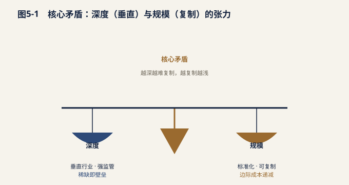
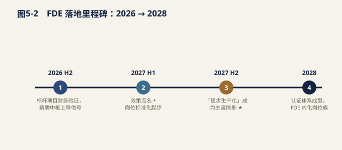
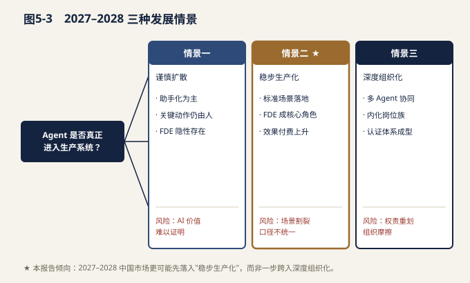

# 第五章 挑战、趋势与展望

FDE 作为连接通用 AI 能力与企业真实业务系统的关键角色，其价值已在多个行业的生产级交付中得到验证。然而，作为一种尚处于早期制度化阶段的新兴岗位，FDE 在规模化扩张、组织嵌入与机制设计上仍面临深层张力。本章系统梳理 FDE 面临的核心矛盾、身份与采购机制挑战，研判未来五到十年的能力演化方向，并梳理政策层面的最新动向，为 CIO 与数字化负责人提供决策参考。

> **数据来源类型说明**：本章关于政策文件的分析基于北京、武汉等地公开发布的智能体/人工智能专项政策文本；关于行业趋势的判断综合了行业趋势报道、头部厂商实践披露与跨国对比研究（以美国"AI 原生软件公司"的现场工程化交付模式为参照）。

## 5.1 核心矛盾：深度与规模如何平衡

FDE 的本质是高定制化、强现场性的交付角色。它要解决的是"最后一公里"问题——把通用模型与算法适配进客户专属的数据环境、业务流程、权限体系与组织惯性之中。这种工作天然带有"非标"属性：每一个客户的数据底座、系统架构、审批链条都不同，FDE 必须深入现场、理解语境、反复试错。

但这恰恰与"规模化复制"构成结构性矛盾（见表 5-1）。

| 路径 | 做法 | 优势 | 风险 |
| --- | --- | --- | --- |
| 过度标准化 | 以通用产品/模板统一交付 | 可快速扩张、边际成本低 | 丢失客户特异性价值、沦为普通实施岗 |
| 资产沉淀（破局点） | 在定制中抽象组件/方法论/行业模板 | 兼顾深度与复用、形成护城河 | 前期投入大、对组织知识管理能力要求高 |
|   |   |   |   |

**表 5-1 深度与规模的三条路径对比**

破局点在于"资产沉淀"。成熟的 FDE 团队不会把每一次驻场都当作从零开始的孤立项目，而是在交付过程中有意识地抽取三类可复用资产：其一是**技术组件**（如数据连接器、权限适配层、模型监控模块），其二是**方法论**（如业务场景拆解框架、AI 价值度量模型、上线灰度流程），其三是**行业模板**（如钢铁排产、银行反欺诈、零售会员运营的预置方案骨架）。当定制化的经验被持续转化为标准化资产，FDE 既能保持对客户深度的理解，又能让后续项目以"资产+微调"的方式降低边际成本。这也是 FDE 从"昂贵的人力服务"走向"可杠杆化的交付体系"的关键。

即便 FDE 的价值已被认知，企业在落地时仍普遍遭遇三类机制性障碍。

### （a）岗位身份模糊

在许多企业中，FDE 尚无标准的职级序列与岗位定义。它既不同于传统实施工程师（偏配置与部署），也不同于算法工程师（偏模型研发），更不同于售前顾问（偏方案宣讲）。身份的模糊直接导致两个后果：在招聘端，HR 缺乏清晰的画像与薪酬带宽，难以精准寻访与核算；在组织端，FDE 常被临时挂靠在"解决方案""交付""研发"等不同部门之下，权责与成长通道不清，影响人才留存。

### （b）采购机制错配

传统企业 IT 采购长期沿用"人天计价"或"功能点计价"逻辑——为投入的人力工时或交付的功能模块付费。但 FDE 创造的核心价值往往是"业务结果"（如成本下降、命中率提升、人效改善），更适配"按成果分成"或"价值共享"的计价模式。

这种错配在实践中极具代表性。例如某钢铁客户项目中，FDE 进驻数月后，通过把排产模型接入 MES 与能源管理系统，使吨钢能耗显著下降。双方本可约定"从省下的吨钢成本中分一成"作为 FDE 团队的回报机制——这种成果分成既绑定了厂商与客户的利益，也让 AI 价值可被量化兑现。然而，该方案在立项阶段却被传统的"人天报价单"卡住：采购部门要求按驻场人天数报价，而非按价值分成，导致创新计价模式无法进入审批流程，最终项目以保守方式落地，价值释放与厂商激励都打了折扣。

这揭示了一个深层问题：**计价逻辑的滞后，正在成为 AI 从 Demo 走向生产交付的制度性瓶颈**。当 AI 的价值越来越多体现在"结果"而非"工时"时，企业的采购、法务与财务体系需要同步迭代。

### （c）跨边界权责

FDE 驻场于客户环境，往往要接触核心业务数据与系统权限。在数据权限、合规责任、安全边界上，FDE 与客户的权责划分必须清晰。例如：模型训练所用的数据是否可出域？驻场工程师的账号权限边界在哪里？因 AI 决策引发的合规风险由谁承担？这些问题若不在项目启动前以合同与流程的形式明确，极易在交付过程中引发摩擦，甚至造成安全与合规事故。

## 5.3 未来趋势

综合行业趋势报道与跨国对比研究，我们判断 FDE 角色将在以下四个方向上加速演化。

**趋势一：工程执行变便宜，判断能力更稀缺。**随着 AI 自动生成代码、自动搭建系统的能力成熟，纯执行层的工程价值被持续压缩。过去需要资深工程师数周完成的系统集成、接口开发、脚本编写，正越来越多地由 AI 辅助甚至自主完成。其结果是：能够**定义场景、判断价值、指挥 AI**的人变得空前稀缺。FDE 的核心竞争力，正从"我能写多少代码"转向"我能否判断哪件事值得做、能否指挥 AI 把事做成"。

**趋势二：未来属于更懂业务、更懂组织、更懂指挥 AI 的人。**价值重心从"写"转向"判断与编排"（orchestration）。当执行可被外包给 AI，人的独特价值体现在对业务语义的理解、对组织政治与变革阻力的把握，以及对多智能体协作的编排能力。一个优秀的未来 FDE，可能用更多时间在会议室里对齐业务目标、在白板上拆解流程，而非在 IDE 里敲代码。

**趋势三：低端实施被持续压缩，场景定义与行业知识沉淀继续升值。**通用、低复杂度的实施工作（如标准对话机器人部署、简单报表自动化）将越来越多地被标准化产品与自助平台吸收。相反，需要深度行业 know-how 的场景定义能力，以及把经验沉淀为可复用资产的能力，将成为持续的升值项与护城河。这也是为什么领先厂商都在强调"行业模板库"与"方法论资产"的建设。

**趋势四：岗位走向标准化。**随着政策层面的点名（见 5.4）与头部企业实践的固化，FDE 的职级体系、定价模型与考核标准将逐步标准化。我们预期未来三到五年内，会出现相对统一的 FDE 能力模型与认证体系，使企业在招聘、采购与考核时有据可依。

| 趋势 | 关键判断 | 对企业的启示 |
| --- | --- | --- |
| ②价值重心迁移 | 从"写"到"判断与编排" | 招聘重业务理解与指挥力 |
| ③know-how 升值 | 行业知识沉淀成护城河 | 投资方法论与资产库建设 |
| ④岗位标准化 | 职级/定价/考核统一 | 提前建立内部 FDE 体系 |

**表 5-2 FDE 未来四大趋势及企业启示**

## 5.4 政策动向

值得关注的是，FDE 这一角色已开始进入地方政策的视野。在北京、武汉等地发布的智能体（Agent）发展专项政策中，明确将"现场部署工程师""驻场交付工程化"等模式列为鼓励的创新形态，并在生态建设与人才培育方面给予配套支持。

政策点名的意义不仅在于资金或资源倾斜，更在于为岗位的**制度化**提供合法性背书。具体而言：其一，有助于推动岗位标准化——当政策层面认可该角色，企业更有依据设立标准职级与定价；其二，有助于采购机制创新——政策鼓励成果导向的合作模式，为"按价值分成"提供制度空间；其三，有助于人才供给改善——政策带动高校与培训机构围绕该方向培养复合型人才，缓解供给瓶颈。

综合来看，政策、市场与技术的三重推力正在交汇：技术让执行变便宜，市场让判断变稀缺，政策让角色变规范。FDE 正处于从一个"模糊的实践"走向"明确的职业"的拐点之上。

---

## 5.5 2027—2028 三种发展情景

FDE 能否从一项"隐性能力"演化为一个被广泛认知的显性岗位，根本上取决于一件事：企业的 Agent（智能体）是否真正进入了生产场景、承担了业务动作，而不仅停留在辅助与建议层面。当前阶段，多数企业仍处于"AI 可用"向"AI 管用"过渡的摸索期，不同行业、不同体量的企业节奏差异极大。基于技术成熟度、组织接受度与采购习惯三条主线的推演，本报告将 2027—2028 年的演化路径归纳为三种情景。

**情景一：谨慎扩散**

在此情景下，企业对 AI 的部署以"助手化"为主——用于文案生成、信息检索、会议纪要、辅助分析等低风险环节，生产系统内的关键动作仍由人或传统软件完成。Agent 很少被授权直接触达交易、审批、履约等核心流程。在这种情况下，企业对"把 AI 接到业务里"的诉求虽真实存在，但量级有限、复杂度可控，相关工作由既有的解决方案架构师、实施顾问、售前/交付岗位顺带承担。FDE 不是消失了，而是以其他岗位身份"隐性存在"——职责被拆分进多个成熟角色，尚未形成独立命名与清晰边界。

**情景二：稳步生产化**

当 Agent 开始在销售线索跟进、客服应答与工单流转、企业知识库运营、IT 与业务工单调度等相对标准化、可度量、容错空间较大的场景中落地，并稳定产出业务价值时，企业会面临一个新问题：这些场景彼此独立、系统各异、权限与数据口径不统一，单靠产品方通用交付已无法覆盖。此时，专精于"把通用 AI 能力对接到具体业务现场"的复合角色需求陡增。FDE 由此成为 AI 服务公司的核心交付角色——它上承产品能力，下接客户流程，是 Demo 转生产的实际操盘者。这是从"卖工具"到"交付结果"转型过程中的关键岗位。

**情景三：深度组织化**

更进一步，当多个部门的 Agent 系统开始跨边界协作（如供应链 Agent 与销售 Agent 联动、财务 Agent 与采购 Agent 对账），企业被迫重组流程、重定权责、重建考核与追责体系时，FDE 不再只是项目交付中的临时角色，而会沉淀为企业内部岗位族与外部服务能力的双重存在。对内，它可能是"AI 落地经理""业务系统 AI 负责人"；对外，它是集成商、咨询方、服务商的标准交付单元。此时 FDE 与 HR 职级、能力模型、认证体系深度绑定，成为组织进化的一部分。

三种情景对比见下表：

| 维度 | 情景一：谨慎扩散 | 情景二：稳步生产化 | 情景三：深度组织化 |
| --- | --- | --- | --- |
| 企业核心动作 | 仍以人或传统软件为主 | Agent 承担可度量的业务动作 | Agent 系统协同驱动流程重塑 |
| FDE 存在形态 | 隐性存在，职责分散于既有岗位 | 显性核心角色，集中于 AI 服务公司 | 关键岗位族，内化于组织与外部服务 |
| 采购与组织信号 | 工具采购为主 | 交付结果与效果付费上升 | 岗位族、能力模型、认证体系成型 |
| 典型风险 | AI 价值难以证明 | 场景割裂、口径不统一 | 权责重划引发组织摩擦 |

**本报告的倾向性判断**

综合国内企业数字化成熟度、数据安全合规约束、以及 AI 服务商的供给节奏，本报告判断：2027—2028 年中国市场更可能先落入"稳步生产化"情景，而非一步跨入深度组织化。原因有三：一是高价值、边界清楚的标准场景（客服、工单、知识库）最容易形成可复制交付；二是企业组织惯性决定了流程级重组不会一蹴而就；三是服务商在"卖工具"之外，正加速补齐诊断、集成、培训与运维能力，为 FDE 提供了真实土壤。换言之，未来两年是 FDE 从隐性走向显性的关键窗口，但其岗位边界将首先在场景交付中清晰，而非在组织架构中先行。

FDE 的成熟不是单一角色的事，而是企业、服务商与从业者共同演化的结果。不同主体在 AI 落地链条上的位置不同、痛点不同，因此行动重点也应各有侧重。下表按对象给出针对性建议。

| 对象 | 核心建议 | 关键动作要点 |
| --- | --- | --- |
| 业务负责人 | 说清指标与验收，别只当写稿工具 | 明确业务指标（如转化率、处理时长、一次解决率）与验收方式，把 AI 视为生产环节的参与者而非单纯的文本生成器 |
| IT / 数据团队 | 把地基打牢 | 提前准备可用的数据源、权限体系、系统接口、日志能力与隔离的测试环境，降低 FDE 进场后的对接成本 |
| 法务 / 合规 | 划清边界与追责 | 明确高风险数据范围、Agent 可执行的动作边界，以及出错后的追责与补救方式，把合规前置而非事后补丁 |
| AI 服务商 | 卖结果，不卖账号 | 不止交付软件权限，要把诊断、系统集成、培训、运维与资产沉淀做成完整闭环，使客户真正获得生产能力 |
| FDE 候选人 | 在真实项目里练真功夫 | 通过真实交付项目锻炼现场沟通、系统集成与结果复盘三项硬能力，而非仅停留在模型与工具的使用层面 |

需要强调的是，上述建议并非各自为政。企业管理者定场景、业务负责人定指标、IT 与法务定底座与边界、服务商补能力、候选人练交付——五方围绕同一批"小场景"协同，正是 FDE 得以落地的现实路径。

**收尾核心**

AI 落地的辩证法，从来不是"先规划一个宏大的智能组织，再逐步填充能力"，而是相反：**先从小场景做出真实结果，再把结果复制到相近流程**。FDE 的价值，正是在这一轮又一轮"小场景—真结果—可复制"的循环中被反复验证、最终固化成岗位与能力的。谁能在前两个窗口期跑通这个循环，谁就掌握了下一阶段企业 AI 生产力的主动权。

> **企业 AI 落地就绪度自检（回答“我现在能不能引入 FDE”）**
>
> - 是否已有 3–5 个边界清楚、高频高价值的场景？
> - 数据、权限、接口、日志底座是否 ready（见 7.5）？
> - 业务一号位是否愿进入 AI 决策链？
> - 是否定义了可量化验收指标（见 8.13）？
>
> 以上四项有两项以上为“否”，建议先补地基，再谈 FDE 建制。
