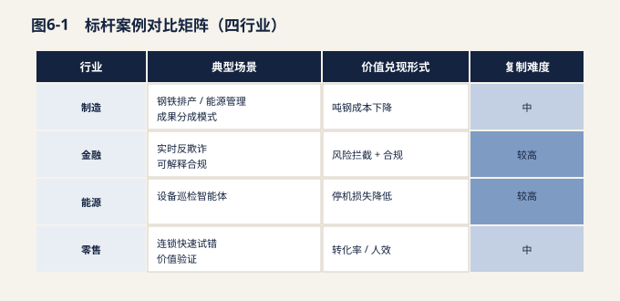
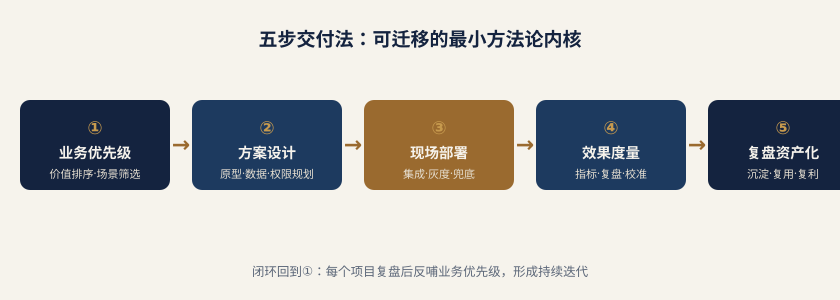

# 第六章 标杆案例研究

> **说明**：以下案例基于公开报道与行业实践综合整理，部分为示意性重构，供方法论参考，不代表任何特定企业的完整事实表述。

FDE 的价值不在于概念，而在于真实业务系统中的生产级交付。本章选取制造、金融、能源、零售四个行业的代表性场景，剖析 FDE 如何在前线完成"从 Demo 到生产"的关键一跃。每个案例均遵循统一结构：背景、痛点、FDE 的关键动作、成果/价值、可复用经验。

> **案例统一结构**
>
> 以下案例均按「背景 → 痛点 → FDE 关键动作 → 量化结果 → 可复用资产」五段呈现，便于横向比较与直接套用。

## 6.1 制造业：钢铁排产与能源管理的成果分成模式

**【背景】**某大型钢铁企业拥有完整的炼钢—轧制产线，但排产长期依赖老师傅经验，能源（电、气、水）消耗缺乏与生产节奏的联动优化，吨钢成本存在可观的压缩空间。企业引入 AI 排产与能耗优化方案，但模型始终停留在离线验证阶段。

**【痛点】**其一，排产模型所需的"料（原料库存）、机（设备状态）、能（能源供给）"三方数据分散在 MES、能源管理系统与仓储系统中，口径不一、实时性差；其二，模型团队在实验室跑出的优化结果，到了现场因工况波动频繁失效；其三，传统采购要求按人天付费，厂商缺乏把"真实降本"做实的动力，项目容易止步于 POC。

**【FDE 的关键动作】**FDE 进驻现场数月，完成三件关键事：第一，打通数据链路，为 MES、能源管理系统、仓储系统分别构建轻量连接器，将三方数据统一到以"炉次/班次"为粒度的时序底座；第二，把离线排产模型改造为可调参的在线服务，并嵌入一线调度员的决策界面，让"人机协同"而非"全自动替代"先行跑通；第三，与客户共同设计计价机制——以吨钢能耗下降与吨钢成本下降作为分成依据，把厂商收益与生产结果绑定。

**【成果/价值】**在持续运营周期内，该产线吨钢能耗与综合成本实现可量化的下降，FDE 团队依据约定比例从降本收益中分成。对钢铁企业而言，这是"零前期重投入、风险共担"的轻量化转型；对厂商而言，成果分成机制使其有充足动力把模型真正打磨到生产可用。

**【可复用经验】**"成果分成"要成立，前提是价值可被干净度量。FDE 必须先把"降本源自 AI"的归因链条讲清楚（对照基线、排除工况扰动），否则分成机制在审计端站不住脚。这是一种"价值工程化"能力，也是制造业 FDE 的护城河。

## 6.2 金融：银行实时反欺诈与可解释合规

**【背景】**某股份制银行面临电信诈骗与信贷欺诈的双重压力，希望引入机器学习模型提升实时反欺诈命中率。监管同时要求，凡是影响客户权益的自动化决策，必须可解释、可追溯。

**【痛点】**模型团队交付的高精度模型在离线评估中表现优异，但上线后暴露两类问题：一是实时性不足，决策链路延迟超出交易授权窗口；二是"黑箱"问题——模型给出拒绝或拦截结论，却无法向监管与客户说明"为什么"，不满足可解释 AI（XAI）的监管要求，合规团队否决了直接投产。

**【FDE 的关键动作】**FDE 驻场后，首先将模型推理改造为低延迟的近实时服务，使其能在交易授权窗口内完成打分；其次，为每一条决策路径构建"留痕"机制——记录触发了该笔交易的哪些特征、命中了哪条规则、模型贡献度如何，生成可审计的决策说明；再次，与合规、风控、科技三方共建上线评审流程，把"可解释性"作为模型准入的硬约束而非事后补丁。

**【成果/价值】**模型在保持（甚至提升）实时命中率的同时，实现了逐笔决策的可解释与可追溯，顺利通过合规评审并转入生产。银行既获得了欺诈拦截能力的实质提升，又满足了监管对自动化决策的透明性要求，避免了"能力有了却不敢用"的尴尬。

**【可复用经验】**在强监管行业，FDE 的现场价值很大程度体现在"架桥"——在算法团队与合规团队之间建立共同语言。把监管要求翻译为可工程化的约束（如决策留痕、特征可追溯），是把 AI 从"实验室合规"推向"生产合规"的关键一步。

## 6.3 能源：电网/石化设备巡检智能体

**【背景】**某电网或石化运营单位拥有海量关键设备，传统人工巡检成本高、覆盖有限，希望通过智能体（Agent）实现设备状态感知、异常预警与工单自动派发。

**【痛点】**该场景的工程复杂度远超通用对话。其一，智能体需要对接 SCADA 实时遥测、既有工单系统与设备知识库，三者协议、数据格式、更新频率差异巨大；其二，设备领域知识高度专业化，通用大模型缺乏足够的领域语义；其三，巡检结论必须可靠，错误预警会引发误停机或漏检责任，容错率极低。

**【FDE 的关键动作】**FDE 完成从"能对话"到"能干活"的关键改造：第一，构建面向 SCADA、工单系统、知识库的多源连接与缓存层，解决实时性与一致性问题；第二，把通用大模型与设备领域知识库（规程、历史缺陷库、专家经验）做检索增强（RAG），纠正幻觉、提升专业度；第三，设计"预警—复核—派单"的人机闭环，智能体只负责初筛与建议，重大决策保留人工确认，并把每条结论与依据绑定回工单系统，形成可追溯闭环。

**【成果/价值】**设备异常的早期识别率与巡检覆盖度显著提升，工单流转从人工串联变为系统自动编排，运维人效改善。更重要的是，智能体在"高风险、强专业"场景下实现了可控落地，验证了 Agent 在关键基础设施中的工程化可行性。

**【可复用经验】**高可靠性场景的 FDE 方法论是"专业增强 + 人机闭环 + 全程留痕"。不要试图让通用模型一步到位替代专家，而要用领域知识库补足语义、用人工确认兜住风险、用链路留痕建立信任。复杂度本身就是这类场景的壁垒与价值来源。

## 6.4 零售：连锁零售的快速试错与价值验证

**【背景】**某连锁零售企业希望用 AI 提升会员运营效率与客服体验，但决策层对大规模投入持谨慎态度，担心"雷声大雨点小"。

**【痛点】**零售业态场景多、变化快，企业难以一次性判断 AI 应在会员运营、智能客服、选品补货中优先投哪里；若直接上马大项目，试错成本高、决策风险大。

**【FDE 的关键动作】**FDE 采取"低客单价、快周期、可度量"的打法：先以小而美的项目切入，例如用智能客服承接高频咨询、用会员运营模型做精准券发放，每个子项目设定清晰的北极星指标（如咨询解决率、券核销率）。在跑通一个场景、用数据证明价值后，再向相邻场景扩展，形成"验证—复制—扩展"的节奏。

**【成果/价值】**企业在可控投入下，先验证了智能客服与会员运营的真实增益，再据此决定是否扩大投入，避免了大额预算押注单一未验证场景的风险。FDE 通过一系列"小胜"积累了内部信任，为后续规模化铺平了组织道路。

**【可复用经验】**在不确定性强、预算谨慎的客户侧，FDE 的价值在于"把不确定性切成小块"。用低客单价项目快速试错、用数据说话、用节奏管理信任，是把 AI 推过"决策犹豫期"的实用路径。

## 6.5 案例对比总览

| 行业 | 核心场景 | FDE 突破口 | 计价/机制特点 | 关键护城河 |
| --- | --- | --- | --- | --- |
| 金融 | 实时反欺诈与可解释 | 低延迟服务 + 决策留痕 | 合规准入硬约束 | 算法—合规架桥 |
| 能源 | 设备巡检智能体 | 多源连接 + 领域增强 | 人机闭环可控 | 高复杂度工程能力 |
| 零售 | 会员运营与智能客服 | 小步快跑验证价值 | 低客单价试错 | 节奏与信任管理 |

**表 6-1 四行业标杆案例对比**

综合四案例可见，尽管行业各异，FDE 的现场方法论存在共性：**先打通数据与环境（接地气），再把 AI 能力以可控、可度量、可审计的方式嵌入业务流程（可生产），最后用价值证据推动机制与组织层面的复制（可扩张）**。这恰是 FDE 区别于纯研发与纯实施的核心所在——它既是工程师，也是价值设计师与组织变革的催化剂。

## 6.6 国际标杆：模型厂商如何把"部署能力"组织化

> **说明**：本节三则案例依据企业官方公告与公开报道综合整理，部分表述为示意性重构。所引数字均为**厂商官方口径**，反映的是头部企业的资源配置意图，**不代表行业平均水平**，亦不宜直接作为国内企业的投入基准。此处引用的重点不在数字本身，而在组织形态的演变信号。

前五节聚焦国内落地现场，本节把镜头拉远。2026 年前后，全球头部 AI 厂商不约而同做了同一件事：**把"让模型在客户现场跑起来"这件事，从售后支持的附属职能，升格为独立建制、独立预算、独立考核的组织单元**。这一转向对中国企业的参照意义在于——如果连模型能力最强的公司都认为"部署"需要专门的人和专门的钱，那么能力更弱、系统更复杂的甲方企业，就更不应指望 AI 能自动落地。

### 6.6.1 OpenAI Deployment Company：把交付独立成公司

**【背景】**随着企业客户从"试用 API"转向"嵌入核心流程"，模型能力与客户实际收益之间的落差被不断放大。问题往往不出在模型，而出在数据接入、权限治理、流程改造与组织适配。为系统性解决这一"最后一公里"，OpenAI 于 2026 年设立专注部署交付的独立实体。

**【关键动作】**其一，投入规模超过 40 亿美元的初始资金，把部署从"成本中心"变为"战略投资"；其二，联合 19 家全球合作伙伴构建交付网络，覆盖不同区域与行业的落地能力；其三，约 150 名 FDE 与部署专家加入首批团队，形成建制化的前线工程力量，而非从研发团队临时抽调。

**【对 FDE 的启示】**这是一个明确信号：**部署能力不是研发能力的延伸，而是一种需要独立组织、独立人才梯队与独立方法论的能力**。国内企业若把 FDE 挂在售前或运维之下，用支持性职能的逻辑管理，很难沉淀出真正的交付资产。组织建制的独立性，是 FDE 能力得以积累的前提条件。

### 6.6.2 Anthropic Claude Partner Network：用伙伴网络放大交付容量

**【背景】**自建团队的交付容量存在天然天花板——FDE 培养周期长、现场驻扎不可复制，客户需求增长速度远快于团队扩张速度。当需求侧呈指数增长而供给侧只能线性扩张时，厂商必然要寻找杠杆。

**【关键动作】**Anthropic 于 2026 年宣布投入 1 亿美元启动资金搭建合作伙伴网络，并将面向伙伴的支持团队（partner-facing team）规模扩大约五倍。资金与人力的投向不是直接服务终端客户，而是**服务那些服务客户的人**——通过培训、工具、方法论与技术支持，把自身的交付经验批量复制给生态伙伴。

**【对 FDE 的启示】**FDE 能力的规模化，路径有二：一是自建团队做深，二是通过赋能网络做广。后者的核心是把"个人经验"转化为"可迁移资产"——标准化的接入组件、可复用的场景模板、结构化的实施方法论。对国内的集团型企业而言，同样适用：总部 FDE 团队不必也不可能覆盖所有业务单元，其更高价值在于沉淀方法论、赋能各分子公司的本地技术团队，把自己从"执行者"变为"能力放大器"。

### 6.6.3 Salesforce Agentforce：产品化与现场工程的双轮绑定

**【背景】**企业级 Agent 产品面临一个结构性矛盾：产品越通用，与客户实际业务的贴合度越差；越贴合客户，越难以复制。Salesforce 在推进 Agentforce 时，选择用现场工程团队来消化这一矛盾。

**【关键动作】**组建专职 FDE 团队直接服务 150 家以上企业客户，在现场完成数据接入、流程适配与权限配置。更关键的是形成了产品与现场的反馈闭环：现场遇到的共性问题被抽象为产品能力，产品能力的增强又反过来缩短现场周期。据其官方口径，部分客户的部署周期从约 6 个月压缩至 3 周左右。

**【对 FDE 的启示】**6 个月到 3 周的差距，绝大部分不来自模型进步，而来自**共性工作的产品化沉淀**。FDE 团队若每次都从零开始，交付周期永远无法收敛；只有把重复出现的接入、配置、校验环节固化为工具与模板，边际交付成本才会下降。判断一支 FDE 团队是否成熟，看的不是它能否搞定难项目，而是**第 N 个项目是否显著快于第 1 个**。

| 案例 | 核心投入（厂商口径） | 组织策略 | 对中国企业的参照点 |
| --- | --- | --- | --- |
| Anthropic Claude Partner Network | 1 亿美元初始投入、伙伴支持团队扩约 5 倍 | 生态赋能放大容量 | 总部沉淀方法论，赋能分子公司 |
| Salesforce Agentforce | 服务 150+ 企业，部分周期 6 月→3 周 | 产品与现场双向反馈 | 共性问题产品化，压缩边际交付成本 |

**表 6-2 国际厂商 FDE 组织化路径对比**

三者路径不同，指向一致：**AI 落地的瓶颈已从模型能力转移到交付能力，而交付能力必须被当作一项独立资产来投资与经营。**

### 6.6.4 国内厂商落地案例：腾讯、字节、阿里的方法论视角

> **说明**：以下三则依据厂商公开产品能力与行业实践综合整理，案例主体为示意性脱敏重构（不出现具体客户名），重点在方法论提炼，与第四章 4.8 互为呼应。

**腾讯：连接型部署——把 AI 接进客户的业务流程与权限（以某金融行业客户为例）。**

**【背景】**客户已有成熟的业务系统与严格的权限体系，AI 需求明确但无法直接接入生产环境。

**【关键动作】**FDE 以腾讯云智能行业方案为底座，先做"权限与数据接地"——在不改动客户核心系统的前提下，通过企业微信、腾讯会议等高频入口把 AI 能力嵌入审批流与协同场景；对强合规环节保留人工复核。

**【启示】**连接型部署的 FDE 关键是"顺着客户既有入口渗透"，而非另起炉灶；懂权限与流程，往往比懂模型更重要。

**字节：增长型部署——用智能体直接撬动营收场景（以某零售/消费品牌为例）。**

**【背景】**客户希望通过 AI 提升营销与会员运营效率，但缺乏自建 Agent 的工程能力。

**【关键动作】**FDE 基于火山引擎提供豆包大模型能力、用 Coze 快速搭建营销智能体，并把智能体接入客户的 CRM 与投放系统；飞书智能伙伴承担内部知识协同。重点在"小步快跑验证增长"。

**【启示】**增长型部署的 FDE 要既懂运营/营销、又懂系统对接；价值用"可衡量的增长指标"定义，而非模型准确率。

**阿里：底座 + 行业纵深部署——下沉到强行业流程改造（以某制造/零售企业为例）。**

**【背景】**客户流程复杂、数据分散，AI 需嵌入生产或供应链环节才能产生价值。

**【关键动作】**FDE 基于阿里云百炼与通义做工程化交付，借助钉钉 AI 助理把能力推向一线员工；对制造场景重点做数据打通与流程改造，对零售场景做会员与库存的智能决策。

**【启示】**底座型部署的 FDE 兼顾"云上工程化"与"行业流程改造"；伙伴生态承担本地化交付，厂商 FDE 负责把项目沉淀为行业模板。

| 厂商 | 生态位 | 代表性落地场景 | FDE 关键能力 | 方法论要点 |
| --- | --- | --- | --- | --- |
| 腾讯 | 连接型部署 | 金融/文旅/政务的流程与权限嵌入 | 懂权限、流程、连接入口 | 顺着既有入口渗透，强合规保留人工复核 |
| 字节 | 增长 + 协同型部署 | 零售/消费的营销智能体、内部协同 | 懂运营营销、系统对接 | 小步快跑，以增长指标定义价值 |
| 阿里 | 底座 + 行业纵深部署 | 制造/零售的流程改造、一线赋能 | 云上工程化 + 行业 Know-how | 伙伴做本地化，厂商沉淀行业模板 |

**表 6-3 国内厂商 FDE 落地路径对比**

小结：三家国内厂商用不同生态位做着同一件事——把模型能力转化为客户现场可兑现的价值。与 4.8 的视角一致，国内的 FDE 更多在"厂商—伙伴—客户"的三方协同网络中工作；对 CIO 而言，选厂商时除了看模型，更要看其在你现场"兜住结果"的真实交付能力。

## 6.7 小企业也能引入 FDE 思路：两个轻量案例

> **说明**：本节两则案例为示意性重构，用于说明方法而非陈述特定企业事实。

FDE 常被误读为"大厂专属"——要驻场、要团队、要预算。但 FDE 的内核并非编制规模，而是一套工作方式：**贴着真实业务找入口、从小闭环开始、把 AI 结论纳入人工确认、用可见的效率改善换取组织信任**。这套方式对中小企业同样成立，甚至更有效，因为其流程短、决策快、试错成本低。

### 6.7.1 30 人销售型公司：从"统一字段"这件小事切入

这家公司的问题不在于缺工具，而在于工具太多：客户信息散落在 CRM、若干个 Excel 表、微信群聊记录与销售个人笔记中。跟进节奏依赖业务员的记忆，人员一旦调岗或离职，客户上下文随之丢失，接手同事只能从零重建关系。管理者对团队真实进展缺乏可靠视图。

引入 FDE 思路后，第一步不是上系统，而是只做三件小事。**统一客户字段**：与销售共同确定十个左右必填字段（客户阶段、决策人、上次接触时间、卡点、下一步动作等），把散落信息归拢到同一口径；**AI 生成跟进纪要**：销售通话或拜访后口述要点，由 AI 整理为结构化纪要，但必须经销售本人确认后才入库，AI 不做事实裁定；**提醒下一步动作**：系统依据字段状态推送待办，把"靠记性"变为"靠机制"。

| 维度 | 改造前 | 试点后 |
| --- | --- | --- |
| 跟进记录 | 事后凭记忆补录，字段随意 | AI 生成结构化纪要，销售确认后入库 |
| 下一步动作 | 依赖个人自觉，易遗漏 | 系统按状态自动提醒 |
| 人员交接 | 上下文大量丢失，需重建关系 | 历史脉络可读，接手即可上手 |
| 管理视图 | 靠周会口头汇报 | 阶段与卡点可实时查看 |
| AI 的角色边界 | — | 只做整理与建议，不替销售做承诺 |

**表 6-4 30 人销售型公司改造前后对比（示意）**

真正的关键不在 AI，而在"统一字段"这一前置动作——**没有统一口径，AI 生成的一切都只是更快地制造混乱**。这恰是 FDE 与普通工具采购的分野：先治理，再智能。

### 6.7.2 200 人制造企业：绕开高风险入口，从知识沉淀起步

这家企业最初的诉求是自动排产。但排产直接牵动交期、成本与设备安全，一旦出错影响是物理性的、不可撤销的，而企业既无历史决策数据的完整留存，也无回滚机制。以此作为第一个 AI 项目，风险与信任成本都过高。

FDE 思路给出的替代入口是：**先让 AI 读懂这家工厂**。把历史工单、质检记录、设备维修档案与操作手册整理为可检索的语料，先做三件低风险的事——异常自动分类、解决方案建议、知识库持续更新。这些工作的共同特征是：出错后果可控、结论有人复核、价值在数周内即可显现。

| 判断 | 事项 | 理由 |
| --- | --- | --- |
| **先做** | 设备异常总结 | 输出为参考信息，不直接触发动作 |
| **先做** | 知识库自动更新 | 沉淀老师傅经验，长期价值高 |
| **先做** | 质检记录解释 | 帮助新人理解判定逻辑，降低培训成本 |
| **先做** | 设备维护建议 | 作为维修工的辅助参考，保留人工判断 |
| **暂缓** | 自动排产 | 牵动交期与成本，出错难以回滚 |
| **暂缓** | 自动调整工艺参数 | 直接影响产品质量与设备安全 |
| **暂缓** | 无人工确认的质量判定 | 责任无法界定，客诉风险高 |
| **暂缓** | 直接触发采购或停机 | 涉及资金支出与产线中断，后果不可逆 |

**表 6-5 200 人制造企业 AI 场景取舍（示意）**

"先做/暂缓"的分界线其实只有一条：**AI 的输出是"给人看的信息"，还是"直接改变物理世界或资金流向的指令"**。前者可以先跑，后者必须等到数据基础、人工复核机制与责任界定都到位之后。等企业积累了足够的工单与知识资产、组织也建立起对 AI 的基本信任，再回头做排产，成功率将远高于一上来就啃硬骨头。

## 6.8 行业场景优先级与筛选评分卡

企业在启动 AI 项目时最常见的失误，不是选错了模型，而是选错了第一个场景。第一个场景决定了组织对 AI 的初始印象——跑通了，后续预算与配合都会顺；跑砸了，再好的方案也很难获得第二次机会。因此，场景筛选本身就是 FDE 最重要的前置工作之一。

### 6.8.1 六类高频场景的优先级判断

| 领域 | 优先切入的具体事项 | 适合的原因 | 必须守住的边界 |
| --- | --- | --- | --- |
| 客服中心 | 会话质检、工单分类、回复建议 | 规则清晰，效果易于量化 | 高风险结论必须人工复核 |
| 制造业 | 工单分派、质检知识库、设备异常总结 | 流程可追踪，数据留痕完整 | 不直接修改生产排程 |
| 财税 | 票据整理、科目解释、经营分析草稿 | 数据结构化程度高，规则明确 | 关键结论须经财务确认 |
| 合规风控 | 材料缺失检查、风险点标注 | 留痕价值高，可减少重复核对 | 保留人工裁决权，AI 不下定论 |
| 研发团队 | 旧代码解释、测试用例补齐、迁移建议 | 反馈周期短，正确性可验证 | 合并前必须经人工评审 |

**表 6-6 六类场景的优先级与边界（通用参考）**

观察这六行会发现一个共同规律：**所有"先做"的事项，AI 都处在辅助位而非决策位**；所有"边界"条款，本质上都是把不可逆的决定权留给人。这不是对 AI 能力的不信任，而是对责任归属的清醒安排——在责任机制尚未建立之前，让 AI 越界只会让第一个项目变成最后一个项目。

### 6.8.2 场景筛选评分卡：五维同时成立

判断一个场景是否适合进入第一批试点，可用五个维度做交叉检验。需要强调的是，这五项之间是**"与"关系而非"或"关系——只有五项同时成立，才建议纳入首批**。任何一项明显不达标，都应当推迟，而不是靠其他四项的高分去弥补。

| 维度 | 低分信号（应推迟） | 高分信号（可入选） |
| --- | --- | --- |
| 频率高 | 一月发生几次，改善难以感知 | 每天/每周反复发生，改善迅速可见 |
| 边界清楚 | 需求随部门变化，无法明确交付标准 | 输入输出定义清晰，对错可判断 |
| 数据可取 | 数据在他人系统中，权限与接口不通 | 数据现成可得，口径基本统一 |
| 风险可控 | 出错影响客户或资金，且难以回滚 | 出错可即时发现并人工纠正 |

**表 6-7 场景筛选评分卡（五维检验）**

实践中建议采用简单打分：每项按 1—5 分评定，任一维度低于 3 分即"一票否决"。这种略显保守的规则有其价值——它把讨论从"这个想法好不好"拉回到"这件事现在能不能做成"。**很多失败项目并非选题错误，只是顺序错误**：把本该排在第三年的场景放到了第一个月。

将 6.6 至 6.8 三节合并观察，可提炼出一条贯穿不同规模企业的共同逻辑：国际厂商用**组织独立化与能力产品化**解决交付规模问题，中小企业用**小闭环与明确边界**解决信任建立问题，而场景评分卡则为两者提供了同一把标尺。规模差异改变的只是资源量级，不改变方法内核——**先找对场景，再谈技术；先建立信任，再扩大授权；先沉淀资产，再追求速度。**

## 6.9 跨案例方法论提炼：一线交付中沉淀的 FDE 工作法

> 以下为按行业类型归纳、脱敏重构的方法论案例，不指向具体企业。相关内容基于公开报道与行业实践综合整理，部分为示意性重构，用于说明方法而非还原某一具体项目。

前八节分行业呈现了 FDE 的落地形态。若把这些形态叠放在一起观察，会发现真正决定项目成败的并不是模型选型或工具栈，而是一套高度一致的工作次序。本节把这套次序提炼为"五步交付法"、一条人机协同分层原则和一份高风险动作的人工复核清单。它们构成了 FDE 在不同行业之间可迁移的最小方法论内核。

### 6.9.1 五步交付法：从业务优先级到复盘闭环

*图 6-2　五步交付法：可迁移的最小方法论内核*

多数失败的 AI 项目都有一个共同起手式——从工具开始。企业先采购平台、再寻找场景，最终把"能做什么"当成了"该做什么"。成熟的 FDE 交付则严格反向推进：先确认业务优先级，最后才谈自动化与规模化。

| 步骤 | 核心问题 | FDE 关键动作 | 阶段交付物 | 典型失败模式 |
| --- | --- | --- | --- | --- |
| ② 知识资产化 | 企业的判断力沉淀在哪里？ | 把负责人经验、历史资料、SOP、客户问答、成交话术结构化 | 可调用的企业知识库与更新机制 | 跳过沉淀直接接模型，输出泛而无用 |
| ③ 定制 Skill / Agent | 具体岗位的哪个动作可被复用？ | 围绕岗位动作而非"通用助手"设计能力单元 | 岗位级 Skill 集合与调用规范 | 做成万能对话框，无人知道何时该用 |
| ④ 接入自动化流程 | 能力如何进入日常工作流？ | 把生成、审核、发布、记录、提醒、更新串成闭环 | 端到端流程与系统对接 | 只生成不闭环，产出停留在聊天窗口 |
| ⑤ 陪跑与复盘 | 团队是否真的在用？ | 现场陪跑、样本纠偏、阶段数据回流下一轮优化 | 使用率/质量数据与迭代清单 | 交付即撤场，三个月后回到人工 |

五个步骤中，第①步决定项目天花板，第②步决定输出质量下限，第⑤步决定成果能否留存。FDE 与传统交付顾问的差别，恰恰在于同时对这三端负责。

**第一步的判断标准可以量化。**一线常用的筛选维度是四问：该环节是否高频发生、单次人力成本是否显著、动作是否高度重复、结果是否强依赖少数熟手。四项中命中三项以上者优先切入；仅命中"高频"一项的环节，往往投入产出比不足。

**第二步是最容易被低估的工程量。**知识资产化不是把文件上传到某个目录，而是把散落的经验转成可检索、可引用、可更新的结构。

| 知识来源 | 常见存在形式 | 采集方式 | 结构化目标 | 更新责任 |
| --- | --- | --- | --- | --- |
| 历史资料 | 分散文档、演示稿、图册 | 归集、去重、版本对齐 | 主题分类的资料库 | 内容岗按发布节奏维护 |
| 作业 SOP | 口头传承或过期文档 | 流程还原与现场确认 | 标准动作清单 | 流程 Owner 变更即更新 |
| 客户问答 | 聊天记录、工单、邮件 | 抽样清洗与归类 | 高频问答与标准口径 | 客服岗月度补录 |
| 成交话术 | 优秀员工个人经验 | 录音转写、成单归因 | 场景化话术模板 | 销售管理者按季迭代 |

**第三、四步的关键词是"岗位动作"与"闭环"。**Skill 的粒度应对齐一个可被验收的岗位动作，而不是一个宽泛职能；自动化的价值则在于把生成之后的审核、发布、记录、提醒、更新一并接上，否则 AI 只是把工作从"写"转移到了"搬运"。

**第五步决定资产是否留存。**陪跑期通常需要覆盖一个完整业务周期，重点观察三类数据：一线实际调用频次、产出一次通过率、人工返工的集中原因。这三项数据直接构成下一轮 Skill 迭代与知识库补录的输入。

### 6.9.2 人机协同分层：AI 打底，专家增值

FDE 在现场需要反复向管理者澄清一件事：AI 的目标不是替代岗位，而是重新划分岗位内部的价值分工。可复用的分层原则是"AI 打底、专家增值"。

| 层级 | 任务特征 | 承担方 | 衡量指标 | 管理关注点 |
| --- | --- | --- | --- | --- |
| 协同层 | 半结构化、需上下文补充 | AI 起草 + 人工修订 | 返工率、修订耗时 | 模板与口径是否统一 |
| 增值层 | 个案判断、信任建立、复杂成交 | 人主责 | 转化率、客户满意度 | 人力是否被释放到此层 |
| 决断层 | 承诺、定价、合规、对外署名 | 人独有 | 差错率、合规事件数 | 是否存在越权自动执行 |

这套分层的实际效果不体现在"减了多少人"，而体现在人力结构的上移：当打底层被稳定接管，专家时间才可能集中到增值层与决断层。CIO 在立项评审时应把"专家时间投入结构的变化"列为与效率指标同等重要的观测项。

### 6.9.3 高风险动作的人工复核清单

AI 在生产环境的最大风险不是答错，而是"以企业名义"答错。因此，凡涉及对外承诺、公开发布与专业边界的动作，都必须保留人工节点，且该节点不可因效率诉求被取消。

| 风险场景 | 风险性质 | 控制方式 | 复核责任岗 | 失控后果 |
| --- | --- | --- | --- | --- |
| 报价与商务条款 | 合同与履约风险 | AI 不自主承诺，仅提供参考区间 | 销售负责人 | 价格失控、纠纷 |
| 合规与资质问题 | 监管与市场准入 | 设定标准口径，超边界即转人工 | 合规/法务 | 违规申报、订单撤销 |
| 医疗健康类咨询 | 过度承诺与专业越界 | 预设回答边界与免责表述 | 专业审核人 | 误导用户、监管问询 |
| 高意向客户对话 | 商机与信任 | 识别信号后即时转人工接管 | 一线业务 | 商机流失 |

一条务实的落地经验是：把人工复核写进流程配置而非制度文档。审核节点若只存在于规范文本中，在业务高峰期一定会被绕过；只有当它成为系统中无法跳过的一步，控制才真正生效。

### 6.9.4 底层判断：知识资产化是地基

综合各行业实践，企业 AI 落地的首要障碍通常不是"不会用工具"，而是关键知识仍分散在负责人、业务骨干与历史资料之中，从未被系统化沉淀。在此状态下推进自动化，得到的往往是快速产出的低质内容。因此 FDE 的第一份价值，常常不是模型集成，而是替企业完成一次迟到多年的知识梳理——这也是本章各行业案例中最具共性的一条结论。

## 6.10 行业类型化案例（脱敏方法论案例）

> 以下为按行业类型归纳、脱敏重构的方法论案例，不指向具体企业。案例按【行业场景】【痛点】【FDE 方法】【可复用经验】四段呈现，重在还原方法路径，不还原具体项目细节。

### 6.10.1 生命科学与大健康：把个人经验转为组织能力

**行业场景**：以招商与渠道拓展为增长主线的健康产业企业，内容与话术是核心生产资料。

**痛点**：核心卖点、客户画像与成功逻辑高度集中在创始人和少数资深业务手中；资料版本混乱，新员工产出质量波动大，内容生产成为增长瓶颈。

**FDE 方法**：先与决策层完成战略拆解，明确目标客户与核心价值主张，避免在错误定位上做效率优化；随后将招商资料、卖点体系、客户画像、高频问答与内容模板沉淀为结构化知识库；在此基础上定制面向招商岗的专用 Skill，把选题、成稿、话术适配等动作标准化；最后接入自动化发布流程，并对健康类表述预设回答边界，涉及疗效与承诺的内容一律进入人工审核。

**可复用经验**：对这类知识密集型企业，"把个人经验转为知识库 + Skill"是 AI 落地的第一杠杆。跳过这一步的自动化，只会更快地复制不合格内容。

### 6.10.2 外贸与跨境制造：用合规边界守住信任底线

**行业场景**：面向多时区海外客户的制造与贸易企业，询盘响应速度直接影响转化。

**痛点**：客户分布跨时区导致响应窗口错位；询盘中大量为重复性的参数与资质问题；产品资料分散在多套文档与人员手中，回复口径不一致，客户信任受损。

**FDE 方法**：建设覆盖产品参数、认证资质与适用市场的结构化知识库，并在其中明确标注各目标市场的准入与合规边界；由 AI 承接标准化询盘，实现全时段首轮响应；对涉及认证适用性、定制条款与价格的问题，系统不允许自主承诺，仅提供已核准口径；同时设定高意向识别信号，一旦命中即转人工跟进。

**可复用经验**：外贸场景的 AI 客服价值不在"全自动"，而在"以合规边界 + 转人工机制"同时守住响应效率与风险底线。边界越清晰，AI 可承担的比例反而越高。

### 6.10.3 本地生活与门店运营：机器初稿，人工终审

**行业场景**：依赖公域平台获客的连锁门店与本地服务商，内容更新频率高。

**痛点**：选题、文案撰写、配图生成、草稿整理等环节高度重复且耗时，占据运营人员大量时间，但单条内容的边际价值有限。

**FDE 方法**：识别耗时最集中的环节优先自动化，把选题建议、文案初稿与配图生成串成一条流水线，产出统一进入草稿箱；发布权限保留在人工端，由运营人员完成事实核对、活动信息校验与品牌语气调整后发布；同时回收发布后的互动数据，反哺选题模型与模板迭代。

**可复用经验**：凡面向公域平台的发布动作，必须坚持"机器初稿 + 人工终审"。自动化的目标是压缩草稿成本，而非取消发布责任人。

### 6.10.4 金融情报监测：价值在筛选，不在堆砌

**行业场景**：需要持续跟踪市场变化以支持投资与经营决策的机构与团队。

**痛点**：新闻、研报、财报、社交舆情与价格数据来源分散、噪声高，人工浏览量巨大却难以沉淀为可用判断。

**FDE 方法**：设计"宏观—行业—个股"三层监测链路，各层设定不同的信息源权重与更新频率；将多源信息统一转换为可读摘要与结构化信号，并标注来源与时间戳以便回溯；对异常波动设置提醒阈值，推送时附带背景摘要而非原始链接堆叠；最终判断与仓位决策仍由专业人员完成。

**可复用经验**：情报类产品的价值取决于筛选与摘要能力，而非信息覆盖量。衡量指标应从"抓取了多少条"转为"减少了多少无效阅读"。

### 6.10.5 四类模式横向对照

| 行业类型 | 核心痛点 | 知识资产核心 | AI 主要承担 | 人工把关点 | 首要杠杆 |
| --- | --- | --- | --- | --- | --- |
| 外贸/跨境制造 | 跨时区、询盘重复 | 参数、资质、合规边界 | 标准询盘首轮响应 | 报价、认证适用性 | 合规边界 + 转人工 |
| 本地生活/门店 | 内容生产耗时 | 选题库与内容模板 | 初稿与配图生成 | 发布前事实与品牌审核 | 最耗时环节自动化 |
| 金融情报监测 | 信息碎片化 | 信息源分层与信号定义 | 摘要与信号生成 | 投资判断与决策 | 分层链路 + 摘要能力 |

四类模式的行业属性差异明显，但方法路径高度收敛：先确认业务优先级，再沉淀知识资产，随后围绕岗位动作定制能力，接入闭环流程，并在高风险节点保留人工。这一收敛性正是 FDE 作为一种职业角色能够跨行业迁移的根本原因，也为企业评估自身 AI 落地成熟度提供了可对照的坐标。

## 6.11 FDE 交付检查表（可套用）

本节将前文方法论（五步交付法、人机协同分层、高风险人工复核、场景筛选评分卡、0—4 阶段路线、安全红线、资产沉淀）整合为一份可直接打印/复制填写的检查表。企业可在每个项目启动时复制本节，逐项打勾验收。标注「红线」的项为不可让步项，未通过不得进入下一阶段。

### 6.11.1 入场前 · 场景筛选评分卡（五项全过才进第一批）

| 维度 | 评估问题 | 通过信号 | 不通过信号 | □ |
| --- | --- | --- | --- | --- |
| 频率高 | 该动作每周/每日发生几次？ | 高频、重复、稳定发生 | 一年几次、偶发 | ☐ |
| 边界清楚 | 输入、输出、异常路径是否明确？ | 能画出流程与异常分支 | 边界模糊、依赖人脑判断 | ☐ |
| 数据可取 | 数据源是否存在、可授权、质量可用？ | 有现成系统/文档且可脱敏取用 | 数据散落、权限未清 | ☐ |
| 风险可控 | 出错后果是否可承受、可回滚？ | 错了能撤回、影响局部 | 错一次即重大损失/违规 | ☐ |

> 五项同时成立才进入首批试点；任一不达标先降为"观察项"，待条件成熟再提。

### 6.11.2 阶段检查表（0—4 阶段，逐阶段打勾）

**阶段 0 · 准备期（0—2 周）**

- [ ] 已锁定 3—5 个候选场景，并与业务负责人对齐优先级
- [ ] 已明确本项目的业务指标与口径（增收/降本/提速/提质/降风险之一）
- [ ] 已确定项目发起方、业务负责人、IT/数据接口人、FDE 责任人
- [ ] 已通过场景筛选评分卡，首批场景五项达标
- [ ] 已确认安全与合规基线（参照第七章 7.4、本检查表 6.11.3）

**阶段 1 · 诊断期（2—4 周）**

- [ ] 已梳理目标岗位的真实流程（输入—处理—输出—异常）
- [ ] 已盘点数据源、接口、权限与质量（产出数据源清单）
- [ ] 已识别高风险动作与合规要求（产出风险清单）
- [ ] 已完成 ROI 粗算，且参数经业务负责人认账
- [ ] 已产出场景优先级图与诊断报告

**阶段 2 · 试点期（1—2 月）**

- [ ] 已搭出可运行 MVP，且仅在受控范围/灰度内运行
- [ ] 高风险动作保留人工审核，未开放自动写回
- [ ] 已建立评估集与日志方案（错误率、回滚次数可观测）
- [ ] 已沉淀首批知识资产（知识库/模板/组件雏形）
- [ ] 已收集用户反馈并完成至少一轮迭代

**阶段 3 · 生产期（2—4 月）**

- [ ] 已接入真实业务流程，设计监控与维护机制
- [ ] 已定义 SLA、监控指标、回滚路径与培训材料
- [ ] 已通过安全红线检查（6.11.3 全部勾选）
- [ ] 使用频次/活跃用户达预期，人工修改率下降
- [ ] 可验证 ROI 已形成（对照阶段 1 口径）

**阶段 4 · 扩展期（4—12 月）**

- [ ] 已将成功场景复制到相近流程
- [ ] 已沉淀可复用模板/组件库/岗位培训手册
- [ ] 内部团队已能独立运维至少一类场景（能力留痕）
- [ ] 已产出产品反馈清单，反哺平台/厂商
- [ ] 已做项目复盘，更新组织级 FDE 方法论

### 6.11.3 安全与隐私红线检查表（「红线」项，未过不得上线）

| 类别 | 检查项 | □ |
| --- | --- | --- |
| 最小权限 | 权限按需申请、角色分层、定时回收 | ☐ |
| 脱敏 | 敏感字段在训练/推理/日志中已脱敏 | ☐ |
| 动作边界 | 已划分只读/建议/有限执行三级，写回在白名单内 | ☐ |
| 人工确认 | 高风险写回动作需人工确认（红线） | ☐ |
| 回滚 | 已设计回滚路径与应急暂停预案（红线） | ☐ |
| 日志 | 关键操作有日志、审批节点、责任人可追溯（红线） | ☐ |
| 模型/供应链 | 模型与插件来源可信，已做依赖与注入防护 | ☐ |
| 隐私合规 | 满足目的限定、数据最小化、留存期限要求 | ☐ |
| 跨境/集团 | 外资等涉及跨境传输已走审批、数据驻留合规 | ☐ |
| 主体权利 | 已规划查询/更正/删除等响应机制 | ☐ |
| 责任边界 | FDE 与 IT/法务/业务权责已在启动前签字确认 | ☐ |

### 6.11.4 人机协同与人工复核红线（高风险动作清单）

- [ ] 面向公域平台的 **内容发布** ：机器初稿 + 人工终审（红线）
- [ ] **报价、合同条款、合规结论** ：AI 不自主承诺，转人工（红线）
- [ ] **医疗健康** 表述：设回答边界，防过度承诺（红线）
- [ ] **高意向客户/重大商机** ：识别后转人工跟进（红线）
- [ ] **财务关键结论** （票据/科目/经营分析）：关键结论财务确认
- [ ] **自动排产、自动改工艺、无人工确认的质量判定、直接触发采购或停机** ：暂缓，不进首批（红线）

### 6.11.5 资产沉淀交付物清单（判断 FDE 是否退化为高价外包）

| 阶段 | 应沉淀的交付物 | 是否留存 □ |
| --- | --- | --- |
| 试点 | MVP / 评估集 / 日志方案 / 人工审核规则 | ☐ |
| 上线 | SLA / 监控指标 / 回滚机制 / 培训材料 | ☐ |
| 复盘 | 问题清单 / 改进建议 / 可复用模板 / 产品反馈 | ☐ |
| 扩展 | 场景复用包 / 组件库 / 岗位培训手册 | ☐ |

> 判定原则：若项目结束只留下"人走了事没了"，即退化为高价人力外包；只有沉淀出可复用资产，FDE 交付才产生复利。
