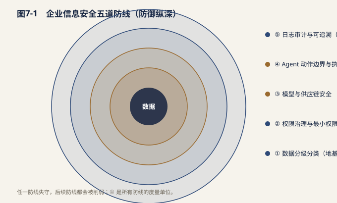
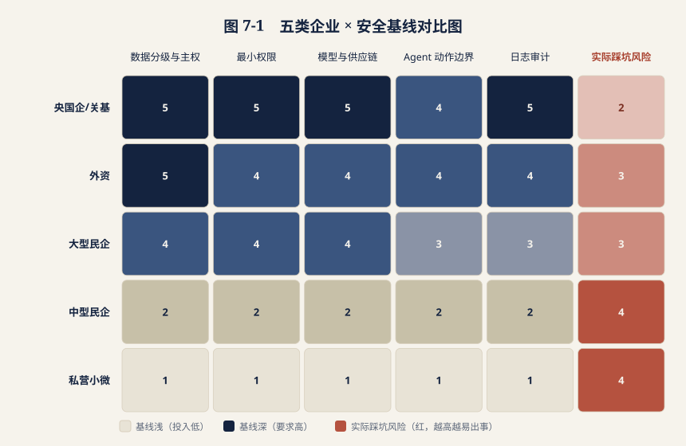

# 第七章 企业信息安全与隐私保护：FDE 不可逾越的红线

> 说明：本章涉及的法律、行政法规、国家标准、行业规范与境外法规均标注来源类型，仅作合规框架讨论之用，具体适用以官方发布文本及监管解释为准。

## 7.1 为什么 FDE 把安全与隐私推到最前沿

传统软件交付中，乙方工程师大多在测试环境里作业：数据是造出来的，系统是隔离的，接口是挡板，项目出问题最坏的结果是延期。FDE 的价值建立在相反的前提上——这个角色之所以能把 AI 从 Demo 推到生产，是因为他"进得去"：进得去客户的生产网络，看得见真实的业务数据分布，够得着真实的流程节点和审批链，甚至能让 Agent 触发一次真实的写回动作。

能力边界推进到这里，风险的性质就变了：它不再是"交付质量问题"，而是"企业级安全事件"。

| 维度 | 传统项目制交付工程师 | FDE（现场部署工程师） |
| --- | --- | --- |
| 数据 | 脱敏样本、模拟数据 | 核心业务数据，部分含个人信息 |
| 系统交互 | 只读接口、离线导出 | 读写混合，可调用业务系统 API |
| 动作后果 | 影响项目进度 | 直接改变生产状态（工单、账务、库存、审批） |
| 时间跨度 | 阶段性进场 | 长期驻场，权限长期存续 |
| 风险归属 | 主要在乙方项目侧 | 甲方业务与合规责任同时被触发 |

三个结构性事实需要 CIO 与安全负责人特别注意。

第一，**权限是 FDE 的生产资料，也是最大的负债**。FDE 要在真实数据上做需求澄清、效果评估、异常归因，天然倾向于申请"看得更全一点"的权限；而权限一旦发放，回收往往滞后于项目节奏，长期驻场使"临时授权变成常驻授权"成为高频问题。

第二，**AI 大幅缩短了"读"与"写"之间的距离**。过去人工操作生产系统有天然的速度限制和心理门槛，Agent 化之后，一次意图识别偏差就可能在几秒内批量触发数十次写回。权限越高，单位时间内可造成的损害越大。

第三，**安全不能作为上线后的补丁**。权限申请、数据脱敏、动作分级这些设计应发生在交付的第一周而非验收前一周。等系统跑起来再补权限治理，要么推翻已有集成，要么默认接受既成风险，代价都远高于前置设计。

结论因此是明确的：安全与隐私不是 FDE 交付的约束条件，而是**准入条件**。不能通过客户安全评审的 FDE 团队，本质上不具备交付能力。

## 7.2 企业信息安全的五道防线

我们把 FDE 场景下的企业信息安全拆解为五道递进的防线。它们不是可选项菜单，而是一个链条——任何一道失守，后面的防线都会被削弱。

| 防线 | 核心目标 | 关键控制点 | FDE 侧的具体责任 | 主要参照来源 |
| --- | --- | --- | --- | --- |
| ② 权限治理与最小权限 | 每个账号只拿"刚好够用"的权限 | 角色分层（只读/操作/管理）、按需授权、有效期与定时回收、账号实名不共用 | 提交带业务理由的权限清单并设到期日，里程碑后主动降权 | 【国家标准】GB/T 22239-2019 等保 2.0 访问控制项 |
| ③ 模型与供应链安全 | 保证模型与组件本身可信 | 模型来源与备案可核查、依赖与插件清单审计、第三方 API 出网管控、Prompt 注入防护 | 提供模型与依赖清单（含版本），固化指令隔离与输入净化策略 | 【法律】《网络安全法》供应链条款；【部门规章】《生成式人工智能服务管理暂行办法》 |
| ④ Agent 动作边界与执行安全 | 让 AI 够不到不该碰的地方 | 动作分级（只读/建议/有限执行）、写回白名单、单次与累计限额、回滚、紧急熔断 | 为每个能力定义动作等级与白名单，上线前完成回滚演练 | 【国家标准】等保 2.0 安全计算环境；企业变更管理制度 |
| ⑤ 日志审计与可追溯 | 事后能说清"谁在何时做了什么" | 操作日志、模型输入输出留痕、审批节点、责任人标识、异常监控告警 | 所有动作带可追溯上下文 ID，日志不可被交付方自行删除 | 【法律】《网络安全法》第二十一条日志留存不少于六个月；【国家标准】等保 2.0 安全审计 |

几点补充判断：

- **①是所有防线的地基** 。没有数据分级，最小权限就没有度量单位，脱敏就没有优先级，审计就没有告警阈值。实践中大量问题的根因不是控制手段缺失，而是"没人说得清这张表算不算机密"。
- **③在 AI 时代被显著低估** 。企业普遍严格审查基础软件供应链，却对模型权重来源、向量库组件、Agent 插件生态缺乏同等强度的审查。Prompt 注入尤其值得警惕：当 Agent 会读取工单内容、邮件正文或外部网页时，攻击者可以把指令写进"数据"里。
- **④是 FDE 与纯 SaaS 交付的分水岭** 。绝大多数生产事故不来自"AI 说错话"，而来自"AI 做错事"，动作边界的设计质量直接决定事故上限。

信息安全解决的是"数据别丢"，隐私保护解决的是"数据该不该这么用"。后者在中国的监管语境下有清晰的法律骨架。

**基础原则层**（主要依据【法律】《个人信息保护法》，配套【国家标准】GB/T 35273《个人信息安全规范》）：

| 原则 | 含义 | FDE 交付中的常见违反形式 |
| --- | --- | --- |
| 最小必要 | 只采集实现目的所必需的最少信息 | 为省事直接 `SELECT *` 全表接入 |
| 匿名化 / 去标识化 | 匿名化后不属个人信息；去标识化仍受保护 | 删掉姓名列即称"已匿名"，忽略手机号尾号+地址的重识别风险 |
| 留存期限 | 保存期限为必要的最短时间 | 调试期样本长期滞留在个人终端或临时对象存储 |
| 单独同意 | 敏感个人信息、对外提供等需单独同意 | 将含个人信息的数据投喂给未纳入协议的第三方模型 API |

**跨境层**：数据出境是外资及跨国业务企业的高频红线，现行路径主要为安全评估申报、标准合同备案、个人信息保护认证三条（依据【法律】《个人信息保护法》第三十八条及【部门规章】《数据出境安全评估办法》《个人信息出境标准合同办法》《促进和规范数据跨境流动规定》）。对 FDE 而言最实际的判断题只有三个：模型推理请求是否离开境内？向量化后的 Embedding 是否构成出境？日志与遥测是否回传境外总部？这三问必须在方案设计阶段书面回答，而不是上线后被审计问出来。

**行业特殊层**：

- **金融业** ：账户、交易明细、信贷记录等可识别客户信息受严格约束，风控与合规要求全流程留痕，AI 参与的决策环节需可解释、可复核（参照【行业规范】金融行业数据安全分级及相关监管要求）。
- **医疗健康** ：个人健康生理信息属敏感个人信息，从严处理；科研与训练用途需履行伦理审查与去标识化程序（依据【法律】《个人信息保护法》敏感个人信息条款、《基本医疗卫生与健康促进法》）。
- **工业与关键信息基础设施** ：能源、交通、水利、公共通信等领域运营者承担更高保护义务，重要数据境内存储与网络产品服务采购安全审查是硬约束（依据【行政法规】《关键信息基础设施安全保护条例》、【部门规章】《网络安全审查办法》）。
- **涉外场景** ：面向欧盟数据主体的业务还需对齐【境外法规】GDPR 的合法性基础、权利响应时限与 DPIA（数据保护影响评估）要求。

## 7.4 不同所有制与规模企业的安全治理差异

这是本章最具操作意义的部分。中国企业的安全基线不是一条线，而是五条并行的线。FDE 若用同一套交付模板走遍所有客户，必然在某一类客户处触礁。

| 企业类型 | 安全治理主线 | 硬性红线 | 典型技术环境 | FDE 交付形态 | 最易踩的坑 |
| --- | --- | --- | --- | --- | --- |
| 外资企业 | 双重合规：境内法规 + 集团全球政策 | 跨境传输须走合规路径；数据驻留指定区域；供应商须过集团安全问卷 | 本地部署或指定区域云，全球统一 IAM/SSO | 需同时通过中国区 IT 与总部安全评审，周期长 | 低估总部审批链条；未评估 Embedding 与日志回传是否构成出境 |
| 大型民营企业 | 资产驱动：知识产权与商业秘密 | 私有知识库、算法资产、业务数据不得外泄；微调成果归属明确 | 私有云为主，自建 MLOps 平台 | 深度共建，常与甲方团队混编 | 合同未约定模型/知识库归属与训练数据使用范围 |
| 中型企业 | 成本驱动，性价比优先 | 第三方与外包人员风险可控；不因安全建设拖垮预算 | 公有云 + 少量自建，安全能力多外采 | 标准化交付包，复用平台内置权限与审计能力 | 为省事共用管理员账号；无独立安全评审环节 |
| 私营 / 小微企业 | 生存驱动，基础防护 | 账号不被盗、核心数据不外流 | SaaS 为主，几无自建安全设施 | 轻量化交付，以配置与培训为主 | 把客户名单、报价单粘贴进不可控的外部 AI 工具；缺乏钓鱼防范意识 |

> 图 7-2「五类企业 × 安全基线对比图」以热力矩阵形式直观呈现上述差异（强度 1 最低、5 最高；「实际踩坑风险」越高代表越易出事）：央国企/关基与外资整体基线最深，中型与小微技术基线最浅，但二者「实际踩坑风险」同为 4——即安全投入与真实风险最不匹配的一段，详见下方 SVG 热力矩阵。

*图 7-2　五类企业 × 安全基线对比图（强度 1 最低、5 最高；红色为实际踩坑风险，越高越易出事）*

**三条派生判断：**

1.**交付形态是安全基线的函数，不是商务谈判的结果**。央国企场景下"数据不出域"意味着模型必须支持私有化部署，这是技术路线问题，不能靠折扣解决，应在售前阶段完成判定。 2.**中型企业是风险与投入最不匹配的一段**。其数据价值已接近大型企业，安全预算却仍停留在小微水平。对这类客户应提供"标准化最小安全套件"——固定的权限模板、脱敏规则与审计开关，而非定制化安全方案。 3.**小微企业的主要威胁不在技术层，而在行为层**。账号共享、弱口令、钓鱼邮件、把敏感内容投喂给外部工具，这四项造成的实际损失远超技术漏洞，FDE 的价值更多体现为习惯建立。

## 7.5 FDE 现场安全操作清单

安全承诺必须被翻译成可核查的现场动作。以下清单可直接作为 FDE 进场检查表使用。

| 序号 | 动作项 | 具体要求 | 验证方式 | 责任方 |
| --- | --- | --- | --- | --- |
| 2 | 权限有效期与回收 | 所有授权设到期日；里程碑后主动降权；离场当日全部注销 | 权限台账按月复核 | 甲方 IT |
| 3 | 敏感字段脱敏 | 姓名、证件号、手机号、账号、地址、健康信息在开发调试链路默认脱敏 | 脱敏规则配置 + 抽样验证 | FDE |
| 4 | 数据不落地 | 禁止导出生产数据至个人终端、网盘或外部工具；调试数据存受控目录并定期清理 | 终端检查、导出日志审计 | FDE + 甲方审计 |
| 5 | 动作分级 | 每个能力标注只读/建议/有限执行三级，写入方案文档 | 能力清单表 | FDE 设计，业务确认 |
| 6 | 写回白名单 | 列明允许写回的系统、表、字段及取值范围，白名单外一律拒绝 | 白名单配置 + 拦截用例 | FDE 实现，业务批准 |
| 7 | 高风险动作人工确认 | 资金、账务、对外发送、批量变更、不可逆操作强制二次确认 | 审批流验证 | FDE |
| 8 | 操作限额 | 设单次批量上限与单位时间累计上限，超限自动挂起 | 限流与告警测试 | FDE |
| 9 | 回滚路径 | 每类写回动作配对应回滚方案，上线前完成回滚演练 | 演练记录与耗时 | FDE + 甲方运维 |
| 10 | 全链路日志 | 记录输入、输出、决策依据、执行结果、操作人与时间戳 | 日志抽样与完整性校验 | 甲方平台侧 |
| 11 | 审批规则固化 | 谁能批准扩权、新增白名单、提升动作级别，写入项目章程 | 安全章程签署页 | 甲乙双方 |
| 12 | 应急暂停预案 | 一键熔断开关，明确触发条件、通知路径、恢复流程与响应时限 | 应急演练记录 | 甲方安全 + FDE |

这张清单的关键不在条目多少，而在**每一条都有验证方式**。安全评审中最常见的失败模式，就是"我们会注意脱敏"这类无法核查的承诺——可验证性是安全从口号变成能力的唯一标志。

## 7.6 隐私工程：Privacy by Design 在 FDE 交付中的内建

"Privacy by Design"（隐私设计先行）强调把隐私保护嵌入系统设计的默认状态，而非事后附加。它并非中国法定术语，但其核心要求与《个人信息保护法》的最小必要、目的限定、告知同意原则高度一致，也是 GDPR 第 25 条的明文要求。对 FDE 而言，它可以落成五项工程动作。

| 隐私工程动作 | 交付阶段 | 具体做法 |
| --- | --- | --- |
| 目的限定与用途隔离 | 架构设计 | 不同业务目的使用独立数据视图与独立模型上下文，禁止跨目的复用同一数据集 |
| 留存期限管理 | 数据链路建设 | 为对话记录、中间产物、日志、缓存分别设 TTL，到期自动清理并留存凭证 |
| 主体权利响应 | 上线前 | 打通查询、更正、删除、撤回同意的技术通道；个人信息进入向量库或微调集时须说明删除请求如何传导 |
| 去标识化训练与评估 | 模型迭代 | 训练与评测集使用去标识化数据；评估重识别风险；避免真实敏感样本出现在提示词示例中 |

其中最容易被忽略的是**主体权利在 AI 链路中的传导**。传统数据库里删除一条记录是明确动作，但当同一份个人信息已被切分、向量化、写入检索库甚至参与过微调，"删除"就成了需要架构级答案的问题。成熟团队会在设计阶段选定策略：或保持向量库与源库的可追溯映射以支持级联删除，或从源头避免把可识别个人信息纳入训练与检索语料。回避它，等于把合规风险留给客户。

## 7.7 风险事件与责任边界

**典型事故类型与传导路径：**

| 事故类型 | 典型场景 | 直接后果 | 根因层级 |
| --- | --- | --- | --- |
| 错误写回生产 | 意图识别偏差导致批量修改工单状态或客户标签 | 业务中断、数据污染、人工回补 | 动作边界（④） |
| 提示注入越权 | 外部输入夹带指令，诱导 Agent 执行非预期操作 | 越权操作、信息外泄 | 供应链与输入安全（③） |
| 数据外流 | 生产数据被导出至个人终端或外部 AI 工具 | 商业秘密泄露、个人信息违规提供 | 行为管控（①④） |
| 审计缺失 | 事后无法还原操作链条 | 无法定责、监管问询无法应答 | 日志审计（⑤） |

**责任边界划分建议：**

| 角色 | 核心职责 | 不应承担 |
| --- | --- | --- |
| 甲方 IT / 安全 | 数据分级分类；权限审批与回收；提供受控环境与审计平台；安全评审 | 不为交付方未披露的组件风险兜底 |
| 甲方业务部门 | 确认白名单与高风险动作定义；验收业务规则；承担业务决策后果 | 不承担技术控制失效责任 |
| 甲方法务 / 合规 | 判定合法性基础；选择跨境路径；对外协议与告知同意文本 | 不负责技术实现细节 |
| 供应商（模型/平台） | 模型来源与备案合规；服务可用性与安全承诺；漏洞通报与修复时限 | 依合同约定，通常不承担无限责任 |

合同层面建议至少明确五件事：数据处理者与受托方的角色定位、数据使用与训练的授权范围及禁止事项、模型与知识库资产归属、安全事件通报时限与配合义务、责任限额与保险安排。这些条款的缺失，在事故发生时会直接转化为旷日持久的责任争议。

## 7.8 本章核心判断

**第一，安全与隐私是红线，不是加分项。**FDE 的能力边界由客户授予的权限定义，而权限的授予以安全能力为前提。无法通过安全评审的团队，商业上的所有优势都不成立。安全应被视为交付的第一个里程碑，而非最后一道验收项。

**第二，可验证的现场动作远比事后补救便宜。**权限最小化、字段脱敏、高风险动作人工确认、写回白名单、回滚演练、全链路日志——这六件事的实施成本以人天计；而一次生产数据污染或个人信息泄露的成本，包含业务中断、数据回补、监管应对与客户信任损失，量级完全不同。安全投入的回报恰恰体现在"没有发生的事情"上，这要求管理层用制度而非事故来驱动投入。

**第三，安全基线的差异决定 FDE 必须因企制宜。**央国企的"数据不出域"、外资企业的跨境审批、大型民企的资产归属、中型企业的性价比约束、小微企业的行为风险，是五种性质不同的约束，无法用同一套交付模板覆盖。成熟的 FDE 组织会把安全基线判定前置到售前，用它决定技术路线、部署形态、人员配置乃至是否接单——这既是对客户负责，也是对自身风险敞口的管理。

归根结底，FDE 能进入客户生产环境，靠的不是技术热情，而是可被审计、可被追溯、可被叫停的确定性。这份确定性，就是这个角色最硬的专业门槛。
