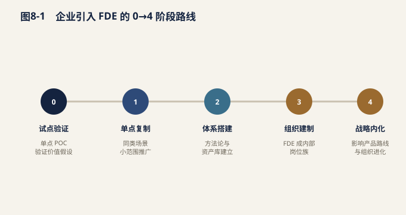
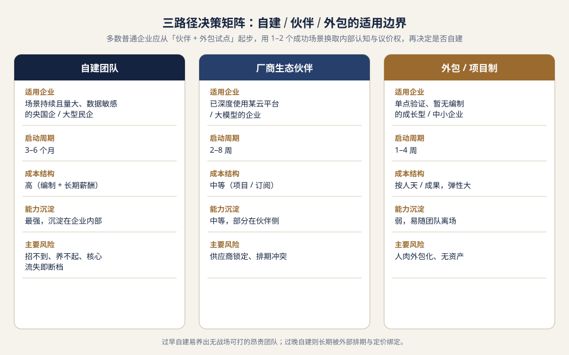

# 第八章 企业如何构建 FDE 能力

当 AI 从"能力展示"进入"生产交付"阶段，企业面对的不再是要不要做的问题，而是谁来做、怎么做的问题。FDE 作为连接通用 AI 能力与具体业务现场的复合角色，其价值的释放高度依赖组织机制的支撑。本章面向希望建立 FDE 体系的企业管理者，从团队定位、人才获取、培养、考核、协作边界与资产沉淀六个维度，给出可操作的建议。

## 8.1 团队定位：FDE 是"价值交付中枢"，而非廉价外包

许多企业在初次组建 FDE 团队时，容易将其理解为"派到客户现场写代码的人"，进而用外包或实施岗的逻辑去管理——按人天计价、按工时考核、按指令执行。这种定位会迅速消解 FDE 的价值。FDE 的稀缺性，恰恰在于它处在技术、业务与组织的"三界交汇点"：既要听得懂客户的业务语言，也要把需求翻译成可工程化的方案，还要推动方案在生产环境中真正跑通。

因此，企业应将 FDE 定位为"价值交付中枢"——它不直接生产 AI 模型，却是让模型在客户侧产生业务结果的唯一抓手。这一中枢定位带来两个管理要求：

- **重视资产沉淀。** FDE 在一线积累的行业模板、对接组件、避坑清单，是比单次交付本身更值钱的长期资产。组织必须设计机制，让这些隐性知识显性化、可复用。
- **重视成果度量。** 中枢的价值要用"客户业务结果"衡量，而非"投入了多少人力"。没有度量，中枢会退化成成本中心。

## 8.2 人才画像与招聘：从四类背景中识人

*（组织侧的招聘画像与个人侧的成长路径互为镜像：从业者视角的能力积累顺序见**9.2 个人成长指南**，评价与认证口径见**9.3**。）*

FDE 不是从单一专业通道成长起来的岗位，其人才供给分散在四类背景中，各有长短：

| 来源背景 | 先天优势 | 主要短板 | 适合场景 |
| --- | --- | --- | --- |
| 售前 / 解决方案 | 懂客户语言，沟通推进强 | 工程深度不足 | 快速验证、关系型交付 |
| 管理咨询 / 业务顾问 | 业务建模与组织洞察强 | 技术实现需依赖他人 | 流程再造类、战略级项目 |
| 行业专家（如工艺、金融、医疗） | 领域知识壁垒高 | 数字化工具链不熟 | 强监管、强专业知识行业 |

**招聘时看什么？**简历背景只是入口，真正要在面试中验证三项核心能力：

1.**业务抽象力**：能否把客户"我们要提升效率"这类模糊诉求，拆解为可量化、可验证的具体问题与指标。可让候选人现场对一个真实业务场景做需求拆解。 2.**工程力**：能否在不依赖完整工具链的情况下，用最小成本搭出一个能跑通的验证原型。重点看"动手把事情做出来"的惯性。 3.**组织推动力**：能否识别客户内部的决策链与阻力点，并设计推进节奏。可考察其过往"在资源不充分时如何推动落地"的经历。

这三项能力往往无法在同一人身上满分具备，企业应采用"互补组队"思路，而非苛求单兵全能。

## 8.3 培训体系：项目即教材，交付一线即考场

*（本节从企业培养视角展开；对应的个人自学路径与阶段目标见**9.2**，能力阶梯定义见**9.1**。）*

FDE 的能力高度依赖真实场景的淬炼，课堂培训收效有限。更有效的路径是"项目即教材、一线即考场"：

- **真实交付是最好的训练场。** 让新人从加入第一天起就进入真实项目的边缘角色（如文档、对接、测试），在实战中建立对业务与技术接口的直觉。
- **双轨轮岗。** 设计"客户侧—产品侧"双轨轮岗：驻场积累业务与交付经验，回流产品侧沉淀方法论与组件。轮岗能避免 FDE 长期陷于单一客户而被"锁死"，也利于把一线洞察反哺产品。
- **案例复盘制度化。** 每个项目设置强制复盘节点，沉淀"做对了什么、踩了哪些坑、下次如何标准化"，形成内部可检索的经验库。

## 8.4 考核与激励：与业务成果绑定，拒绝纯人天计价

如果用"人天"或"工时"作为 FDE 的核心考核口径，组织会不自觉地鼓励"把简单事情复杂化、把交付周期拉长"。FDE 的考核应转向业务成果：

| 考核维度 | 推荐指标 | 说明 |
| --- | --- | --- |
| 客户健康 | 留存率、复购率、增购率 | 衡量长期价值而非一次性 |
| 资产贡献 | 沉淀组件 / 方法论 / 行业模板数量与复用次数 | 衡量对组织的复利贡献 |
| 客户满意 | NPS、续约意愿 | qualitative 补充 |

在激励上，可引入**成果分成**机制：FDE 团队按其为客户创造的可量化价值（如降本、增收、人效提升）分享收益，而非仅拿固定服务费。用友等企业的实践已显示，成果分成能把供应商与客户利益对齐，从"卖人头"转向"共担风险、共享收益"。但需注意，成果分成要求清晰的归因口径与双方认可基线，否则易引发争议。

## 8.5 与产品 / 售前 / 交付的协同边界

FDE 不是万能岗，清晰界定与相邻团队的边界，才能避免职责重叠与推诿：

- **售前** ：负责机会识别与初步方案，签单前的"能不能做"。FDE 在售前后期介入做可行性评估，但不主导商务。
- **FDE** ：负责签单后的"怎么做成"。它是客户现场的价值交付主体，对生产落地结果负责。
- **产品研发** ：负责把 FDE 沉淀的通用需求转化为平台能力。FDE 是需求的"上游来源"，产品是能力的"供给侧"。
- **交付 / 实施** ：在 FDE 完成定制化与生产验证后，承接标准化、规模化的复制部署。

衔接要点在于：**FDE 是需求与能力的双向翻译器**——向下游产品输出可产品化的需求，向上游售前反馈真实可交付边界，向外对交付输出已验证的模板。

## 8.6 资产沉淀机制：让每个项目产生复利

FDE 体系能否越做越轻、越做越值钱，取决于资产沉淀机制是否扎实。建议建立三层资产：

1.**组件层**：可复用的对接适配器、权限桥接、数据管道片段，避免每个项目从零造轮子。 2.**方法论层**：行业交付 SOP、风险评估清单、推进节奏模板，让新项目少走弯路。 3.**行业模板层**：面向特定行业（如制造、金融、政务）的开箱即用场景包，缩短从 POC 到生产的周期。

关键是"项目结束即固化"的强制动作：每个项目收尾必须输出至少一项可入库资产，并进入组织级检索与复用考核。唯有如此，FDE 团队才能从"每次重新发明轮子"走向"站在资产上交付"，形成真正的复利效应。

---

## 8.7 五类组织形态：FDE 应该"挂"在哪里

企业决定投入 FDE 之前，第一个要回答的不是"招几个人"，而是"这支力量以什么形态存在"。当前市场上已经跑出五种较为清晰的组织形态，各自的能力边界与失效模式都不相同。

| 组织形态 | 典型主体 | 结构性优势 | 高发失效模式 |
| --- | --- | --- | --- |
| ② 产品公司 + 伙伴网络 | 平台方 + 区域 / 行业集成伙伴 | 快速放大交付容量，覆盖长尾行业与区域市场，边际成本低 | 伙伴能力参差，交付质量方差大；平台对现场发生了什么缺乏可见度 |
| ③ 咨询 / 集成商 FDE | 传统 IT 咨询、系统集成公司 | 熟悉大型组织的推进节奏，擅长跨部门协调、流程梳理与项目治理 | 惯性回落到传统外包路径——按人天计价、按工时结算，AI 只是新包装 |
| ④ 精品 AI 应用工作室 | 小规模全栈团队 | 端到端灵活，产品感强，从场景定义到上线可由同一批人贯通，试错速度快 | 强依赖少数核心成员，规模天花板明显，客户承担"关键人风险" |
| ⑤ 企业内部 FDE | 甲方数字化 / IT 部门内设 | 天然熟悉自家系统、数据口径、审批链与政治地形，长期责任可追溯 | 被日常运维与临时需求淹没，AI 项目排在工单之后，难以形成持续推进 |

**关于汇报线的一个判断**：FDE 不应只向销售单线汇报，也不宜完全塞进研发体系。前者会把 FDE 变成"高级售前 + 免费定制资源"，交付动作服务于签单节奏；后者会让团队远离业务语言，产出技术上正确、业务上无人使用的系统。较稳妥的做法，是把 FDE 放在**产品、交付、客户成功与业务结果四者的交界处**——考核由业务结果牵引，资源由产品与交付共同供给，日常协同由客户成功侧提供组织入口。

**关于内外部分工的一条经验法则**：越靠近核心系统（ERP、核心账务、生产控制、主数据），越需要有内部责任人长期在场，因为权限、变更窗口与事故责任无法外包；越靠近探索性试点（新场景验证、可行性摸底、工具型效率提升），越适合借助外部力量快速跑一轮，用较低成本换取判断依据。

不同企业条件下的组织方式选择，可参考下表：

| 企业条件 | 更适合的组织方式 | 理由 |
| --- | --- | --- |
| 数据敏感、权限结构复杂（金融、医疗、政务） | 内部团队 + 外部专家共建 | 权限与合规责任必须留在内部，外部提供方法与工程加速 |
| 多系统、多部门、跨流程改造 | 咨询 / 集成商牵头 + 内部 FDE 协同 | 需要跨部门推进能力，同时保留内部知识沉淀的接口人 |
| AI 产品公司，战略客户多 | 自建 FDE 团队 | 把现场约束沉淀为产品能力，是自建团队不可替代的价值 |

---

## 8.8 责任归属：项目启动前必须签字的四件事

FDE 项目失败的原因，往往不在技术，而在"没人明确对某件事负责"。指标没人认账、权限没人批、上线后没人推动使用，最终结果是项目挂在 FDE 身上，而 FDE 恰恰是权限最小的一方。建议在项目启动会上就把下表确认清楚，并落到书面纪要。

| 责任项 | 责任持有方 | 具体含义 | 未明确时的典型后果 |
| --- | --- | --- | --- |
| 系统安全 | IT / 数据团队 | 数据出域规则、账号权限、接口开放范围、审计要求 | 试点阶段一路绿灯，生产上线时被安全评审卡死 |
| 交付推进 | FDE / 项目负责人 | 排期、里程碑、跨方协调、问题升级 | 进度依赖各方自觉，任何一个环节延误都无人兜底 |
| 组织采用 | 管理层 + 一线负责人共同持有 | 谁来要求员工使用、如何调整考核与流程 | 系统建成但无人使用，沦为"验收即闲置" |

需要强调的是最后一项：**组织采用必须由管理层与一线负责人共同持有，不能单独交给任何一方**。只有管理层推动，一线会阳奉阴违；只有一线负责人推动，缺乏调整考核与流程的权力。这一项的缺失，是"技术全部完成、项目仍然失败"最常见的单一原因。

---

## 8.9 从 0 到 4：企业引入 FDE 的阶段路线

企业不必一上来就成立完整的 FDE 部门。更务实的路径是：由外部 FDE 带着内部团队跑通首批场景，在过程中把方法、资产与判断力留在企业内部，再决定是否扩编。整体节奏可分为五个阶段。

| 阶段 | 参考周期 | 核心动作 | 关键产出 |
| --- | --- | --- | --- |
| 1 诊断期 | 2–4 周 | 梳理现有流程、数据源、权限结构、合规风险，粗算 ROI 并排定优先级 | 诊断报告、场景优先级图、风险清单 |
| 2 试点期 | 1–2 个月 | 搭建可运行系统，保留人工审核环节，小范围真实用户试用 | MVP 系统、评估集、运行日志、人工审核规则 |
| 3 生产期 | 2–4 个月 | 接入真实业务流程，设计监控与运维机制，完成用户培训 | 生产系统、SLA、监控看板、培训材料 |
| 4 扩展期 | 4–12 个月 | 向相邻场景复制，抽取共性能力沉淀为平台组件 | 场景模板、组件库、复盘文档 |

阶段划分的意义不在于严格照搬周期，而在于**每个阶段都有明确的退出条件**：诊断期结束若发现数据基础不支撑，应当果断终止而非硬推到试点；试点期结束若人工修改率居高不下，说明场景边界没找准，应回到诊断而不是强行上生产。允许在早期阶段止损，是 FDE 体系成熟度的标志之一。

在这条路线中，外部与内部的关系不是"承包"而是"共建"。共建不是口号，它对应四类具体动作，每一类都有明确的交付意义：

| 共建动作 | 交付意义 |
| --- | --- |
| 共同构建评估集 | 把"好不好用"从主观感受转为可回归测试的样本，成为长期质量基线 |
| 共同培训关键用户 | 内部人成为场景的第一解释者，外部撤出后使用不断档 |
| 共同复盘与归档资产 | 方法与组件留在企业内部，而非随外部团队一起离场 |

---

绝大多数企业在接触 FDE 时，第一反应是"招一个这样的人"。但真正的第一道选择题不是"招谁"，而是"用哪种方式获得 FDE 能力"。对普通企业而言，直接组建一支 FDE 团队往往是成本最高、风险最大、也最不必要的起点。本章 8.9 给出的阶段路线，本质也是建议从外部带着内部跑通，再决定是否自建。本节把"选团队 / 选服务"这件事拆成可操作的框架。

### 8.10.1 三条路径的适用边界

获得 FDE 能力主要有三条路径，它们的成本结构、能力沉淀方式与主要风险截然不同，没有哪一条天然最优。

| 路径 | 适用企业 | 启动周期 | 典型成本结构 | 能力沉淀 | 主要风险 |
| --- | --- | --- | --- | --- | --- |
| 自建团队 | 场景持续且量大、数据高度敏感、需长期组织能力的央国企 / 大型民企 | 3–6 个月 | 高（编制 + 长期薪酬） | 最强，沉淀在企业内部 | 招不到、养不起、核心人员流失即断档 |
| 厂商生态伙伴 | 已深度使用某云平台 / 大模型、希望借厂商资产加速落地的企业 | 2–8 周 | 中等，常按项目或订阅计费 | 中等，部分沉淀在伙伴侧 | 供应商锁定、伙伴排期冲突、接口不透明 |
| 外包 / 项目制服务 | 单点场景验证、内部暂无编制、希望快速看到结果的成长型与中小企业 | 1–4 周 | 按人天或按成果，弹性较大 | 弱，易随团队离场 | 人肉外包化、无资产沉淀、质量依赖个别人员 |

一个被反复验证的判断是：**多数普通企业应从"伙伴 + 外包试点"起步，用 1–2 个成功场景换取内部认知与对外的议价权，再决定是否自建**。过早自建，容易在缺乏场景积累时养出一支"没有战场可打"的昂贵团队；过晚自建，则会长期被外部伙伴的排期与定价绑定。

### 8.10.2 评估外部 FDE 服务商的六个维度

无论走伙伴还是外包路径，对服务商的评估都应落到六个可比较的维度，而不是停留在"案例看起来很牛"。

1. **落地真实性** ：有无同行业、已上生产的真实案例；能否清楚讲出过程中的失败与踩坑（只讲成功、回避失败的服务商，风险更高）。
2. **行业 know-how** ：是否真正理解你的业务流程、组织关系与合规边界，而不只是"通用 AI 能力"。
3. **安全合规能力** ：能否对接你企业已有的五道防线（2.9、7.2），是否接受你的审计与权限约束。
4. **资产沉淀机制** ：是否承诺交付可复用组件、评估集与模板，而不是每次从空白开始。
5. **现场兜底承诺** ：上线后出现问题由谁负责、响应时效与责任边界是否写进合同。
6. **商业可持续性** ：其收入是否依赖"堆人天"——若项目越多毛利率越低，说明它做的是人力外包而非能力交付。

### 8.10.3 RFP / 招标提问清单

把上述维度转成可在招标或比选阶段直接发出的问题，能快速筛掉"只会讲 Demo"的供应商。核心问题可分六组：

- **场景理解** ：你对我们这个场景的生产环境约束了解多少？请列出三个你认为最可能失败的点。
- **方法论** ：你的标准交付流程是什么？诊断、试点、生产各阶段的退出条件如何定义？
- **安全合规** ：你如何保证数据不出域 / 权限不越界？出现越界事件的责任与赔付如何约定？
- **交付物** ：合同验收时你会交付哪些可复用资产？组件复用率是否有量化承诺？
- **团队** ：实际交付人员是谁？是否允许指定核心成员、约定最低驻场时长与更换条件？
- **商业** ：计费方式是人天、成果还是订阅？哪些指标与尾款挂钩？

### 8.10.4 试点验证：先给 6–8 周 POC，再谈规模化

规模化采购 FDE 服务前，应先以单一场景做一轮受控试点。试点的验收条件建议明确为四条：

- 在 **真实业务数据** 上跑通，而非脱敏样例；
- **人工修改率** 下降到约定阈值（如 ≤20%）以下；
- 与客户共同构建出 **评估集** ，成为后续质量基线；
- 交付首批 **可复用资产** （脚本、组件、模板）。

任一条件未达成，都不应直接进入规模化，而应回到诊断或换供应商——试点本就是"用最小代价验证对方真实能力"的机制。

### 8.10.5 五个常见陷阱

- **把 FDE 当廉价外包** ：按人天计价、不考核资产与结果，最终买到的是更贵的"高级外包"。
- **只看 Demo 不看生产证据** ：演示效果与上线表现可能天差地别，必须索要生产环境参考。
- **案例不可验证 / 张冠李戴** ：要求提供可联系的业务方或脱敏运行日志，而非宣传稿截图。
- **无资产沉淀条款** ：不把"交付物齐备率、组件复用率"写进合同，经验随团队离场。
- **过度依赖个别"大神"** ：核心能力锁在单个人身上，其离职即项目断档；应按 8.6 要求能力组件化。

*图 8-2　三路径决策矩阵：自建 / 伙伴 / 外包的适用边界*

---

## 8.11 FDE 服务标准与量化考核体系：标准能否量化？

可以量化，但前提是**先分层**。很多企业的困惑来自把"服务标准"当成一句笼统的"服务要好"，结果验收时只能凭感觉。FDE 服务的标准应当拆成四层：SLA 管"稳不稳"、交付物管"留不留"、价值指标管"值不值"、合规管"红线碰没碰"。没有分层的量化，标准就会退化为关系型采购。

### 8.11.1 为什么必须量化

不量化的直接后果是：无法客观验收、无法做续约 / 扩围决策、无法在不同供应商之间比较，最终退化为"谁关系好用谁"。量化让"好 FDE"变成可定义、可比较、可复制、可追责的对象，也让内部 FDE 团队有了清晰的成长坐标。

### 8.11.2 四层量化框架

| 层 | 管什么 | 代表指标 |
| --- | --- | --- |
| SLA 层 | 系统稳定性与响应 | 可用率、故障恢复时长、响应时延、工单闭环率 |
| 交付层 | 资产沉淀与规范 | 交付物齐备率、组件复用率、评估集覆盖、文档完整率 |
| 价值层 | 业务结果 | 增收 / 降本金额、ROI 转正周期、人工修改率下降、返工减少 |
| 合规层 | 红线 | 数据出域次数、权限越界次数、审计日志完整率、事故数 |

### 8.11.3 FDE 服务量化评分卡（可直接写进合同）

下表是一张可直接作为合同附件的量化评分卡。指标分四层，权重合计 100；合规层两项为**一票否决**项，任一发生即整体不合格。

| 指标 | 定义 / 取数方式 | 目标值 | 数据来源 | 权重 |
| --- | --- | --- | --- | --- |
| 系统可用率 | 生产环境月度可用时间占比 | ≥ 99.5% | 监控平台 | 10 |
| P1 故障恢复时长 | 严重故障从发生到恢复的时间 | ≤ 30 分钟 | 工单系统 | 8 |
| 交付物齐备率 | 合同清单中实际交付占比 | 100% | 验收记录 | 12 |
| 组件复用率（第 3 个项目起） | 新项目复用既有组件的比例 | ≥ 30% | 组件库 / 代码库 | 12 |
| 人工修改率（试点末） | 模型 / 系统输出需人工修正的比例 | ≤ 20% | 评估集回归 | 12 |
| 评估集覆盖业务场景 | 评估集覆盖核心业务场景的比例 | ≥ 80% | 评估集清单 | 8 |
| ROI 转正周期 | 项目累计收益覆盖累计成本的月数 | ≤ 6 个月 | 测算模板（8.13） | 12 |
| 审计日志完整率 | 操作与决策留痕的完整比例 | 100% | 审计系统 | 10 |
| 数据出域事件 | 敏感数据违规离开企业边界的次数 | = 0（一票否决） | 数据防泄漏系统 | — |
| 权限越界事件 | 超授权访问 / 操作的发生次数 | = 0（一票否决） | 权限审计 | — |

注：各指标的目标值与权重应根据企业规模、行业与场景调整；合规两项之所以设为"一票否决"，是因为它们直接对应第七章的五道安全防线，触及即可能造成不可逆损失。

### 8.11.4 服务商成熟度分级（L1–L4）

| 级别 | 名称 | 核心特征 | 可约定的量化证据 |
| --- | --- | --- | --- |
| L1 | 人天外包 | 按人天计费，无资产沉淀，质量依赖个人 | 仅交付工时记录 |
| L2 | 项目管理型 | 有交付物清单，部分复用，过程较规范 | 交付物齐备率、文档完整率 |
| L3 | 资产驱动型 | 组件库 + 评估集，复用率可量化，能跨项目复利 | 组件复用率、评估集覆盖 |
| L4 | 平台生态型 | 沉淀转化为产品或平台能力，跨客户共享，边际成本递减 | 复用率 + 客户数 + 毛利率随规模上升 |

### 8.11.5 验收阈值与"一票否决"红线

- **一票否决（任一发生即不合格）** ：数据出域、权限越界、伪造 / 篡改评估集、发生重大合规事故。
- **综合阈值** ：量化评分卡月度得分 **≥ 80 分** 且红线全过，方可续约或扩围；连续两月低于 70 分触发整改；低于 60 分或触碰任一红线，启动退出机制。

### 8.11.6 把评分卡嵌入合同与月度复盘

量化标准的价值在于被执行，而非被收藏。两条落地建议：

1. **合同附件化** ：将评分卡、各指标的数据取数口径、业务负责人签字一并写入合同，避免上线后由 FDE 自行定义"好不好"。
2. **月度复盘会** ：评分卡逐月公示，由业务方、IT 与 FDE 三方共同打分；连续两月低于阈值即触发整改或退出。这与 8.13 的 ROI 测算、8.14 的风险治理清单构成完整的"选—管—验"闭环。

---

## 8.12 交付物清单：判断 FDE 好不好的硬标准

如何判断一个 FDE 项目做得好不好？最可操作的标准不是客户口头评价，而是**项目结束后留下了什么可复用的东西**。下表按阶段列出应当强制要求的交付物。

| 阶段 | 必备交付物 |
| --- | --- |
| 试点 | MVP 系统、评估集与评测结果、日志采集方案、人工审核规则 |
| 上线 | SLA 约定、监控指标定义、回滚机制、用户培训材料 |
| 复盘 | 问题清单、改进建议、可复用模板、给产品侧的需求反馈 |
| 扩展 | 场景复用包、通用组件库、岗位操作培训手册 |

这份清单的价值在于它可以被写进合同附件或内部验收标准。一旦交付物成为验收条件，双方在项目早期就必须认真对待流程梳理与评估集建设，而不是把精力都投在演示效果上。

反过来看，**没有资产沉淀的 FDE，本质上是价格更高的人力外包**。它的典型特征是：每个新项目都从空白开始，前一个项目的经验只存在于个别工程师的记忆里，团队规模与交付量呈线性关系，成本永远压不下来。企业若在两三个项目之后仍看不到组件复用率的提升，就应当重新审视这支团队的运作方式。

---

## 8.13 ROI 测算模板：把"感觉有效"变成可复盘的经营指标

AI 项目最容易失守的环节，是价值论证停留在"大家都觉得挺好用"。FDE 体系要建立可持续的预算合法性，必须提供一套能被财务与业务共同接受的测算口径。

**月度收益 = 增收收益 + 人力节省 + 返工减少 + 风险损失降低 + 资产复用收益**

| 收益项 | 说明 | 常见取数方式 |
| --- | --- | --- |
| 人力节省 | 释放的工时 × 综合人力单价 | 抽样计时或系统操作日志 |
| 返工减少 | 减少的错误处理、二次沟通、重复录入成本 | 工单系统中的返工工单量变化 |
| 风险损失降低 | 漏判、超期、违规导致的预期损失下降 | 历史事故频次 × 单次损失金额 |
| 资产复用收益 | 本项目沉淀的组件在后续场景中节省的开发投入 | 复用次数 × 单次自研估算工作量 |

**月度成本 = 模型 / API 成本 + 工程人力 + 培训成本 + 运维成本 + 合规成本**

**ROI =（月度收益 − 月度成本）/ 月度成本**

公式本身并不复杂，真正的难点在两处。

第一，**每一个参数都要有业务负责人认账**。人力单价按哪个口径、基线取哪三个月、对照组怎么选，这些都应在项目启动时由业务方书面确认，而不是上线后由 FDE 自行估算——后者无论算出什么数字，都难以在管理层会议上站住脚。

第二，**不同业务线的指标语言不同，测算口径必须本地化**：

- 销售场景关注线索转化率、跟进周期、商机推进速度；
- 客服场景关注平均处理时长、一次解决率、投诉率；
- 合规与风控场景关注漏判率、返工工单量、事故风险敞口；
- 生产与供应链场景关注异常发现提前量、单位成本、计划达成率。

把这些指标嵌入测算模板，ROI 才能从一份技术团队自说自话的材料，变成业务负责人愿意在经营分析会上引用的数据。这也是 FDE 区别于纯工程角色的关键能力：**不只是把系统做出来，还要把价值说清楚、算明白、可复盘**。

---

## 8.14 风险治理清单与绩效验收指标

### 8.14.1 七类高发风险与治理动作

FDE 体系的风险大多不是技术风险，而是组织与治理层面的结构性风险。下表列出七类高发问题及其应对建议，可直接作为项目治理检查表使用。

| 风险 | 典型表现 | 治理建议 |
| --- | --- | --- |
| 角色边界不清 | 销售、顾问、研发都把难题丢给 FDE | 用 7.8 的责任归属表明确权责，验收时逐项对照 |
| 只会演示 | Demo 效果惊艳，生产环境频繁出错 | 强制要求日志、监控、评估集、回滚路径四件套 |
| ROI 不清 | 汇报只说"节省了时间" | 指标必须覆盖增收、降本、提质、降风险四个维度 |
| 组织不采用 | 系统上线后无人使用 | 培训 + 使用反馈机制 + 管理层跟踪三者并行 |
| 权限治理缺失 | AI 越权读取或写入业务数据 | 权限分层、操作审计、关键动作审批、最小权限原则 |
| 自动化过度 | 高风险动作过早交由系统自动执行 | 按"先建议 → 再人工审核 → 后有限自动执行"三段推进 |

其中最容易被低估的是权限治理与自动化节奏。建议无论项目大小，**至少留下四份基础文档：权限对照表、操作日志表、审批规则说明、回滚路径预案**。这四份文档在项目顺利时看似冗余，一旦发生数据异常或误操作，它们决定了事故是"半小时恢复"还是"三天定责"。

### 8.14.2 绩效与验收指标体系

验收不能只看满意度打分。建议从八个维度构建指标集：上线成功率、系统可用性、错误率与回滚次数、使用频次与活跃用户数、人工修改率、平均处理时长、可验证 ROI、可复用资产的数量与质量。

指标必须有可核验的证据来源，否则容易退化为自我评估：

| 指标类别 | 代表指标 | 证据来源 |
| --- | --- | --- |
| 质量类 | 错误率、人工修改率、回滚次数 | 评估集回归结果、审核记录、变更工单 |
| 业务类 | 处理时长、转化率、返工量 | 业务系统报表、与基线的对照分析 |
| 资产类 | 沉淀组件数、模板复用次数 | 资产库登记与调用记录 |
| 风险类 | 越权事件数、事故响应时长 | 审计日志、安全事件记录 |

在激励设计上，建议按下列权重结构分配，并根据企业所处阶段微调——早期试点可适当上调"组织采用"权重，规模化阶段应上调"资产沉淀"权重：

| 激励对象 | 建议权重 | 说明 |
| --- | --- | --- |
| 生产质量 | 20%–25% | 可用性、错误率、回滚频次等运行表现 |
| 组织采用 | 15%–20% | 真实使用率与用户留存，而非培训场次 |
| 资产沉淀 | 15%–20% | 入库资产的数量、质量与被复用次数 |
| 风险治理 | 10% | 权限、审计、合规执行到位程度 |

最后需要提醒两个极端做法。**其一是只按主观满意度发奖**：满意度受关系亲疏、汇报技巧、期望管理影响极大，容易奖励善于沟通者而非真正创造价值者。**其二是只按上线数量发奖**：这会直接鼓励团队堆叠短平快的浅层场景，追求"本季度上线八个 AI 应用"的数字，而回避那些周期长、协调难、但真正影响经营指标的核心场景。健康的考核结构，应当让"做成一个难项目"的回报，不低于"做完五个易项目"。
