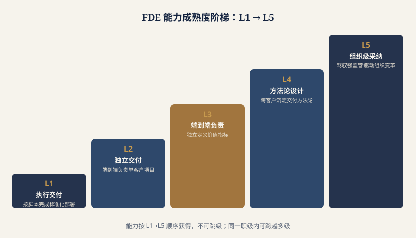

# 第九章 FDE 人才发展与职业路径

**核心观点**：FDE 是一个"交付即成长"的复合岗位，其能力无法靠书本习得，只能在生产一线、在与客户组织反复碰撞中沉淀。本章认为，人才供给是当前 FDE 生态的最大瓶颈——行业缺的不是会写代码或会讲方案的人，而是既懂 AI 工程又懂客户业务、还能在复杂组织里推动落地的"垂直行业资深 FDE"。本章将系统梳理 FDE 的职业进阶通道、个人成长路径、评价与认证体系、产学研衔接、全球版图对比、企业人才战略与职业风险应对，为 CIO、数字化负责人、AI 厂商管理者与人才研究者提供可操作的参考框架。

> 数据来源说明：本章综合使用四类数据来源——招聘平台公开岗位数据（美国 Indeed、国内 BOSS 直聘/猎聘）、行业媒体报道、政策文件（上海、北京、武汉等地专项政策）、厂商实践案例（用友等），文中均以"（来源类型：xxx）"标注。

---

## 9.1 职业发展通道：四级进阶阶梯

*（本节为个人视角的能力阶梯；企业侧对应的岗位定位见**8.1**，考核与激励设计见**8.4**。）*

*图 9-1　FDE 能力成熟度阶梯：L1 → L5*

FDE 的能力成长并非线性，而是一个"工程深度 × 业务广度 × 组织推动 × 资产沉淀"四维同时放大的过程。基于对一线岗位的观察，可将 FDE 划分为四个典型阶段。每一级都对应清晰的能力要求、可衡量的产出、可识别的晋升信号与大致所需时间。

> 数据来源类型：厂商实践 + 行业媒体访谈综合归纳

**表 8-1 FDE 四级职业进阶通道**

| 层级 | 角色定位 | 核心能力要求 | 典型产出 | 晋升信号 | 大致周期 |
| --- | --- | --- | --- | --- | --- |
| L2 中级项目 FDE | 项目负责人 | 独立负责一个客户项目的端到端交付；能做需求拆解与方案选型；理解客户权限/流程痛点 | 主导完整生产交付项目；沉淀 2–3 个行业模板；建立客户侧信任关系 | 同时带 1–2 个并行项目且零重大回滚；能预判并规避交付风险 | 1.5–3 年 |
| L3 高级行业 FDE | 行业专家 | 深耕 1–2 个垂直行业（如金融、制造、医疗）；懂行业监管与业务逻辑；能设计行业级交付方法论 | 打造行业级解决方案与资产库；定义交付标准 SOP；影响厂商产品路线图 | 成为厂商在该行业的"招牌人物"；客户点名要求参与；带教 L1/L2 | 3–6 年 |
| L4 FDE 专家/管理者 | 体系构建者 | 搭建 FDE 团队与培养体系；制定定价与交付治理机制；连接战略、产品与人才 | 建立组织级 FDE 能力中台；输出方法论与认证体系；推动业务成果分成模式 | 所带团队规模化交付且健康运转；能力资产被多行业复用 | 6 年以上 |

需要强调的是，时间只是参考维度，**真正的晋升信号是"独立承担复杂度的提升"**——从被指派任务，到主动定义问题，再到定义行业范式。许多一线 FDE 卡在 L2，正是因为缺乏从"执行项目"到"定义方法"的跃迁机会。

---

## 9.2 个人成长指南：如何成为 FDE

FDE 的复合性决定了它几乎没有"科班出身"的纯正来源，绝大多数从业者都是从相邻角色转轨而来。针对四类典型来源背景，其能力短板与补齐路线各不相同，但共同原则是：**交付一线是最好的考场**——任何理论学习都必须以真实客户场景为检验。

**表 8-2 四类背景转轨 FDE 的补齐路线**

| 来源背景 | 原有优势 | 关键短板 | 补齐路线 | 优先历练项目 |
| --- | --- | --- | --- | --- |
| 售前 / 解决方案 | 客户沟通强、懂商业与方案 | 工程深度不足、无法亲手验证可行性 | 补代码与工程实践（至少能写可运行脚本、读懂模型 API）；做 2–3 个端到端交付以建立工程直觉 | 从"讲方案"转"做方案"，亲手交付小场景 |
| 管理咨询 | 框架思维、组织诊断、问题结构化 | 不写代码、对 AI 技术边界感知弱 | 学基础 Python 与 AI 平台操作；理解模型能力与成本；与工程搭档完成交付 | 主导一个流程重塑类 AI 项目，工程部分外包协作 |
| 行业专家（业务侧） | 行业 Know-how 深厚、客户信任 | 缺 AI 与工程常识、表达难被技术侧承接 | 补 AI 通识与基础工程概念；学会把业务问题转述为技术可解问题；掌握数据权限边界 | 作为"业务接口人"参与交付，逐步接管方案定义 |

**学习路径建议（通用）**：

1.**打地基（1–3 个月）**：掌握一门语言（Python 优先）、主流大模型 API 与 RAG/Agent 基础、企业权限与数据安全常识。 2.**进现场（3–12 个月）**：以辅助角色进入真实客户项目，重点训练"需求翻译"与"风险识别"两项能力。 3.**独立交付（1–2 年）**：独立负责小场景，建立自己的模板与检查清单。 4.**沉淀方法论（2 年以上）**：把项目经验抽象为可复用资产，开始带教他人。

**项目历练建议**：选择"难但可控"的首批场景——既有足够复杂度锻炼能力，又在可回滚范围内控制风险。避免一上来就挑战核心交易系统。建议在第一个项目中刻意记录"客户为什么拒绝/接受了某方案"，这比任何教材都更能塑造 FDE 的直觉。

> 数据来源类型：行业媒体薪酬与转轨案例 + 厂商实践

需要正视一个行业现实：行业媒体已有"第一批做 FDE 的人，离高薪差远了"的报道（来源类型：行业媒体）。这说明早期 FDE 多停留在 L1–L2 的执行层，未形成稀缺性。真正的溢价出现在 L3 以上——那时人才从"人力成本"变为"业务增长的杠杆"。

---

## 9.3 人才评价与认证体系

**为何需要评价体系？**FDE 岗位标准缺失，是当前招聘与定价混乱的根源。同一头衔在不同厂商可能意味着"现场写代码的"或"行业方案架构师"，导致：企业难以招聘到匹配人才、厂商难以合理定价、个人难以判断职业坐标。建立评价体系，是 FDE 从"野生岗位"走向"职业化"的必经之路。

**可设计的评价维度**：

**表 8-3 FDE 能力评价三维模型**

| 维度 | 评价内容 | 评价方式 | 权重建议 |
| --- | --- | --- | --- |
| 交付实绩 | 已上线项目数、客户续约率、生产稳定性、业务指标提升 | 项目档案 + 客户反馈 | 40% |
| 资产贡献 | 沉淀模板/方法论、被复用次数、带教人数 | 知识库统计 + 内部评审 | 20% |

**行业认证的可能性与趋势**：随着政策层面开始"点名"FDE——上海等地将 FDE 纳入新型技术人才培育（来源类型：政策文件），北京、武汉智能体专项政策明确 FDE 为创新模式（来源类型：政策文件）——岗位的标准化与认证体系有了政策推力。可以预见，未来 2–3 年可能出现：厂商主导的"交付能力认证"、行业协会牵头的"FDE 职业资格"、以及院校与厂商共建的"微证书"。但需注意，FDE 高度依赖实战经验，纯纸面考试认证的含金量有限，更可能走向"实操 + 实绩 + 同行评审"的混合认证。

**企业内如何做 FDE 能力认证**：建议厂商建立内部"FDE 职级地图"，将表 8-1 的四级与表 8-3 的三维结合，每半年基于交付实绩复盘定级；同时设置"影子评审"机制——由资深 FDE 跟随现场评估，避免自评失真。认证结果直接挂钩定价权与项目分配，使能力可视化、可交易。

> 数据来源类型：政策文件 + 厂商实践

---

## 9.4 高校与职业教育衔接

FDE 的"工程 + 行业双语"属性，决定了它很难由单一学科培养。院校课程改革应围绕三个方向展开：

1.**课程设计**：打破计算机与商学院的壁垒，开设"AI 交付工程""行业数字化""客户场景设计"等交叉课程，强调真实项目导向（Project-based Learning）。 2.**实训基地**：与 AI 厂商共建"AI 交付"方向实训基地，让学生在大三/研一即进入厂商真实交付项目轮岗，弥合校园与现场的鸿沟。 3.**共建方向**：参照上海等地将 FDE 纳入新型技术人才培育的政策导向（来源类型：政策文件 + 高校合作），由厂商提供工程资产与场景，院校提供行业理论与生源，联合打造"AI 交付"专业方向或微专业。

**现实约束必须清醒**：院校主要解决**初级供给**（L1 规模的批量输出），但几乎无法产出**资深 FDE（L3 以上）**。原因很简单——资深 FDE 的能力来自成百上千次客户组织内的真实碰撞，这种"复杂度"无法在课堂模拟。因此，院校的角色是"合格入口"而非"终点"，真正的炼成仍在产业一线。产教融合的价值，在于缩短 L1 到 L2 的时间，而非替代 L3 的历练。

> 数据来源类型：政策文件 + 高校合作

---

## 9.5 全球人才版图对比

FDE 虽是全球化岗位，但中美欧三地因产业阶段、监管环境与厂商成熟度的差异，呈现出明显不同的生态形态。

**表 8-4 全球 FDE 人才版图对比**

| 维度 | 美国 | 欧洲 | 中国 |
| --- | --- | --- | --- |
| 代表厂商 | Palantir、OpenAI、Anthropic | 大型咨询与 SaaS 实施商 | 用友等 AI 应用厂商、大模型厂商 |
| 岗位标准化 | 高，职级与定价清晰 | 中，多依附咨询体系 | 低，头衔与职责混乱 |
| 定价水平 | 高（高薪、高溢价） | 中等，受监管与用工成本影响 | 分化，早期执行层薪酬落差明显 |
| 驱动逻辑 | 产品驱动、技术领先 | 监管驱动、合规优先 | 项目驱动、业务落地优先 |
| 人才流动 | 厂商间高流动、创业活跃 | 偏稳态、跨咨询流动 | 快速流动、向头部聚集 |

数据印证：美国 Indeed 平台 FDE 相关岗位从约 643 个增至 5,330 个，两年增长 700%+（来源类型：招聘平台）；国内 BOSS 直聘/猎聘等平台 2024–2025 同样明显放量（来源类型：招聘平台）。但两国在"标准化程度"上的差距，使中国厂商在定价与人才复用上仍处于劣势。

**跨境人才流动与启示**：美国成熟的 FDE 方法论（如 Palantir 的"forward deployed"文化）正通过人才回流与厂商出海向中国传导；欧洲对"监管驱动交付"的经验，对中国金融、医疗等强监管行业的 FDE 培养有借鉴价值。对中国企业的启示是：在标准缺失期，可主动借鉴美国职级体系快速建立内部秩序，同时吸收欧洲合规交付的严谨性。

> 数据来源类型：招聘平台 + 厂商实践 + 行业媒体

---

## 9.6 企业人才战略：自建、外包与混合

*（本节讨论人才来源的战略选择；与之配套的落地路径与三路径决策矩阵见**8.10**，服务标准与量化考核见**8.11**。）*

企业面对 FDE 需求，有三种典型策略：

- **自建** ：掌控核心交付能力与客户关系，适合业务高度差异化、AI 是战略中枢的企业。缺点是周期长、前期成本高。
- **外包** ：快速获得交付能力，适合试点期或长尾场景。缺点是知识留不住、易被供应商绑定。
- **混合（推荐）** ：以"影子团队"模式——引入外部 FDE 跑通首批关键场景的同时，安排内部人员全程参与、同期培养。项目交付完成时，内部已长出一支懂业务的 FDE 梯队。

**影子团队实操要点**：外部 FDE 负责"打样"，内部人员负责"跟学与接管"；每个场景设定明确的"知识移交里程碑"；项目验收时内部人员需能独立复现。这既降低了试错成本，又避免了"请人来交付、人走 capability 归零"。

**留存与激励**：FDE 贴近客户、易被高薪挖角，企业应：

1.**知识绑定**：将交付资产沉淀到企业知识中台，降低单点人员依赖。 2.**成果分成激励**：借鉴用友"按业务成果分成"模式（来源类型：厂商实践），让 FDE 分享其创造的业务价值，而非仅拿固定薪资。 3.**成长通道前置**：明确 L1→L4 路径与对应定价权，使资深 FDE 看到"留下来"的上升空间。

> 数据来源类型：厂商实践

---

## 9.7 职业风险与应对

FDE 并非没有阴影。其职业风险主要来自三方面：

**风险一：AI 自动生成代码压缩执行层价值。**随着 Agent 与低代码平台成熟，L1 级别的"现场写脚本、接接口"工作正被快速自动化。低端实施型 FDE 面临被替代的直接威胁。

**风险二：角色被"去稀缺化"。**当 AI 厂商将交付能力产品化（开箱即用的行业模板），纯执行 FDE 溢价下降——这正是早期 FDE 薪酬落差报道的深层原因（来源类型：行业媒体）。

**风险三：职业天花板与路径模糊。**若长期停留在项目交付，易陷入"高负荷低成长"陷阱，缺乏清晰的转型出口。

**应对策略**：

- **向"判断与编排"升级** ：从"亲手做"转向"定义做什么、如何让 AI/团队做"。资深 FDE 的核心价值应是业务判断、风险编排与组织推动，而非代码行数。
- **主动构建稀缺性** ：深耕垂直行业，成为"既懂行又懂 AI"的少数派。本章反复强调——L3 以上资深行业 FDE 是生态最稀缺资源。
- **预设转型路径** ：FDE 的常见出口包括——走向 **产品** （定义 AI 产品方向）、走向 **管理** （带 FDE 团队/交付体系）、走向 **行业专家** （成为某领域权威）、走向 **创业** （以交付能力切入细分市场）。应尽早规划，而非被动等待天花板到来。

> 数据来源类型：行业媒体 + 厂商实践

---

## 9.8 本章核心判断

1.**人才是 FDE 生态最大瓶颈。**行业不缺 Demo 能力，缺的是能把 AI 接进客户真实组织并稳定产出的 FDE，尤其是垂直行业资深 FDE。招聘平台数据显示岗位两年增长 700%+（美国 Indeed）且国内快速放量（BOSS 直聘/猎聘），但供给质量远未跟上。 2.**胜负手在"垂直行业资深 FDE"（L3 以上）。**政策已点名（上海培育、北京武汉智能体专项），市场已放量，但能定义行业范式、沉淀资产、带教梯队的人才极度稀缺。谁先建立这类人才的供给与留存机制，谁就掌握 FDE 竞争的制高点。 3.**个人应尽早从"执行"转向"判断与编排"。**执行层价值正被 AI 压缩，早期 FDE 的薪酬落差已是预警。成长的关键是借交付一线锤炼业务判断与组织推动，并预设产品/管理/行业/创业四条转型出口。 4.**企业应把人才战略前移。**不要等场景成熟再招人，而应以"影子团队"在首批项目中同时培养内部 FDE；用成果分成（如用友模式）与知识中台绑定人才与能力；以清晰的 L1–L4 职级地图把 FDE 从"野生岗位"变为"可投资、可定价的战略资产"。

> 综合数据来源类型：招聘平台、行业媒体、政策文件、厂商实践、高校合作
